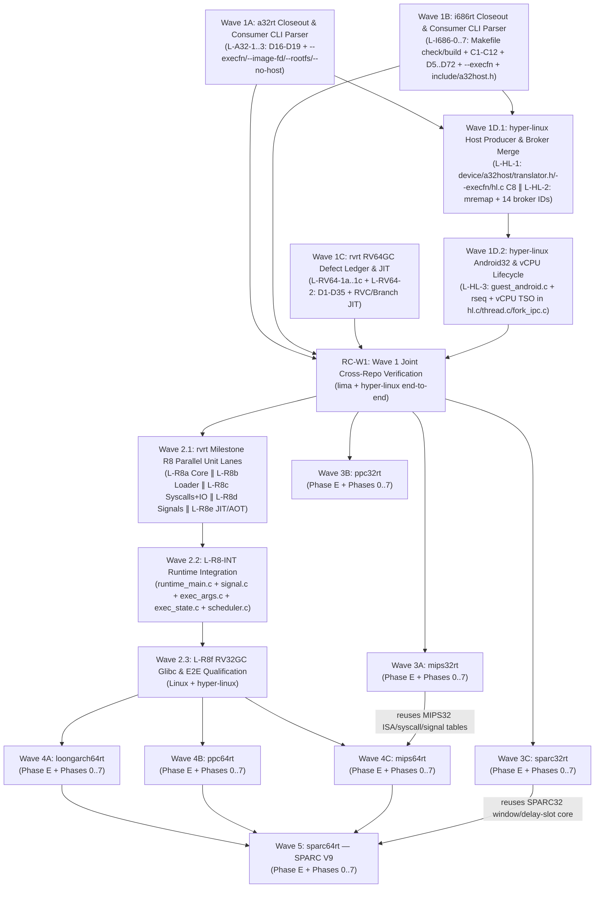

# `rt-series` — Master Muse Spark Implementation Plan

Status: Draft rev 3, 2026-10-23 (incorporates Astra Review #1 and Review #2 fixes)  
Document kind: Binding implementation plan for Muse Spark (`muse`)  
Owner: Moritz Angermann <moritz@zw3rk.com>, zw3rk pte. ltd.  
Specification: [`SPEC.md`](SPEC.md)  
Host Contract: [`docs/HOST-CONTRACT.md`](docs/HOST-CONTRACT.md)  
Executable Goal Prompt: [`GOAL.md`](GOAL.md)  
Detailed Lane Task Cards:
- [`docs/lanes/wave-1-closeout.md`](docs/lanes/wave-1-closeout.md)
- [`docs/lanes/wave-2-rv32gc.md`](docs/lanes/wave-2-rv32gc.md)
- [`docs/lanes/wave-3-rt32-family.md`](docs/lanes/wave-3-rt32-family.md)
- [`docs/lanes/wave-4-rt64-family.md`](docs/lanes/wave-4-rt64-family.md)

---

## 1. Muse Spark Execution Architecture

This implementation plan is engineered specifically for **Muse Spark** (`muse`), combining the proven Coordinator + Worker-Lane DAG from [`../i686rt/GOAL.md`](../i686rt/GOAL.md), [`../i686rt/GOAL-DEFECTS.md`](../i686rt/GOAL-DEFECTS.md), and [`../i686rt/docs/lanes/`](../i686rt/docs/lanes/) with the multi-agent worktree and outside-reviewer gates of [`../hyper-linux/docs/GOAL-bsd-process-model.goal`](../hyper-linux/docs/GOAL-bsd-process-model.goal).

### 1.1 Role Split & Model Routing
1. **Top-Level Coordinator (Main Session, `--reasoning-effort max`)**:
   - Owns the master DAG across `rt-series` and sibling repositories (`../a32rt`, `../i686rt`, `../rvrt`, `../hyper-linux`, `../mips32rt`, `../ppc32rt`, `../sparc32rt`, `../loongarch64rt`, `../ppc64rt`, `../mips64rt`, `../sparc64rt`).
   - **Freezes shared interfaces and build rules before every phase fan-out**: writes and commits ABI-locked context headers (`*_ctx_t` with `_Static_assert`s), decoder structs, interpreter/DBT dispatch signatures, syscall marshaling headers, `Makefile` test target rules, and task cards (`docs/lanes/`).
   - Writes core architectural glue (trampolines, lazy flag / delay-slot / register-window state machines, signal frame delivery/return, `clone`/TLS/futex coordination).
   - **Does zero grunt work**: delegates all instruction decode tables, opcode handlers, DBT emitters, syscall struct translators, sysroot provisioners, and test fixtures to parallel Worker Lanes.
   - Reviews completed worker lanes in batches against [`SPEC.md`](SPEC.md) and the lane card, merges accepted branches locally (`git merge --no-ff`), resolves escalations, and runs each phase's single **Review Checkpoint (`RC`)** acceptance check once.
2. **Parallel Worker Lanes (Explicit Per-Lane Git Worktrees)**:
   - **Worktree Isolation Rule**: Passing `--experimental-worktree-isolation` to `muse` only enables the capability; omitting an explicit worktree request leaves a child in the shared directory! Therefore, every worker lane MUST be created in an explicit isolated git worktree on a pinned base commit:
     ```bash
     git -C ../<repo> worktree add ../<repo>-<lane> -b lane/<phase>-<lane> <base-sha>
     ```
     and the worker's very first command MUST assert `pwd` and `git rev-parse --abbrev-ref HEAD` match `../<repo>-<lane>` and `lane/<phase>-<lane>`.
   - Every worker lane receives **one self-contained Task Card** specifying:
     - **Scope**: exact functions/tables/fixtures to implement.
     - **Exclusive File Ownership**: the exact list of files the lane may create or edit. **No two concurrent lanes in the same sub-wave ever touch the same file**; shared files are either pre-frozen by the Coordinator (`Makefile`, headers) or placed in sequential sub-waves (`Sub-Wave A` -> merge -> `Sub-Wave B`).
     - **Frozen Interface**: the exact header files and function prototypes the lane codes against.
     - **Single Acceptance Check**: one deterministic, runnable shell command wrapped in `timeout --kill-after=30s <seconds> bash -lc "..."` that builds and executes the artifact on the target substrate (`lima` or `hl`) and asserts an explicit pass condition.
     - **Output Location**: branch name and commit requirement.
3. **Outside Reviewer Gates (`codex exec -s read-only` / `muse exec`) & Pre-Review Baseline Protection**:
   - **Important**: Passing `--trust-workspace` to `muse exec` loads workspace rules; it does **not** make the reviewer read-only!
   - Before invoking any outside reviewer, the Coordinator records the exact working-tree baseline:
     ```bash
     git status --porcelain > /tmp/rt-pre-review.status
     git diff | shasum -a 256 > /tmp/rt-pre-review.diffsha
     ```
   - Prefer `codex exec -m gpt-6-astra -s read-only` (enforced read-only sandbox) or run `muse exec --model muse-spark-1.3-contributor --reasoning-effort max` inside a detached temporary worktree.
   - After the review completes, compare `git status --porcelain` and `git diff | shasum -a 256` against `/tmp/rt-pre-review.*`. **Never blindly run `git checkout -- .`**, which would destroy pre-existing user changes!

### 1.2 Escalation Protocol & Concurrency Discipline
- **Mandatory Worker Escalation Triggers**:
  A worker lane **must stop immediately and escalate to the Coordinator** with a 4-line note (`What`, `Attempted`, `Exact Error`, `Proposed Fix`) if:
  1. Its acceptance check fails **twice**;
  2. Completing its task requires any change to a frozen header, `Makefile`, or a file outside its exclusive ownership list; or
  3. Any instruction encoding, struct offset, or syscall rule in the card is ambiguous.
- **Resource & Process Lifecycle Bounds**:
  - Every complete build-and-test command group, compiler, QEMU oracle, Docker/Podman container, Lima VM, and `hl` invocation MUST be wrapped in `timeout --kill-after=30s <seconds> bash -lc "..."`.
  - Every Docker/Podman container MUST use `--name <unique-lane-id> --rm --memory 2g --cpus 2`, and the lane script MUST verify removal with `docker ps -a --filter name=<unique-lane-id>` in an `EXIT` trap.
  - At most **1 heavy Nix cross-toolchain build or full test suite** may run at a time; CPU-light C compilation lanes may fan out up to **8 parallel worktrees**.

---

## 2. Program Wave Overview & Dependency DAG



### Priority & Dependency Rationale
1. **Wave 1 (Consumer-First CLI Migration across `a32rt`, `i686rt`, `rvrt` RV64GC, and `hyper-linux`)**:
   - **Backward-Compatible Consumers First**: `W1A` (`L-A32-2` in `a32rt`) and `W1B.1` (`L-I686-3` in `i686rt`) land backward-compatible CLI parsers supporting `--execfn`, `--image-fd` (any non-negative `FD >= 0`), `--sysroot`/`--rootfs`, `--stats`, and `--no-host`, plus `include/a32host.h` (`A32H_ABI 1.1`) synchronization **before** `W1D.1` (`L-HL-1` in `hyper-linux`) switches the host launcher to emit `--execfn`.
   - **Sequential `W1D.1 -> W1D.2` Split in `hyper-linux`**: `W1D.1` runs disjoint lanes `L-HL-1` (owning `src/device.c`, `src/syscall_io.c`, `src/a32host.h`, `src/translator.h`, `src/a32.c`, `src/i686.c`, `src/hl.c`) and `L-HL-2` (owning `src/syscall.c`, `src/rvrt_fifo.c`, `src/fork_ipc.c`, `src/syscall_net.c`, `src/syscall_fs.c`, `src/syscall_signal.c`, `src/syscall_poll.c`). Once `W1D.1` merges, `W1D.2` runs `L-HL-3` (owning `src/guest_android.c`, `src/hl.c`, `src/thread.c`, `src/fork_ipc.c`, `test/android/run-e2e-32.sh`) without any file-ownership collision.
2. **Wave 2 (`rvrt` Milestone R8 — RV32GC `rv32imafdc` / `ILP32D`)**:
   - Splits into three ordered stages: (2.1) 5 disjoint component lanes (`L-R8a..e`, with `L-R8c` also owning `src/linux/file.c` and `src/linux/io.c` for 8-byte `rv32_iovec_t` conversion), (2.2) sequential runtime integration lane **`L-R8-INT`** wiring `runtime_main.c` (including live-worker syscall admission for RV32 `403/407/413/414/422`), `linux/signal.c`, `linux/exec_args.c`, `runtime/exec_state.c`, and `runtime/scheduler.c`, and (2.3) **`L-R8f`** end-to-end RV32GC qualification on musl and glibc across Linux and `hyper-linux`.
3. **Wave 3 (`mips32rt`, `ppc32rt`, `sparc32rt`)**:
   - Reuses the Wave-1-cleaned Class-A `src/rt32/` substrate across three independent repositories.
4. **Wave 4 (`loongarch64rt`, `ppc64rt`, `mips64rt`)**:
   - Reuses the Class-B `src/rt64/` substrate copied from `rvrt` with an explicit source-to-destination map and adaptation seam contract. **`mips64rt` waits for `mips32rt` Phase 3** so it directly reuses the verified MIPS instruction tables, Legacy/2008 NaN FPU handlers, and guest-owned 128-signal / socket / errno translation tables.
5. **Wave 5 (`sparc64rt`)**:
   - Waits for Wave 4 and **`sparc32rt` Phase 3** so it reuses the verified SPARC register-window and delay-slot/annul machinery widened to 64-bit V9 (`STACK_BIAS = 2047`, dual `CCR.icc`/`xcc` carry flags).

---

## 3. Detailed Wave Execution Plans

### 3.1 Wave 1: Closeout of `a32rt`, `i686rt`, `rvrt` (RV64GC), and `hyper-linux`
Full task cards: [`docs/lanes/wave-1-closeout.md`](docs/lanes/wave-1-closeout.md).

| Sub-Wave | Target Repo | Disjoint Parallel Lanes | Coordinator Sync & Runnable Acceptance Gate (`RC`) |
|---|---|---|---|
| **W1A** | `../a32rt` | **L-A32-1** (`src/decode_a32.c`, `tests/test_m1_isa_fs.c`: fix `D16` `MOVS` mask & `D17` `ALUWritePC` interworking + commit comment hunk) · **L-A32-2** (`src/main.c`, `src/vm.c`, `tests/test_m5_ltp_gdb.c`: fix `D18` `--execfn`/`--image-fd` `FD>=0`/`AT_EXECFD` + `--rootfs`/`--no-host` aliases & `D19` in-window `MAP_SHARED` `mremap`) · **L-A32-3** (`include/a32host.h`, `README.md`, `AGENTS.md`, `A32RT.md`, `tests/test_m{3,4}_*.c`, `DEFECTS.md`: sync `D1`–`D15` + `A32H_ABI 1.1`) | **RC-W1A**: `timeout --kill-after=30s 600s bash -lc "make -C ../a32rt build tests check-headers test-hello-lima test-m1-lima test-m3-lima test-m5-lima"`; `git status --porcelain` is clean. |
| **W1B.0** | `../i686rt` (Coord Freeze) | **L-I686-0 (Coordinator Prerequisite)**: Update `../i686rt/Makefile` to wire real `build` (`_build/i686rt`), `check` (building and running `_build/test_p0..p5` + `check-headers`), and `check-headers` (`cmp -s include/a32host.h ../rt-series/include/a32host.h`). | `timeout --kill-after=30s 120s bash -lc "make -C ../i686rt build"` builds `_build/i686rt`. |
| **W1B.1** | `../i686rt` (Sub-Wave 1) | **L-I686-1a** (`src/os/sys_stat.c`, `src/os/sys_misc.c`, `src/os/syscalls.c`: `statx(383)`, `D27` `fchmodat`, `D31` `set_tid_address`, `D41` `settimeofday`, `D43` `getdents64`, `D47` `O_DIRECTORY`, `D53` `statfs`) · **L-I686-1b** (`src/os/sys_pass.c`, `src/os/clone.c`: `C1` 10 syscalls in 8 groups `_llseek(140)`, `msync(144)`, `readv(145)`, `truncate64(193)`/`ftruncate64(194)`, `tkill(238)`, `sched_setaffinity(241)`/`sched_getaffinity(242)`, `set_robust_list(311)`/`get_robust_list(312)`, `D52` `openat`) · **L-I686-2** (`src/dbt/emit_exit.c`, `src/dbt/emit_alu.c`, `src/dbt/emit_mov.c`, `src/dbt/emit_stack.c`, `src/dbt/emit_str.c`, `src/dbt/emit_branch.c`, `src/dbt/emit_sse.c`, `src/x86/decode.c`: default-on unaligned-safe software TSO `D5/D6/D17` + `moffs` `D13` + `ea_default_seg` `D14`) · **L-I686-3** (`include/a32host.h`, `src/os/sigframe_i386.h`, `src/os/signals_i386.c`, `src/main.c`, `src/i686rt.h`: `_fpstate_32` `0x110` layout `D34` with authoritative legacy `_st[0..7]` restore & zeroed `sw_reserved` in pure FXSR mode, `sp = ((sp+4)&~15)-4` `D37`, `--execfn`/`--image-fd` `FD>=0` `D23` + `--sysroot`/`--stats`/`--no-host`, `exec_path_buf` `D26`, `--x87-64` `D28`) · **L-I686-4** (`src/interp/h_sse.c`, `src/interp/x87.c`, `src/interp/h_x87.c`, `src/interp/x87_80.c`: `C4` + `D57`–`D72`) | **RC-W1B.1**: Merge `L-I686-1a..4`; run `make -C ../i686rt check`; run `tools/run-ltp.sh` and `tools/run-libctest.sh` against freshly built `_build/i686rt` and machine-assert `tests/hardening/results/ltp.tap` (`total==103`, `pass>=80`, `framework_deaths==0`) and `libctest.tap` (`total==343`, `pass>=125`). |
| **W1B.2** | `../i686rt` (Sub-Wave 2) | **L-I686-5** (`C2` pthread timeout fix in `src/os/sys_pass.c` `sys_futex`, `src/os/clone.c`, `src/os/threads.h`, `tools/run-ltp.sh`, `tools/run-libctest.sh`) · **L-I686-6** (6-step `C6` DBT perf on identical `limactl` substrate + `C7` SMC reclamation in `src/dbt/flags_dbt.c`, `src/dbt/translate.c`, `src/dbt/engine.c`, `src/trampoline.S`, `tools/run-coremark.sh`) · **L-I686-7** (`C3` DBT wine check, `C9` winevdm, `C10` dynamic glibc 2.44 RC4, `C11` `--x87-80` math table, `C12` stash reconciliation) | **RC-W1B.2**: `tools/run-coremark.sh` on `limactl shell default` asserts valid CoreMark CRCs and `dbt_iter_s > interp_iter_s`; `_build/i686rt _build/test_h1_smc` and `_build/i686rt _build/test_p4_glibc` PASS. |
| **W1C** | `../rvrt` | **L-RV64-1a** (`src/linux/file.c`, `poll.c`, `metadata.c`, `signal.c`, `exec_args.c`: preserve `-EBADF` for `D1` `O_PATH` `pread64`/`pwrite64` with oracle regression test + fix `D2, D8, D9, D10, D24`) · **L-RV64-1b** (`vendor/softfloat/source/include/internals.h`, `src/runtime/scheduler.c`, `family_wait.c`, `family.c`, `native_signal.c`, `family_file_index.c`, `guest_memory.c`: fix `D13, D15, D16, D17, D26, D34, D35`) · **L-RV64-1c** (`nix/rv32-glibc-target-libraries.nix`, `test/musl_heap_tls.c`, `test/test_fork_*.py`, `test/r5_exec.c`, `docs/HOST-CONTRACT.md`, `README.md`: fix `D3–D6, D20–D23, D28` + commit 12 comment hunks) · **L-RV64-2** (`src/jit/a64.c`: `RVC`/shift/compare/branch/mul-div JIT expansion) | **RC-W1C**: `timeout --kill-after=30s 600s bash -lc "make -C ../rvrt build runtime-linux test-aot-format test-aot-reader test-aot-multiblock test-aot-dynamic test-fsize-hard0-linux"` all PASS; generate non-destructive 278-worktree inventory report. |
| **W1D.1** | `../hyper-linux` (Sub-Wave 1) | *(Runs after W1A & W1B.1)* **L-HL-1** (`src/device.c`, `src/syscall_io.c`, `src/a32host.h`, `src/translator.h`, `src/a32.c`, `src/i686.c`, `src/hl.c`: fix `D185`, `D187`–`D191`, `C8` `guest_env` ordering in `hl.c`, `--execfn` handoff, masked `e_flags` table) · **L-HL-2** (`src/syscall.c` file-backed `mremap` + `src/rvrt_fifo.c`, `src/fork_ipc.c`, `src/syscall_net.c`, `src/syscall_fs.c`, `src/syscall_signal.c`, `src/syscall_poll.c`: audit/fix 13 Round-17 broker IDs `D211–D213`, `D249–D258` + `D201` on `bc8b136`/`67afb8a`) | **RC-W1D.1**: Merge `L-HL-1..2`; `timeout --kill-after=30s 300s bash -lc "make -C ../hyper-linux hl test-a32-hello && python3 ../rvrt/test/test_fork_poll_lease.py"` PASS. |
| **W1D.2** | `../hyper-linux` (Sub-Wave 2) | *(Runs after W1D.1 merges)* **L-HL-3** (`src/guest_android.c`, `src/hl.c`, `src/thread.c`, `src/fork_ipc.c`, `test/android/run-e2e-32.sh`: Android Slice C dynamic Bionic32 linker + `D218` `rseq` + optional vCPU TSO readback & MP/Dekker/IRIW verification across `hl.c`/`thread.c`/`fork_ipc.c`) | **RC-W1**: Full Wave 1 cross-repo verification across `a32rt`, `i686rt`, `rvrt`, and `hyper-linux` (`test-hello-hl`, `test-m1-hl`, `test-m3-hl`, `test-m5-hl`, `i686rt` custom `argv[0]`/`argc==0`/`FD==0` on `hl`, and RV64 broker tests). |

---

### 3.2 Wave 2: `rvrt` Milestone R8 — RV32GC (`rv32imafdc` / `ILP32D`) Qualification
Full task cards: [`docs/lanes/wave-2-rv32gc.md`](docs/lanes/wave-2-rv32gc.md).

Coordinator freezes `src/core/profile.h`, `src/core/compressed.h`, `src/loader/image.h`, `src/linux/rv32_abi.h` (verified against `rt-series/tests/check_abi_invariants.c`), and `Makefile` test rules on `rvrt` `master`, then executes three sequential sub-stages:

| Stage / Lane | Worktree / Branch | Exclusive File Ownership | Single Runnable Acceptance Check |
|---|---|---|---|
| **2.1 L-R8a** | `../rvrt-r8a` (`lane/r8-core`) | `src/core/profile.c`, `src/core/compressed.c`, `src/core/decode.c`, `src/core/interp.c`, `src/core/fp.c`, `test/test_rv32_core.c` | `timeout --kill-after=30s 120s bash -lc "make -C ../rvrt-r8a _build/test_rv32_core && ../rvrt-r8a/_build/test_rv32_core"` -> `RV32 CORE PASS` (verifies `RV32IMAFDC` + `RV32C` `C.FLW`/`C.FSW` `uimm[6\|5:3\|2]`, `C.JAL`, `C.FLWSP`/`C.FSWSP`, 32-bit EA wrapping before memory lookup, and `SIGILL` on all RV64-only opcodes and `RDCYCLE*`/`RDTIME*`/`RDINSTRET*`) |
| **2.1 L-R8b** | `../rvrt-r8b` (`lane/r8-loader`) | `src/loader/image.c`, `src/loader/stack.c`, `test/test_rv32_loader.c` | `timeout --kill-after=30s 120s bash -lc "make -C ../rvrt-r8b _build/test_rv32_loader && ../rvrt-r8b/_build/test_rv32_loader"` -> `RV32 LOADER PASS` (loads static & dynamic `PT_INTERP` `ELFCLASS32` `EM_RISCV` images and verifies 16B-aligned 32-bit `argc`/`argv`/`envp`/`Elf32_Auxv` stack layout) |
| **2.1 L-R8c** | `../rvrt-r8c` (`lane/r8-linux-sys`) | `src/linux/rv32_syscall.c`, `src/linux/rv32_structs.h`, `src/linux/file.c`, `src/linux/io.c`, `src/linux/poll.c`, `src/linux/socket.c`, `test/test_rv32_syscalls.c` | `timeout --kill-after=30s 120s bash -lc "make -C ../rvrt-r8c _build/test_rv32_syscalls && ../rvrt-r8c/_build/test_rv32_syscalls"` -> `RV32 SYSCALLS PASS` (verifies Linux v6.18 RV32 syscalls `mmap2`, `_llseek` high-first, `statx`, `fcntl64`, `ftruncate64`, `waitid(95)` 5-arg `rusage32` + `-ENOSYS` on raw `260`, `clock_gettime64`, `futex_time64`, `pselect6_time64`, 8-byte `rv32_iovec_t` conversion in `file.c`/`io.c`, `getitimer` 32-bit `old_itimerval`, `msghdr32`/`cmsghdr32` 4B align, and non-wrapping buffer `EFAULT`) |
| **2.1 L-R8d** | `../rvrt-r8d` (`lane/r8-signals`) | `src/linux/rv32_signal_frame.c`, `test/test_rv32_signals.c` | `timeout --kill-after=30s 120s bash -lc "make -C ../rvrt-r8d _build/test_rv32_signals && ../rvrt-r8d/_build/test_rv32_signals"` -> `RV32 SIGNALS PASS` (verifies 16B kernel `sigaction`, 944B `rt_sigframe`, 816B `ucontext` with `uc_mcontext` at 160, 528B 16B-aligned `union __riscv_fp_state`, and `rt_sigreturn(139)`) |
| **2.1 L-R8e** | `../rvrt-r8e` (`lane/r8-jit-aot`) | `src/jit/a64.c`, `src/runtime/aot_cache.c`, `test/test_rv32_jit.c` | `timeout --kill-after=30s 120s bash -lc "make -C ../rvrt-r8e _build/test_rv32_jit && ../rvrt-r8e/_build/test_rv32_jit"` -> `RV32 JIT PASS` (32-bit `W`-reg JIT + `aot_cache.c` `xlen`/`ILP32D` identity isolation so RV32 and RV64 records never cross-admit) |
| **2.2 L-R8-INT** | `../rvrt-r8-int` (`lane/r8-runtime-int`) | `src/runtime_main.c`, `src/linux/signal.c`, `src/linux/exec_args.c`, `src/runtime/exec_state.c`, `src/runtime/scheduler.c`, `test/test_rv32_runtime_int.c` | *(Runs after 2.1 merges)* `timeout --kill-after=30s 180s bash -lc "make -C ../rvrt-r8-int runtime-linux _build/test_rv32_runtime_int && ../rvrt-r8-int/_build/test_rv32_runtime_int"` -> `RV32 RUNTIME INT PASS` (wires `xlen==32` startup, `< 4 GiB` sigtramp at `0x7fff1000`, 4B `exec_args` pointers, `exec_state` `xlen==32`, scheduler `SYS_futex_time64=422`, and `runtime_main.c:3497` live-worker admission for RV32 `403/407/413/414/422` with multithreaded wait & clock tests) |
| **2.3 L-R8f** | `../rvrt-r8f` (`lane/r8-glibc-e2e`) | `nix/rv32-glibc-target-libraries.nix`, `test/test_runtime_rv32_qualification.py`, `docs/SUPPORT.md` | *(Runs after 2.2 merges)* `timeout --kill-after=30s 600s bash -lc "make -C ../rvrt-r8f test-rv32-export-oracle && python3 -m unittest test/test_runtime_rv32_qualification.py"` -> `OK` (qualifies static & dynamic C and C++17 RV32GC binaries on musl and glibc under `rvrt-linux-aarch64` on Linux and `hl`) |

---

### 3.3 Wave 3: Class-A 32-Bit 4 GiB-Window Translators (`mips32rt`, `ppc32rt`, `sparc32rt`)
Full task cards: [`docs/lanes/wave-3-rt32-family.md`](docs/lanes/wave-3-rt32-family.md).

Each repository (`../mips32rt`, `../ppc32rt`, `../sparc32rt`) executes the **9-phase** pipeline (`Phase E` + `Phases 0–7`), with **Phase 3 (FPU & SIMD)** ordered *before* **Phase 5 (Dynamic Linking `PT_INTERP` & Ecosystem)** and Phase-gated `AT_HWCAP` advertising (`SPEC.md` §1.4):

| Phase | Purpose | Coordinator Freeze | Parallel Worker Lanes | Acceptance Gate (`RC`) |
|---|---|---|---|---|
| **Phase E** | Pre-implementation verification | Experiment template (`README.md` + `FINDINGS.md`) | `E01` (Nix cross attrs & QEMU oracle) · `E02` (Kernel UAPI `stat64`/`statx`/`ipc`/`flock` offsets — e.g. 104B MIPS O32 `stat64`) · `E03` (Complete `sigframe`/`ucontext`/`sparc32_rt_signal_frame_t` `348B`/`mc_vregs` layouts) · `E04` (`ld.so` TLS/vDSO/auxv) · `E05` (ISA corner cases: page-final delay-slot faults, Legacy/2008 NaN, SPE `evr`, SPARC `SAVE`/`RESTORE`) · `E06` (`hl` offset-mode `G=4 GiB`) | **RC-E**: All 6 `FINDINGS.md` committed and verified against `tests/check_abi_invariants.c`. |
| **Phase 0** | Repo & `rt32` scaffold | `src/<arch>rt.h` (`*_ctx_t` offsets + `_Static_assert`s), `include/a32host.h`, `Makefile` (`check-line-limits`, `check-headers`) | `L0a` (`src/rt32/` from Wave-1-cleaned `a32rt`/`i686rt` + endian-aware `rt32_elf32.c`) · `L0b` (`flake.nix`) · `L0c` (`tests/check_abi.c`, `LICENSE`, `.gitignore`) | **RC0**: `timeout --kill-after=30s 300s bash -lc "nix build .#<arch>rt && make check-line-limits"` -> static-PIE AArch64 ELF. |
| **Phase 1** | Base Integer Decoder & Interpreter (`interp`) | `insn_t`, decoder API, delay-slot/window state machine in `interp.c` | `L1a` (`tools/gen_insn_tab.py` + `insn_tab.h`) · `L1b` (ALU/logic/bitfield handlers) · `L1c` (load/store + endian/unaligned/window handlers) · `L1d` (branch/delay-slot/annul/trap/TLS handlers) · `L1e` (mul/div/atomic handlers) · `L1f` (`gen_syscall_tab.py` + minimal syscalls) · `L1g` (`tests/hello.c`, `tests/test_p1_isa.c`) | **RC1**: `test_p1_isa` under `interp` matches `qemu-<arch>` oracle (`PASS`). |
| **Phase 2** | Static Libc Syscalls + Base Integer DBT (`dbt`) | `structs_<arch>.h`, error-polarity adapter (`$a3` / `CR0.SO` / `PSR.icc.C`), constant tables, `trampoline.S`, `emit.h`, integer-only Phase 2 `AT_HWCAP` | `L2a` (`sys_stat.c`, `sys_sock.c`, `sys_ipc.c`) · `L2b` (`sys_time.c`, `sys_misc.c`, `sys_pass.c`, `vdso.c`, `proc.c`) · `L2c` (`emit_alu.c`, `emit_mem.c` with `REV16`/`REV32`) · `L2d` (`emit_branch.c` with page-final delay-slot `EXIT_SINGLE_STEP`, `emit_atomic.c`, `tools/difftest.sh`) | **RC2**: `difftest.sh` reports `0` mismatches on `test_p1_isa`, and static `hello` passes on both `interp` and `dbt`. |
| **Phase 3** | **FPU & SIMD / APU (`interp` + `dbt`)** | FPU/SIMD state in `*_ctx_t` (`FR=0/1` + Legacy/2008 NaN on MIPS32; Classic FPU + e500v2 64-bit SPE `ev*`/`efs*`/`efd*` on PPC32; V8 FPU on SPARC32) + Phase 3 FPU/SIMD `AT_HWCAP` | `L3a` (Interpreter FPU/SIMD handlers) · `L3b` (DBT NEON/FP emitters) · `L3c` (`tests/test_p3_fp_simd.c` + QEMU golden vectors including NaN/rounding/exception corner cases) | **RC3**: `test_p3_fp_simd` matches `qemu-<arch>` golden output bit-for-bit on both `interp` and `dbt`. |
| **Phase 4** | **Signals, Threads (`clone`/`futex`/TLS) & Process (`fork`/`execve`)** | `clone.c` (`CLONE_SETTLS`), `sigframe_<arch>.h`, `signals_<arch>.c` (including guest-owned 128-signal table & RT queue for MIPS) | `L4a` (`signals_<arch>.c` + internal `in_delay_slot` fault restart / `348B` `sparc32_rt_signal_frame_t` / `mc_vregs` restoration) · `L4b` (`tests/test_p4_threads_signals.c` testing frame edits, page-final delay-slot faults, annulled branch before unmapped page, MIPS signals `65..128` & `SIGEMT`, window spills, LL/SC clear, pthreads, `fork`/`execve`) | **RC4**: `test_p4_threads_signals` matches `qemu-<arch>` on both `interp` and `dbt`. |
| **Phase 5** | **Dynamic Linking (`PT_INTERP`), `BusyBox`, & Target `libc` Matrix** | Sysroot layout & `AT_HWCAP` admission | `L5a` (`tools/setup_sysroot.py`: `musl` + `glibc` for `mips32rt`/`ppc32rt`; **`glibc` `sparc-unknown-linux-gnu` for `sparc32rt`**) · `L5b` (`tests/test_p5_dyn.c` + BusyBox applet/pipeline suite) | **RC5**: Dynamic `libc` `test_p5_dyn` and `BusyBox` match `qemu-<arch>` on both `interp` and `dbt`. |
| **Phase 6** | **`hyper-linux` (`hl`) End-to-End Qualification** | `hl_translators[]` entry (wired in Wave 1D.1) | `L6a` (`tools/hl-smoke.sh` + both-host parity suite including adjacent 4 KiB page permissions) | **RC6**: On macOS Apple Silicon, `hl` passes `test_p1..p5` and `hl ./busybox-<arch> sh -c 'echo ok'`. |
| **Phase 7** | **Hardening (`H1`–`H4`)** | Per-task cards | `H1` (SMC + icache sync) · `H2` (`libc-test` + LTP runners with machine-enforced TAP threshold assertions) · `H3` (6-step instrumented CoreMark `dbt > interp` on identical Lima substrate) · `H4` (AOT cache + C++17 smoke) | **RC-H**: `H1`–`H4` assertion gates pass once. |

---

### 3.4 Waves 4 & 5: Class-B 64-Bit Full-Address-Space Translators (`loongarch64rt`, `ppc64rt`, `mips64rt`, `sparc64rt`)
Full task cards: [`docs/lanes/wave-4-rt64-family.md`](docs/lanes/wave-4-rt64-family.md).

Each Class-B repository copies the Wave-1/2-cleaned `rvrt` runtime substrate into `src/rt64/` during Phase 0 (`L0a`) using the frozen source-to-destination map in [`SPEC.md` §1.3](SPEC.md) (`src/linux/space.c -> src/rt64/rt64_space.c`, `src/runtime/family*.c -> src/rt64/rt64_family*.c`, `src/runtime/scheduler.c -> src/rt64/rt64_scheduler.c`, `src/runtime/native_signal.c -> src/rt64/rt64_native_signal.c`, `src/runtime/safe_syscall_a64.S -> src/rt64/rt64_safe_syscall_a64.S`, `src/runtime/aot_cache.c -> src/rt64/rt64_aot_cache.c`) and executes the **9-phase** pipeline (`Phase E` + `Phases 0–7`):

1. **Wave 4A — `loongarch64rt` (`../loongarch64rt`, `va_bits = 47`)**:
   - Phase-gated feature advertising (`0x0047` integer-only in Phase 2; `0x004f` FP / `0x007f` LSX+LASX in Phase 3), `CPUCFG` words `0..5` (including `LAM` bit 22 + `FP/LSX/LASX` in word 2, `1 GHz` in word 4), `RDTIME.D rd, rj`, `statx(291)` (`79`/`80` omitted returning `-ENOSYS`), 16B-aligned `sctx_info` headers with **32B-aligned `LASX` (`0x41535801`) payload**, `musl` + `glibc` (`ld-linux-loongarch-lp64d.so.1`) qualification on Linux and `hyper-linux`.
2. **Wave 4B — `ppc64rt` (`../ppc64rt`, `va_bits = 47`)**:
   - `(e_flags & EF_PPC64_ABI) == 2` ELFv2 admission, linker-encoded `st_other` local entry vs global entry (`r12 = target_pc`, never fixed `+8`), 4 KiB `AT_PAGESZ = 4096` handling 64 KiB-aligned ELFs, Phase-gated `AT_HWCAP` (`0xc4003102` in Phase 2; `0xdc003182` + `AT_HWCAP2 = 0x8af40000` in Phase 3), `sc` vs `scv 0` syscalls, **unconditional non-zero 16B-aligned `v_regs` pointer into `vmx_reserve[101]` (`808 B`) preserving `VRSAVE` even before the first vector instruction**, `musl` + `glibc` (`ld64.so.2`) qualification on Linux and `hyper-linux`.
3. **Wave 4C — `mips64rt` (`../mips64rt`, `va_bits = 40` N64 / `TASK_SIZE = 0x7fff8000` N32; depends on `mips32rt` Phase 3)**:
   - Reuses `mips32rt`'s instruction tables, Legacy/2008 NaN FPU, and guest-owned 128-signal / socket / errno subsystem; enforces `SXTW` canonical 32-bit sign-extension invariant, profile-specific stack/mmap/interp/sigtramp layout below `1ULL << 40` (N64) and `0x7fff8000` (N32), 6 register syscall args (`$a0..$a5`) at bases `5000` (N64) and `6000` (N32), Loongson 3A3000 MMI + Cavium Octeon III `cnMIPS`, `musl` + `glibc` qualification on Linux and `hyper-linux`.
4. **Wave 5 — `sparc64rt` (`../sparc64rt`, `va_bits = 47`; depends on Wave 4 & `sparc32rt` Phase 3)**:
   - Reuses `sparc32rt`'s register-window and delay-slot/annul core widened to 64-bit SPARC V9 with `STACK_BIAS = 2047` (`[%sp + 2047]`), `CCR.icc`/`xcc` dual condition codes, `ASI_PRIMARY_NOFAULT (0x82)` / `ASI_PRIMARY_LITTLE (0x88)`, VIS 1–3 (`faligndata`), `ta 0x6d` clearing/setting **both `CCR.icc.C` and `CCR.xcc.C`**, complete **`528 B` `sparc64_rt_signal_frame_t`** (`192 B` `sparc_stackf` prefix + `siginfo` + `pt_regs` + `fpu_ptr` + `stack_t` + `sigset_t` + `rwin_save_ptr`), and **`glibc` (`sparc64-unknown-linux-gnu`)** qualification on Linux and `hyper-linux`.

---

## 4. Umbrella vs. Per-Repository Verification Gates

1. **In `rt-series` (this umbrella repository)**:
   - `make check` runs `check-headers` (`include/a32host.h` syntax check), `check-abi-invariants` (compiles and runs `tests/check_abi_invariants.c` asserting `a32h_info_t`, `i386_uapi_fpstate_t`, `rv32_rt_sigframe_t`, `mips32_ctx_layout_t`, `sparc32_stackf_t`, `sparc32_rt_signal_frame_t` `348 B`, `sparc64_stackf_t`, `sparc64_rt_signal_frame_t` `528 B`, and symbolic LoongArch/PPC64 Phase 2 & Phase 3 HWCAP/CPUCFG masks), and `check-docs`.
   - These umbrella checks validate frozen specification layouts and header syntax; they do **not** substitute for building and running the sibling translators.
2. **In Every Sibling Translator Repository (`a32rt`, `i686rt`, `rvrt`, and Waves 3–5)**:
   - **Compile Gate**: `-std=c11 -Wall -Wextra -Werror -Werror=vla -pedantic` (zero warnings).
   - **Modularity Gate (`check-line-limits`)**: Added in Phase 0 `Makefile` for every new Waves 3–5 translator (`src/*.c <= 1000` lines, `src/*.h <= 500` lines) and enforced on all newly created files in existing translators (`src/linux/rv32_*.c`, `src/rt64/*.c`) without requiring an unassigned whole-tree split of legacy `a32rt/src/syscalls.c` or `rvrt/src/runtime_main.c`.
   - **Header Sync Gate (`check-headers`)**: Enforce byte-for-byte equality of `include/a32host.h` across `rt-series/include/a32host.h`, `a32rt/include/a32host.h`, `i686rt/include/a32host.h`, Class-A Wave 3 translators, and `hyper-linux/src/a32host.h`.
   - **Independent Oracle & Both-Host Gate**: Every phase `RC` check executes the built artifact on both Linux (`limactl`) and `hyper-linux` (`hl`) and compares output against the `qemu-<arch>` ground-truth oracle.

---

## 5. Waves `U0`–`U6` Unification & Dual-Backend Completion Record (2026-10-27)

Following completion of Waves 1–5 across all 10 `<arch>rt` repositories, the series-wide Unification & Dual-Backend Architecture Program ([`docs/UNIFICATION-PLAN.md`](docs/UNIFICATION-PLAN.md) Rev 4, [`docs/lanes/wave-u-unification.md`](docs/lanes/wave-u-unification.md)) was executed and verified by independent `astra` (`gpt-6-astra`) stage-gate reviews (`RC-U0..RC-U6`):

- **Wave U0 (`RC-U0 PASS`)**: Real `ppc64rt` ELF64/interp/DBT/`--difftest` main wiring, `loongarch64rt` reference `backend_{linux,darwin}.c` + `vm64` + `Provider A` + 7-insn Soft-TLB, `mips64rt` delay-slot `RT_NPC_DYNAMIC_CTX` + `TIF_FIXADE`, and Zero-GAP `tests/parity_suite.sh` rollout.
- **Waves U1 & U2 (`RC-U12 PASS`)**: Complete removal of `src/rt64/` (656 files / 168,783 donor LOC) across `loongarch64rt` (`893637b`), `ppc64rt` (`fe79c9a`), `mips64rt` (`91fc2d4`), and `sparc64rt` (`2f2ce13`), unified `vm64` + `Provider A` + 6-step `tgkill` quiescence + 24B relative `dbt_mem_site_t[]` AOT serialization, and dual `-linux-aarch64` / `-darwin-arm64` artifacts.
- **Wave U3 (`RC-U3 PASS`)**: Two-Regime `vm32` (Regime A1 `[x20, wAddr, uxtw]` on `H == 4096`; Regime A2 7-insn Soft-TLB on `H > 4096`), C11 `__atomic_*` RMWs, `sp_rollback_delta` fault recovery, `a32rt` 5-module `<= 900`-line split + A32/Thumb-2/VFP/NEON interpreter + `--difftest`, and dual binaries across `a32rt` (`47f105e`), `i686rt` (`db832b7`), `mips32rt` (`5f7f285`), `ppc32rt` (`3296803`), and `sparc32rt` (`26f4923`).
- **Wave U4 (`RC-U4 PASS`)**: `hyper-linux` `Provider B` (`src/inode_backing.c` on `lane/u4-integration` @ `cd86f55`), Stage-1 L3 PTE COW repointing, `hv_vcpus_exit` preemption + shared DBT invalidation ring, pre-bucket-lock futex pinning, and 11-architecture `hl_translators[]` auto-dispatch.
- **Wave U5 (`RC-U5 PASS`)**: `rvrt` (`b5c25c5`) migration to `vm64` + `Provider A`, full series DBT + v4 AOT, Milestone R8 `RV32GC` (`ILP32D`) qualification, BusyBox 1.37.0 builtins, retirement of the ~30k-LOC legacy SCM socket broker, and `<= 900` lines/file split.
- **Wave U6 (`RC-U6 PASS`)**: 10-repository × 3-host (`-linux-aarch64`, `hl`, `-darwin-arm64`) matrix qualification (`0` files `> 900` lines, `0 FAIL, 0 GAP` across all `parity_suite.sh` gates).
