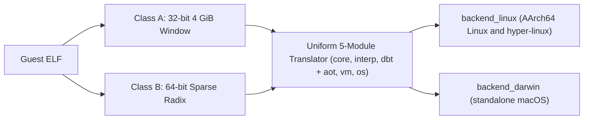

# rt-series

`rt-series` is the `zw3rk` family of 10 standalone, zero-dependency user-mode
binary translators that run foreign Linux userspace — 11 guest ISAs in 16+ ABI
variants (plus 32-bit iOS `armv7`/`armv7s` Mach-O in `a32rt`) — on AArch64
hosts: native `aarch64-linux`, standalone macOS on Apple Silicon, and Apple
Silicon under `hyper-linux` (`hl`). Each translator pairs a portable
interpreter with an AArch64 DBT engine plus a persistent AOT cache, and every
guest ISA outruns `qemu-user` TCG on the same machine (`1.07x–3.13x` on Apple
M4, see [Benchmarks](#benchmarks-apple-m4) below).

## Quickstart: Build & Run in Three Ways

### Standalone macOS on Apple Silicon (`arm64` Mach-O, no VM)

```sh
nix build .#a32rt-darwin
./result/bin/a32rt-darwin --sysroot /path/to/armhf-rootfs -- /path/to/guest-elf
```

Build all 10 native macOS translators at once with
`nix build .#all-translators-darwin`.

### Native AArch64 Linux (`static-pie` `aarch64-unknown-linux-musl`)

```sh
nix build .#a32rt
./result/bin/a32rt --sysroot /path/to/armhf-rootfs -- /path/to/guest-elf
```

`nix build .#default` (or `nix build .#all-translators`) builds all 10
static-PIE Linux translators at once.

### `hyper-linux` (`hl`) on Apple Silicon (automatic ELF dispatch)

```sh
hl --sysroot /path/to/rootfs /path/to/guest-elf
```

`hl` inspects the guest ELF headers and dispatches to the matching translator
automatically, so no per-architecture flags are needed.

### Umbrella Checks & Dev Shell

```sh
nix develop
make check && make check-catalogue
```

`nix develop` opens the unified cross-compilation and audit shell;
`make check` runs the fast acceptance gate and `make check-catalogue` runs the
real-world software qualification catalogue across all 10 translators.

## Architecture at a Glance



- **Two address-space classes.** Class A maps each 32-bit guest into a fixed
  `[G, G + 4 GiB)` window: a single `[x20, wAddr, uxtw]` instruction on 4 KiB
  hosts, a 7-instruction Soft-TLB on 16/64 KiB hosts. Class B keeps 64-bit
  guests in a `vm64` sparse radix page table with the same 7-instruction
  Soft-TLB on every host.
- **Dual execution engine plus persistent AOT.** Every translator ships
  `--interp`, `--dbt`, and `--difftest` lockstep verification, with translated
  blocks persisted to an on-disk AOT cache for instant warm starts.
- **In-place non-relocating copy-on-write.** `Provider A` (`vm_file.c`) keeps
  every guest page at its fixed arena address across `fork`, while
  `Provider B` lets `hyper-linux` repoint Stage-1 pages underneath; a 6-step
  quiescence protocol parks every thread before either host operation commits.
- **Standalone zero-dependency repositories.** Each translator is a complete
  Curated-C11 codebase with no shared library across repositories: copy-first
  reuse, never a common extracted dependency.
- **Two host OS backends from one tree.** `backend_linux.c` produces the
  static-PIE binary for AArch64 Linux and `hyper-linux`; `backend_darwin.c`
  produces the native Mach-O binary with `MAP_JIT` W^X for standalone macOS.

## Supported Architectures & Runtimes

| Guest ISA & ABIs | Class | Runtime | Example CPUs | Target Software & Notes |
| --- | --- | --- | --- | --- |
| AArch64 | Native | The host | Apple M4, AWS Graviton4, AmpereOne | Runs natively; the translators cover every other ISA. |
| x86-64 | Native (Rosetta) | [Rosetta](https://developer.apple.com/documentation/apple-silicon/about-the-rosetta-translation-environment) | AMD Ryzen, Intel Core | Covered on macOS through Rosetta, not through a translator. |
| AArch32 (`armhf`/`armel` ELF & 32-bit iOS `armv7`/`armv7s` Mach-O) | Class A | [a32rt](https://github.com/zw3rk/a32rt) | Cortex-A7 (Raspberry Pi 2), Apple A6/A6X | `armhf`/`armel` Linux userspace (Raspberry Pi OS, Debian, Alpine) **and** 32-bit iOS Mach-O (`MH_MAGIC` / `FAT_MAGIC`, Darwin/XNU `svc #0x80`). |
| x86 32-bit (`i686`) | Class A | [i686rt](https://github.com/zw3rk/i686rt) | Pentium III, Athlon XP | Legacy i386 Linux binaries and i386 multiarch sysroots. |
| MIPS32 (`mipsel` / `mips`, O32) | Class A | [mips32rt](https://github.com/zw3rk/mips32rt) | Ingenic XBurst JZ4770, MediaTek MT7620 | Router and IoT firmware, including OpenWrt on MIPS 24Kc parts. |
| PowerPC 32-bit (classic + e500v2 SPE) | Class A | [ppc32rt](https://github.com/zw3rk/ppc32rt) | PowerPC 750 (G3), NXP P1021 | Avionics, defense, and industrial boards on long-life 32-bit PowerPC. |
| SPARC V8 (`sparc32`) | Class A | [sparc32rt](https://github.com/zw3rk/sparc32rt) | Gaisler LEON3, LEON4 | SPARC V8 Linux userspace for spacecraft programs with long service life. |
| RISC-V 64-bit (`riscv64`, RV64GC) | Class B | [rvrt](https://github.com/zw3rk/rvrt) | SiFive U74, T-Head C910 | riscv64 userspace from boards moving into products. |
| RISC-V 32-bit (`riscv32`, RV32GC) | Class B | [rvrt](https://github.com/zw3rk/rvrt) | Nuclei N300FD | Embedded RISC-V (`ILP32D`) userspace, qualified inside `rvrt`. |
| LoongArch 64-bit (`loongarch64`) | Class B | [loongarch64rt](https://github.com/zw3rk/loongarch64rt) | Loongson 3A6000, 3B6000 | Current Loongson PCs and servers (`LP64D` + LSX/LASX). |
| Power ISA 64-bit (`ppc64le`, ELFv2) | Class B | [ppc64rt](https://github.com/zw3rk/ppc64rt) | POWER9 (Talos II), Power11 | `ppc64le` Linux (RHEL, SLES, Ubuntu on Power) with VSX. |
| MIPS64 (`mips64el` / `mips64`, N64 & N32) | Class B | [mips64rt](https://github.com/zw3rk/mips64rt) | Loongson 3A3000, Cavium Octeon III | Older Loongson systems and Octeon network-processor userspace. |
| SPARC V9 (`sparc64`) | Class B | [sparc64rt](https://github.com/zw3rk/sparc64rt) | Oracle SPARC M8, Fujitsu SPARC64 XII | 64-bit SPARC V9 Linux userspace (stack bias 2047, quad FP, VIS). |

All 10 translators are qualified across static and dynamic `musl` and `glibc`
userlands with `0` open defects; see [`docs/FEATURE-MATRIX.md`](docs/FEATURE-MATRIX.md)
and [`docs/DEFECTS.md`](docs/DEFECTS.md). Active expansion plans — standalone
Class-B **`s390xrt`** (`EM_S390`), big-endian **`ppc64` ELFv1** in `ppc64rt`,
and the **`hyper-linux` Darwin/XNU personality** (`ppc-darwin`, `ppc-darwin-ui`,
and migrating `a32rt/src/ios/` into `hl` so `a32rt` and `ppc32rt` stay small) —
are indexed in [`docs/plans/README.md`](docs/plans/README.md).

## Benchmarks (Apple M4)

Every runtime is benchmarked on the unified 5-workload suite
([`tests/bench_suite.c`](tests/bench_suite.c): CoreMark-style integer/list/
matrix/tokenizer, ChaCha20 20-round ARX cipher, FP/SIMD IEEE-754 and vector
kernels, Calls/IBTC indirect-call dispatch, and `getpid`/`clock_gettime`
syscall round-trips; 1 warmup plus 4 timed trials per workload, reporting the
minimum elapsed microseconds with deterministic CRC verification).

Raw results are recorded in
[`docs/bench/results-darwin5-full.tsv`](docs/bench/results-darwin5-full.tsv).

### Total Suite Execution Time (µs, lower is better)

**Bold** marks the fastest `rt-series` host target per row. `Speedup vs.
qemu-user` compares that fastest `rt-series` DBT result to `qemu-user` TCG.

| Guest ISA | Translator | Darwin DBT (µs) | Linux DBT (µs) | `hyper-linux` DBT (µs) | `qemu-user` TCG (µs) | Speedup vs. `qemu-user` | Darwin Interp (µs) |
| --- | --- | ---: | ---: | ---: | ---: | ---: | ---: |
| **AArch64** *(baseline)* | Native host | `3,255` | `3,740` | — | — | — | — |
| **AArch32** (`armhf`) | `a32rt` | `12,689` | **`7,954`** | `15,118` | `24,914` | **3.13x** | `571,857` |
| **i386** (`i686`) | `i686rt` | `32,904` | `34,441` | **`30,815`** | `36,682` | **1.19x** | `1,174,119` |
| **MIPS32** (`mipsel`) | `mips32rt` | **`30,190`** | `31,057` | `40,664` | `39,533` | **1.31x** | `703,022` |
| **PowerPC 32** (`ppc32`) | `ppc32rt` | **`37,899`** | `38,205` | `47,323` | `67,799` | **1.79x** | `916,982` |
| **SPARC V8** (`sparc32`) | `sparc32rt` | **`40,138`** | `40,537` | `52,502` | `68,051` | **1.70x** | `1,477,200` |
| **RISC-V 64** (`riscv64`) | `rvrt` | `25,686` | **`24,463`** | `37,235` | `30,703` | **1.26x** | `5,213,780` |
| **RISC-V 32** (`riscv32`) | `rvrt` | `26,093` | **`25,046`** | `38,657` | `26,750` | **1.07x** | `5,073,356` |
| **LoongArch64** (`loongarch64`) | `loongarch64rt` | **`38,786`** | `39,222` | `49,558` | `43,724` | **1.13x** | `2,927,333` |
| **Power ISA 64** (`ppc64le`) | `ppc64rt` | **`35,243`** | `35,681` | `44,710` | `68,920` | **1.96x** | `4,284,855` |
| **MIPS64** (`mips64el`) | `mips64rt` | **`23,785`** | `25,150` | `47,080` | `42,229` | **1.78x** | `1,425,215` |
| **SPARC V9** (`sparc64`) | `sparc64rt` | **`51,386`** | `51,428` | `60,051` | `69,027` | **1.34x** | `10,651,648` |

<details><summary>Per-Workload Breakdown — Darwin DBT vs. Linux DBT vs. qemu-user TCG (µs)</summary>

| Guest ISA (`Translator`) | Target | CoreMark (µs) | ChaCha20 (µs) | FP/SIMD (µs) | Calls/IBTC (µs) | Syscalls (µs) | Total (µs) |
| --- | --- | ---: | ---: | ---: | ---: | ---: | ---: |
| `armhf` (`a32rt`) | Darwin / Linux / QEMU | `3,953` / `1,554` / `2,470` | `2,994` / `1,067` / `2,398` | `953` / `950` / `7,943` | `4,607` / `3,713` / `11,159` | `182` / `670` / `944` | `12,689` / **`7,954`** / `24,914` |
| `i686` (`i686rt`) | Darwin / Linux / QEMU | `7,245` / `7,803` / `2,505` | `3,730` / `4,520` / `6,226` | `8,212` / `8,395` / `16,895` | `13,556` / `13,587` / `9,981` | `161` / `136` / `1,075` | **`32,904`** / `34,441` / `36,682` |
| `mipsel` (`mips32rt`) | Darwin / Linux / QEMU | `6,924` / `6,950` / `2,410` | `2,113` / `2,112` / `993` | `8,030` / `8,052` / `26,458` | `11,618` / `11,649` / `8,747` | `1,505` / `2,294` / `925` | **`30,190`** / `31,057` / `39,533` |
| `ppc32` (`ppc32rt`) | Darwin / Linux / QEMU | `7,292` / `7,014` / `2,278` | `2,907` / `2,907` / `981` | `16,348` / `16,409` / `55,408` | `10,826` / `10,830` / `8,254` | `526` / `1,045` / `878` | **`37,899`** / `38,205` / `67,799` |
| `sparc32` (`sparc32rt`) | Darwin / Linux / QEMU | `6,641` / `6,644` / `4,545` | `4,411` / `4,418` / `1,321` | `16,888` / `16,949` / `30,977` | `11,873` / `11,830` / `30,311` | `325` / `696` / `897` | **`40,138`** / `40,537` / `68,051` |
| `riscv64` (`rvrt`) | Darwin / Linux / QEMU | `4,812` / `4,806` / `1,624` | `2,645` / `2,658` / `1,285` | `10,299` / `8,680` / `14,545` | `7,313` / `7,317` / `12,300` | `617` / `1,002` / `949` | `25,686` / **`24,463`** / `30,703` |
| `riscv32` (`rvrt`) | Darwin / Linux / QEMU | `5,081` / `5,095` / `1,615` | `2,634` / `2,651` / `1,292` | `10,238` / `8,743` / `11,091` | `7,525` / `7,561` / `11,816` | `615` / `996` / `936` | `26,093` / **`25,046`** / `26,750` |
| `loongarch64` (`loongarch64rt`) | Darwin / Linux / QEMU | `5,993` / `5,981` / `2,527` | `1,990` / `1,984` / `1,455` | `22,089` / `22,136` / `30,639` | `8,057` / `8,019` / `7,988` | `657` / `1,102` / `1,115` | **`38,786`** / `39,222` / `43,724` |
| `ppc64le` (`ppc64rt`) | Darwin / Linux / QEMU | `10,133` / `10,064` / `3,093` | `1,799` / `1,802` / `1,180` | `8,107` / `8,104` / `50,715` | `14,631` / `14,646` / `12,940` | `573` / `1,065` / `992` | **`35,243`** / `35,681` / `68,920` |
| `mips64el` (`mips64rt`) | Darwin / Linux / QEMU | `7,184` / `7,100` / `2,544` | `2,479` / `2,481` / `1,449` | `3,378` / `3,357` / `29,290` | `10,065` / `10,066` / `8,047` | `679` / `2,146` / `899` | **`23,785`** / `25,150` / `42,229` |
| `sparc64` (`sparc64rt`) | Darwin / Linux / QEMU | `11,691` / `11,475` / `4,418` | `4,268` / `4,073` / `1,325` | `16,227` / `16,150` / `30,966` | `18,747` / `18,810` / `31,362` | `453` / `920` / `956` | **`51,386`** / `51,428` / `69,027` |

</details>

## Repository Contents & Documentation Map

| Path | Description |
| --- | --- |
| [`flake.nix`](flake.nix) | Umbrella Nix flake aggregating all 10 translators plus the cross-architecture benchmark and verification `devShell`. |
| [`include/a32host.h`](include/a32host.h) | Frozen `/dev/a32host` ABI header shared by all Class-A 32-bit translators and `hyper-linux`. |
| [`tests/`](tests/) | Unified benchmark suite, TCG/DBT torture tests, ABI invariant checks, and the catalogue harness. |
| [`tools/`](tools/) | Series-wide orchestration scripts: catalogue runner, parity gate, and benchmark harness. |
| [`docs/ARCHITECTURE.md`](docs/ARCHITECTURE.md) | Technical architecture manual: address-space classes, 5-module layout, Soft-TLB, COW, and backends. |
| [`docs/HOST-CONTRACT.md`](docs/HOST-CONTRACT.md) | Unified host contract: CLI and descriptor invocation, `/dev/a32host`, and `hyper-linux` dispatch. |
| [`docs/FEATURE-MATRIX.md`](docs/FEATURE-MATRIX.md) | Cross-runtime feature, execution-engine, SIMD/FPU, and qualification matrix. |
| [`docs/SOFTWARE-CATALOGUE.md`](docs/SOFTWARE-CATALOGUE.md) | Real-world software qualification catalogue and unified benchmark harness. |
| [`docs/CONVERGENCE-AUDIT-PROCESS.md`](docs/CONVERGENCE-AUDIT-PROCESS.md) | Convergence audit and remediation process: hunting, clustering, fixes, verification. |
| [`docs/DEFECTS.md`](docs/DEFECTS.md) | Defect ledger executive summary: rounds 1–18 resolved, `0` open defects. |
| [`lode/ISA-TRAP-AND-ABI-MATRIX.md`](lode/ISA-TRAP-AND-ABI-MATRIX.md) | 11-architecture ISA, trap, and ABI reference matrix. |
| [`docs/archive/`](docs/archive/) | Historical campaign plans, per-wave task cards, and archived defect rounds. |
