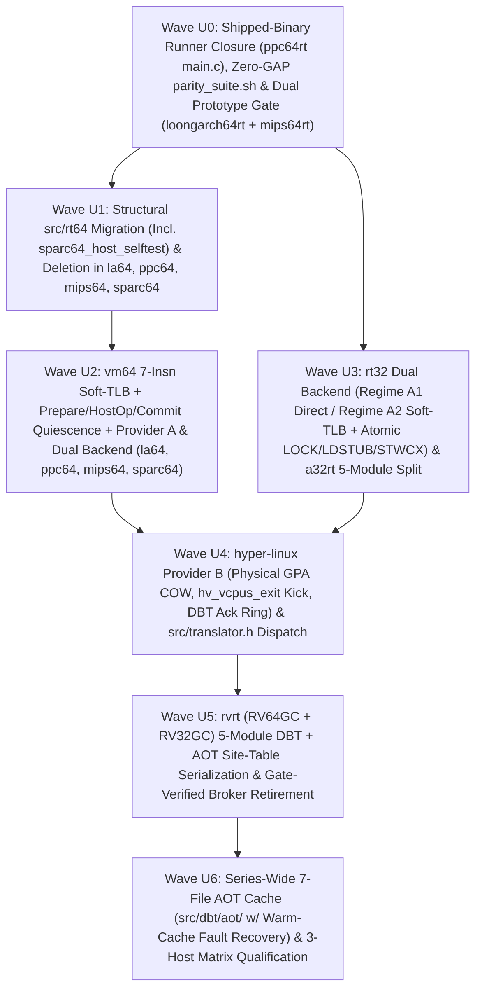

# `rt-series` Unification & Dual-Backend Architecture Plan

- **Copyright**: 2026 Moritz Angermann `<moritz@zw3rk.com>, zw3rk pte. ltd.`
- **License**: `Apache-2.0`
- **Date**: 2026-10-26 (Rev 4 — Hardened after fresh-context `astra#xhigh` Review #3 and `fable#high` Review #4)
- **Review Records**:
  - Review #1 (`codex`): [`lode/reviews/2026-10-26-astra-unification-review.md`](../lode/reviews/2026-10-26-astra-unification-review.md) & [`dispositions`](../lode/reviews/2026-10-26-astra-unification-review-dispositions.md)
  - Review #2 (`codex`): [`lode/reviews/2026-10-26-astra-unification-review-2.md`](../lode/reviews/2026-10-26-astra-unification-review-2.md) & [`dispositions`](../lode/reviews/2026-10-26-astra-unification-review-2-dispositions.md)
  - Review #3 (`astra#xhigh` via `codex -m gpt-6-astra -c model_reasoning_effort="xhigh"`): [`lode/reviews/2026-10-26-astra-xhigh-unification-review-3.md`](../lode/reviews/2026-10-26-astra-xhigh-unification-review-3.md)
  - Review #4 (`fable#high` via `claude -p --model claude-fable-5-1 --effort high`): [`lode/reviews/2026-10-26-fable-unification-review.md`](../lode/reviews/2026-10-26-fable-unification-review.md)
  - Combined Review #3 (`astra#xhigh`) & Review #4 (`fable#high`) Dispositions: [`lode/reviews/2026-10-26-astra-xhigh-and-fable-dispositions.md`](../lode/reviews/2026-10-26-astra-xhigh-and-fable-dispositions.md)
- **Companion Documents**: [`README.md`](../README.md), [`SPEC.md`](../SPEC.md), [`PLAN.md`](../PLAN.md), [`docs/HOST-CONTRACT.md`](HOST-CONTRACT.md), [`docs/FEATURE-MATRIX.md`](FEATURE-MATRIX.md)

---

## 1. Executive Summary & Architectural Goals

Across Waves 1–4, the `zw3rk` translator family grew to **10 standalone repositories covering 11 guest Linux ABIs**:

| Generation | Repositories | Current Structural State |
|---|---|---|
| **Gen 1** (`a32rt`) | `a32rt` (`d84feb3`, 18 files, 18,369 LOC) | Flat `src/` layout + `include/a32host.h`; JIT (`src/jit.c`) + single-file AOT (`src/aot.c`, `Makefile:56`, `src/main.c:256`) + GDB stub (`src/gdb.c`); `src/elf32.c:588` maps the kuser helper guest page `PROT_READ \| PROT_EXEC` on the host; no reference interpreter (`--interp`) or `--difftest`; 7 files exceed 900 lines; Linux-only host syscalls (`svc #0` / `/dev/a32host`). |
| **Gen 2** (`rvrt`) | `rvrt` (`33385fc` / `a7182d5`, 224 files, 66,452 pinned LOC) | 8 subdirectories (`core/`, `fp/`, `jit/`, `aot/`, `loader/`, `memory/`, `linux/`, `runtime/`) + `include/rvrt.h` + `vendor/softfloat/` + `vendor/mbedtls/`; fragmented `family_p1..p7.c`, `file_caps_p1..p2.c`, `guest_memory_p1..p3.c`; ~30k LOC of user-space family MM/file/truncation/broker machinery used by both `-linux` and `-hl` suites; limited direct-ALU JIT (`src/jit/a64.c`, 11 integer opcodes, no block chaining/IBTC/RAS/Soft-TLB); `RV32GC` execution unqualified (`rvrt/docs/SUPPORT.md:18`). |
| **Gen 3** (`rt32`) | `i686rt` (`f40d6e3`, 73 files, 38,696 LOC), `mips32rt` (`aeaeeeb`, 37 files, 14,352 LOC), `ppc32rt` (`cab7ae6`, 50 files, 19,224 LOC), `sparc32rt` (`83b1f63`, 51 files, 16,093 LOC) | Clean 4-module layout (`src/rt32/`, `src/interp/`, `src/dbt/`, `src/os/`) + `include/a32host.h` with dual engines (`--interp`, `--dbt`, `--difftest`), block chaining, IBTC, RAS, and 4 GiB `[x20, wAddr, uxtw]` hardware memory lowering; currently bound to Linux host syscalls (`syscall(__NR_*)` / `svc #0`). Note that `i686rt/src/interp/h_alu.c:12` currently treats `LOCK` as a no-op and `ppc32rt`/`sparc32rt` interpreters lack atomic host RMW on `STWCX.`/`LDSTUB`. |
| **Gen 3.5** (`rt64`) | `loongarch64rt` (`2064710`, 124 files, 44,046 LOC), `ppc64rt` (`70498a0`, 280 files, 68,135 LOC), `mips64rt` (`3ea43a7`, 123 files, 46,765 LOC), `sparc64rt` (`2bcf6d4`, 304 files, 78,868 LOC) | **Split-brain layout**: Phase 0 copied 81–252 files (168,783 total pinned LOC across the four `src/rt64/` trees) from `rvrt`, while Phases 1–7 implemented a Gen-3-style `src/core/` + `src/interp/` + `src/dbt/` + `src/os/` stack alongside it. `ppc64rt/src/main.c:99` is still a Phase-0 CLI stub (`tests/h3_run.sh` used separate harnesses). Current DBT memory lowering is heterogeneous (`fable` `M1`, `astra#xhigh` #15): `mips64rt/src/dbt/emit_mem.c:69-107` emits inline `[x20 + va]` with a `task_size` check and `str pc, [ctx, #scratch]`; `sparc64rt/src/dbt/emit_rt.c:23` and `ppc64rt/src/dbt/emit_int.c:732` call C helpers; and `loongarch64rt/src/dbt/emit_int.c:777-800` exits to `interp_step` on every load, store, and atomic. |

This plan defines the architecture and phased execution schedule to achieve **three overarching goals** without violating the zero-shared-library rule (`AGENTS.md` §2.1):

1. **Goal 1 — Uniform 5-Module Internal Architecture Across All 10 `<arch>rt` Translators**:
   - Align every repository (`a32rt`, `i686rt`, `mips32rt`, `ppc32rt`, `sparc32rt`, `rvrt`, `loongarch64rt`, `ppc64rt`, `mips64rt`, `sparc64rt`) onto a uniform 5-module internal layout (`src/core/`, `src/interp/`, `src/dbt/` [with `difftest.c` + `aot/`], `src/vm/`, `src/os/`), unified CLI surface (`--interp`, `--dbt`, `--difftest`, `--cache-dir`, `--pretranslate`), and ≤900-line Curated C11 file discipline.
   - Wire `ppc64rt/src/main.c` to its production runner, migrate the complete live dependency closure (including `sparc64_host_selftest`) out of `src/rt64/` in `loongarch64rt`, `ppc64rt`, `mips64rt`, and `sparc64rt`, delete the remaining `src/rt64/` trees, and unify DBT memory lowering around an assembler- and mathematically-verified **7-instruction AArch64 Inline Soft-TLB** (used by all Class-B engines and by Class-A engines on `H > 4096` hosts, while Class-A retains 1-instruction `[x20, wAddr, uxtw]` on `H == 4096` Linux and `hyper-linux` hosts).
2. **Goal 2 — Consolidate macOS APFS / Inode / Truncation / Shared-Memory Semantics in `hyper-linux` (`hl`) While Preserving Native Linux Family Semantics**:
   - Extend `hyper-linux` (`src/inode_backing.[ch]`, `src/translator.h`) into a full inode-keyed VMM backing & truncation engine (`hl_inode_backing_t`) with physical private GPA allocation on COW promotion, active vCPU preemption (`hv_vcpus_exit`) with acknowledged cross-VM Stage-1 + translator DBT code invalidation, post-fork controller interning, and complete mutation hook coverage (`ftruncate`, `truncate`, `openat(O_TRUNC)`, `write`, `pwrite64`, `writev`, `fallocate`, `sendfile`, `copy_file_range`).
   - Simultaneously, provide a **non-relocating in-place arena file/COW engine + lightweight `MAP_SHARED` family inode table (`Provider A`)** in `src/vm/vm_file.c` so `rvrt` and all translators preserve exact 4 KiB/8 KiB guest file, COW, futex, and `fork()` semantics on native 4K/16K/64K Linux and standalone Darwin without `rvrt`'s 30k-LOC SCM socket broker.
3. **Goal 3 — Dual Host Backend (`backend_linux.c` vs `backend_darwin.c`) for Every `<arch>rt` Translator**:
   - Every `<arch>rt` repository builds two zero-dependency artifacts from the same source tree:
     - **Backend 1 (`_build/<arch>rt-linux-aarch64` via `src/os/backend_linux.c`)**: Static-PIE `aarch64-linux` musl ELF (`aarch64-unknown-linux-musl-gcc -static-pie`) running inside `hyper-linux` (`hl`) or directly on a native `aarch64-linux` kernel.
     - **Backend 2 (`_build/<arch>rt-darwin-arm64` via `src/os/backend_darwin.c`)**: Native macOS `arm64` Mach-O binary (`clang -target arm64-apple-macos13`) running guest Linux ELFs directly on macOS **with zero `Hypervisor.framework` dependency** via `libSystem`, `MAP_JIT` (`pthread_jit_write_protect_np`), per-syscall-class `kqueue`/wakeup-pipe signal-atomic blocking, and 4 KiB Soft-TLB sub-page protection.

---

## 2. Target End-State Architecture

```text
                        ┌──────────────────────────────────────────────┐
                        │           Guest Linux ELF Binary             │
                        │  (arm32, i686, mips32, ppc32, sparc32,       │
                        │   rv32, rv64, la64, ppc64le, mips64, sparc64)│
                        └──────────────────────┬───────────────────────┘
                                               │
                                               ▼
┌──────────────────────────────────────────────────────────────────────────────────────────────┐
│                     UNIFIED <arch>rt TRANSLATOR ARCHITECTURE (All 10 Repos)                  │
│                                                                                              │
│  ┌────────────────────┐     ┌─────────────────────────────────────────────────────────────┐  │
│  │  1. src/core/      │     │  3. src/dbt/ (Dynamic Binary Translator + AOT Cache)        │  │
│  │  • cpu.h (ctx ABI) │     │  • dbt.c / a64_emit.c (block cache, chaining, IBTC, RAS)    │  │
│  │  • loader.c (ELF   │     │  • emit_int.c / emit_fp.c / emit_mem.c / emit_vec.c         │  │
│  │    + PT_INTERP)    │     │  • trampoline_a64.S (per-arch pinned ctx/base, x18 reserved)│  │
│  ├────────────────────┤     │  • difftest.c (--difftest lockstep interp vs DBT verifier)  │  │
│  │  2. src/interp/    │◄───►│  • aot/ (format + relative dbt_mem_site_t[], reader/writer) │  │
│  │  • decode.c        │     └──────────────────────────────┬──────────────────────────────┘  │
│  │  • interp.c (C11   │                                    │                                 │
│  │    oracle w/ real  │                                    ▼                                 │
│  │    __atomic RMW)   │     ┌─────────────────────────────────────────────────────────────┐  │
│  └────────────────────┘     │  4. src/vm/ (Guest Virtual Address Space & Fault Recovery)  │  │
│                             │  • Class A (32-bit, vm32.c):                                │  │
│                             │    - H == 4096 (4K Linux & hl): 1-insn [x20, wAddr, uxtw]   │  │
│                             │    - H > 4096 (16K Darwin / 16K-64K Linux): 7-insn Soft-TLB │  │
│                             │      over linear MAP_PRIVATE arena (preserves fork() COW!)  │  │
│                             │  • Class B (64-bit, vm64.c): 7-insn Soft-TLB + in-place     │  │
│                             │    non-relocating COW + Prepare->HostOp->Commit quiescence  │  │
│                             └──────────────────────────────┬──────────────────────────────┘  │
│                                                            │                                 │
│                                                            ▼                                 │
│  ┌────────────────────────────────────────────────────────────────────────────────────────┐  │
│  │  5. src/os/ (Guest Linux ABI Normalization — Common Across Both Backends)              │  │
│  │  • syscalls.c / syscalls_fs.c / syscalls_net.c / syscalls_mem.c                        │  │
│  │    (Validated copyin/copyout + unified write/SMC/LL-SC/COW hooks -> rt_host_* calls)   │  │
│  │  • sigframe.c / signals.c (Relative dbt_mem_site_t recovery + tgkill preemption)       │  │
│  │  • threads.c / futex.c / exec.c (Pinned futex admission, canonical rt_futex_key_t)     │  │
│  └────────────────────────────┬───────────────────────────────────────────┬───────────────┘  │
│                               │                                           │                  │
│             Build Target A:   │                         Build Target B:   │                  │
│        _build/<arch>rt-linux  │                    _build/<arch>rt-darwin │                  │
│        (static-PIE aarch64)   ▼                    (macOS arm64 Mach-O)   ▼                  │
│  ┌─────────────────────────────────────────┐ ┌────────────────────────────────────────────┐  │
│  │  src/os/backend_linux.c                 │ │  src/os/backend_darwin.c                   │  │
│  │  • Raw Linux AArch64 `svc #0`           │ │  • Direct `blr` into macOS `libSystem.B`   │  │
│  │  • Signal-atomic `safe_syscall_a64.S`   │ │  • Per-class kqueue/wake-pipe/ulock commit │  │
│  │  • `/dev/a32host` + family shm inode tbl│ │  • Linux->Darwin errno/open/stat/dirent/   │  │
│  │  • Host `mprotect` W^X + seal_rx I-cache │ │    sockaddr + `MAP_JIT` APRR W^X + seal_rx │  │
│  └─────────┬──────────────────────┬────────┘ └──────────────────────┬─────────────────────┘  │
└────────────┼──────────────────────┼─────────────────────────────────┼────────────────────────┘
             │                      │                                 │
   (Mode 1a: Native)      (Mode 1b: VMM Guest)              (Mode 2: Standalone macOS)
             │                      │                                 │
             ▼                      ▼                                 │
┌─────────────────────┐  ┌─────────────────────────────────────────┐  │
│ Native AArch64      │  │           hyper-linux (`hl`)            │  │
│ Linux Host Kernel   │  │     (Hardware HVF VM + Unified VFS)     │  │
│                     │  │                                         │  │
│ • Hardware 4K/16K/  │  │ • Guest EL1 Stage-1 4 KiB page tables   │  │
│   64K MMU + VFS     │  │   (H == 4096 inside VM for all guests!) │  │
│ • Provider A family │  │ • `src/translator.h` auto-dispatch for  │  │
│   inode shm table   │  │   all 11 EM_* guest architectures       │  │
│ • Native namespaces │  │ • Provider B `hl_inode_backing_t` (phys │  │
└─────────────────────┘  │   GPA COW, hv_vcpus_exit kick, DBT ack) │  │
                         └────────────────────┬────────────────────┘  │
                                              │                       │
                                              ▼                       ▼
                         ┌──────────────────────────────────────────────────────────────────┐
                         │                macOS Kernel (XNU / Apple Silicon)                │
                         └──────────────────────────────────────────────────────────────────┘
```

---

## 3. Reproducible Baseline Audit Across All 11 Sibling Repositories

All file counts and line counts below are reproducibly measured from **pinned Git tree blobs** under `src/` and `include/`:

```sh
python3 -c '
import subprocess
for repo, rev in [
    ("a32rt","d84feb3"), ("i686rt","f40d6e3"), ("rvrt","33385fc"),
    ("mips32rt","aeaeeeb"), ("ppc32rt","cab7ae6"), ("sparc32rt","83b1f63"),
    ("loongarch64rt","2064710"), ("ppc64rt","70498a0"), ("mips64rt","3ea43a7"),
    ("sparc64rt","2bcf6d4"), ("hyper-linux","be7721f")
]:
    paths = [p for p in subprocess.check_output(
        ["git", "-C", f"../{repo}", "ls-tree", "-r", "--name-only", rev, "src", "include"],
        text=True).splitlines() if p.endswith((".c", ".h", ".S"))]
    loc = sum(subprocess.check_output(["git", "-C", f"../{repo}", "show", f"{rev}:{p}"]).count(b"\n") for p in paths)
    print(f"{repo:15s} {rev}  files={len(paths):3d}  loc={loc:7d}")
'
```

*(Note: Live user sessions in `../rvrt` (`a7182d5`) and `../hyper-linux` (`5c72284`) have advanced beyond the baseline pins above; Wave U4 and Wave U5 refresh those two pins at wave start once sessions `%92` and `%113` are idle/merged.)*

| Repository | Pinned Commit | Total Pinned Files (`src/` + `include/`) | Total Pinned LOC (`src/` + `include/`) | Pinned `src/rt64/` Donor Partition (Files / LOC) | Active Non-`rt64` Partition (Files / LOC) | Current Layout, Memory Lowering & Key Findings |
|---|---|---:|---:|---:|---:|---|
| `rt-series` | `731638b` | — | — | — | — | Master spec, host contract, wave task cards, feature matrix, unification plan. |
| `a32rt` | `d84feb3` | 18 | 18,369 | 0 / 0 | 18 / 18,369 | Flat `src/` + `include/a32host.h`. Has JIT (`src/jit.c`), single-file AOT (`src/aot.c`), and GDB stub (`src/gdb.c`). `src/elf32.c:588` maps the kuser helper guest page `PROT_READ \| PROT_EXEC` on the host (`fable` `m6`). **7 files exceed 900 lines**. Missing `src/interp/`, `--difftest`, `backend_darwin.c`. |
| `i686rt` | `f40d6e3` | 73 | 38,696 | 0 / 0 | 73 / 38,696 | 4-module `src/{rt32,interp,dbt,os}/`. Has `--interp`, `--dbt`, `--difftest`. `src/interp/h_alu.c:12` treats `LOCK` as a no-op and `src/dbt/engine.c:425-440` lacks mid-block GPR/ESP sync on memory faults (`fable` `C4`, `astra#xhigh` #3). |
| `mips32rt` | `aeaeeeb` | 37 | 14,352 | 0 / 0 | 37 / 14,352 | 4-module `src/{rt32,interp,dbt,os}/`. All files ≤900 lines. Missing `src/dbt/aot/`, `backend_darwin.c`. |
| `ppc32rt` | `cab7ae6` | 50 | 19,224 | 0 / 0 | 50 / 19,224 | 4-module `src/{rt32,interp,dbt,os}/`. `src/interp/interp.c:792` `STWCX.` uses non-atomic store after reservation check (`astra#xhigh` #4). |
| `sparc32rt` | `83b1f63` | 51 | 16,093 | 0 / 0 | 51 / 16,093 | 4-module `src/{rt32,interp,dbt,os}/`. `src/interp/interp.c:487` `LDSTUB` uses non-atomic load+store (`astra#xhigh` #4). |
| `rvrt` | `33385fc` | 224 | 66,452 | — (donor) | 224 / 66,452 | 8 subdirectories (`core/`, `fp/`, `jit/`, `aot/`, `loader/`, `memory/`, `linux/`, `runtime/`). Direct-ALU-only JIT (`src/jit/a64.c`, 635 LOC); `src/aot/format.h:63` serializes code/relocations without a memory-site recovery table (`astra#xhigh` #14); `RV32GC` unqualified. |
| `loongarch64rt` | `2064710` | 124 | 44,046 | **81 / 27,969** | 43 / 16,077 | 2 `src/rt64/` files linked (`Makefile:51-54`). **No DBT memory lowering yet**: `src/dbt/emit_int.c:777-800` exits to `interp_step` on all loads, stores, and atomics (`fable` `M1`, `astra#xhigh` #15). `src/interp/interp_mem.h:78` & `interp_amo.c:234` track `ll_valid` under a software lock (`astra#xhigh` #4). `src/dbt/dbt.c:146-189` misuses `mprotect` on `MAP_JIT`. |
| `mips64rt` | `3ea43a7` | 123 | 46,765 | **81 / 28,355** | 42 / 18,410 | 5 `src/rt64/` files linked (`Makefile:36-40`). `src/dbt/emit_mem.c:69-107` already inlines `[x20 + va]` after a `task_size` bounds check and stores PC to `ctx->scratch` (`fable` `M1`, `astra#xhigh` #15). `src/os/mem.c:17-19,55` faults with `SIGSEGV` on unaligned integer accesses instead of Linux MIPS `TIF_FIXADE` emulation / `SIGBUS` (`fable` `M5`). |
| `ppc64rt` | `70498a0` | 280 | 68,135 | **242 / 54,930** | 38 / 13,205 | `ppc64rt/src/main.c:99` is still the Phase-0 CLI stub (`(guest execution lands in Phase 1)`, returning 2). `src/dbt/trampoline_a64.S:10` keeps `cpu, mem_ops, mem_ctx` in caller-saved `x0..x2` and `src/dbt/emit_int.c:732` calls `mem_ops` helpers. |
| `sparc64rt` | `2bcf6d4` | 304 | 78,868 | **252 / 57,529** | 52 / 21,339 | `src/main.c:17` calls `sparc64_host_*` including `sparc64_host_selftest` (`tests/check_host_contract.sh:433`). `src/dbt/emit_rt.c:23` calls C helpers (`sparc64_dbt_mem_*`). `src/os/guest_run_priv.h:39-43` splits `GUEST_PAGE_SIZE = 4096` vs `GUEST_AT_PAGESZ_VALUE = 8192` (`fable` `M8`, `astra#xhigh` #9). |
| `hyper-linux` | `be7721f` | 182 | 141,338 | — | 182 / 141,338 | Enforces 4 KiB permissions via guest EL1 **Stage-1** page tables (`src/guest.c:27,325`). Non-RVRT/non-Android `MAP_SHARED` file mappings currently use a slab snapshot (`src/syscall.c:2241-2247`, `fable` `M6`), and `src/futex.c:504` accesses words under `futex_bucket_lock` (Rank 7, inner to Rank 1 `mmap_lock` in `src/syscall_internal.h:10`, `astra#xhigh` #11). |

---

## 4. Pillar 1: Uniform 5-Module `<arch>rt` Layout, Register Conventions & Soft-TLB Architecture

Every `<arch>rt` repository remains a **standalone, zero-external-dependency repository** conforming to the 5-module internal layout (`src/core/`, `src/interp/`, `src/dbt/`, `src/vm/`, `src/os/`).

### 4.1 Verified Per-Engine AArch64 Register & Current Memory-Lowering Table (`fable` `M1`, `astra#xhigh` #15)

| Translator | Current Context Register (`reg_ctx`) | Current Memory Lowering in Tree | Other Pinned Registers inside Emitted Code | Planned Unification Action |
|---|---|---|---|---|
| `a32rt` ([`a64_emit.h:20-36`](file:///Users/angerman/Projects/zw3rk/a32rt/src/a64_emit.h#L20-L36)) | `x19` (`A64_XCTX`) | `x20` (`A64_XG` 4 GiB `[x20, wAddr, uxtw]`) | `w0..w14` = guest `r0..r14`; `x15..x17, x21, x22` = scratch/addr; `x23..x28` = chain/epoch/thumb; `v8..v31` = VFP cache | On `H == 4096` (4K Linux & `hl`), keep `[x20, wAddr, uxtw]`. On `H > 4096`, bind `x20 = &ctx->tlb[0]` and emit 32-bit Soft-TLB (§4.4). `x18` hard-blocked. |
| `i686rt` ([`emit.h:7`](file:///Users/angerman/Projects/zw3rk/i686rt/src/dbt/emit.h#L7)) | `x19` (`i686_ctx_t *`) | `x20` (`guest_base` `[x20, wAddr, uxtw]`) | `w0..w7` = guest `eax..edi`; `x21` = lazy flags | Same as `a32rt`: 1-insn `[x20, wAddr, uxtw]` on `H == 4096`; 32-bit Soft-TLB (`x20 = &ctx->tlb[0]`) on `H > 4096`. `x18` hard-blocked. |
| `mips32rt`, `ppc32rt`, `sparc32rt` ([`ppc32rt/dbt.h:43`](file:///Users/angerman/Projects/zw3rk/ppc32rt/src/dbt/dbt.h#L43)) | `x19` (`<arch>_ctx_t *`) | `x20` (`guest_base` `[x20, wAddr, uxtw]`) | `x28` = `&dbt->epoch` chaining epoch; `x15/w16` = exit PC/reason | Same as `a32rt`: 1-insn `[x20, wAddr, uxtw]` on `H == 4096`; 32-bit Soft-TLB (`x20 = &ctx->tlb[0]`) on `H > 4096`. `x18` hard-blocked. |
| `loongarch64rt` ([`trampoline_a64.S:35`](file:///Users/angerman/Projects/zw3rk/loongarch64rt/src/dbt/trampoline_a64.S#L35)) | `x28` (`la64_ctx_t *`) | **None** (`emit_int.c:777-800` exits to `interp_step` on all memory ops) | `x19..x27` saved in prologue, unused by emitter | **Keep `x28 = ctx`**; bind unused callee-saved **`x20 = &ctx->tlb[0]`** in `trampoline_a64.S` and add `src/dbt/emit_mem.c`. |
| `mips64rt` ([`emit_mem.c:69-107`](file:///Users/angerman/Projects/zw3rk/mips64rt/src/dbt/emit_mem.c#L69-L107)) | `x19` (`mips64_ctx_t *`) | Inline `[x20 + va]` after `task_size` check + `str pc, [ctx, #scratch]` | `x21..x28` saved in prologue; `x25` = dynamic branch target | **Keep `x19 = ctx`**; replace `[x20 + va]` + `ctx->scratch` store in `emit_mem.c` with `x20 = &ctx->tlb[0]` 7-insn Soft-TLB + `dbt_mem_site_t`. |
| `sparc64rt` ([`trampoline_a64.S:12-44`](file:///Users/angerman/Projects/zw3rk/sparc64rt/src/dbt/trampoline_a64.S#L12-L44)) | `x19` (`sparc64_ctx_t *`) | Calls C helpers `sparc64_dbt_mem_*` (`emit_rt.c:23`) | `x27` = chain entry; `x28` = `&dbt->epoch`; `x15` = exit PC; `w16` = exit reason; host `NZCV` caches guest `CCR` (`emit_priv.h:737`) | **Keep `x19 = ctx`, `x27 = chain`, `x28 = epoch`**; bind unused callee-saved **`x20 = &ctx->tlb[0]`** in `trampoline_a64.S` and replace helper calls with 7-insn Soft-TLB. |
| `ppc64rt` ([`trampoline_a64.S:10-42`](file:///Users/angerman/Projects/zw3rk/ppc64rt/src/dbt/trampoline_a64.S#L10-L42)) | `x0` (`cpu`, caller-saved!) | Calls `cpu->mem_ops` C helpers (`emit_int.c:732`) | `x19..x28` saved in prologue (`trampoline_a64.S:26-30`), unused by emitted blocks | **Migrate in Wave U2**: pin `x19 = cpu` and `x20 = &cpu->tlb[0]` in `ppc64_dbt_enter` prologue, add `src/dbt/emit_mem.c`, and bump AOT emitter version ID. |
| `rvrt` (Wave U5 Full DBT) | `x19` (`rv_ctx_t *`) | Interpreter / helper-dispatched | `x27` = chain entry; `x28` = `&dbt->epoch` | Adopt `x19 = ctx, x20 = &ctx->tlb[0], x28 = epoch` convention and bump `rvrt` AOT emitter identity (`v3 -> v4`). |

### 4.2 Guest ABI Page Size vs Translation Granule vs Host Kernel Page Size (`fable` `M8`, `astra#xhigh` #9)

1. **Guest Architectural & ABI Page Size (`GUEST_ABI_PAGE_SIZE`)**:
   - **`8192` (8 KiB) on `sparc64rt`**: Resolves the current discrepancy in `sparc64rt/src/os/guest_run_priv.h:39-43` (`GUEST_PAGE_SIZE = 4096` vs `GUEST_AT_PAGESZ_VALUE = 8192`) and amends `SPEC.md` D11 (`SPEC.md:92`) to explicitly record `AT_PAGESZ = 8192` for `sparc64rt` and `4096` for the other 9 translators.
   - On `sparc64rt`, **all** guest-visible VM semantics operate on the **8 KiB architectural page granule**: `mmap`/`mprotect`/`munmap`/`mremap` require 8 KiB alignment (`EINVAL` on 4 KiB-only offsets/addresses), `MAP_PRIVATE` COW promotion copies/promotes the entire 8 KiB guest page as one indivisible unit (never leaving one 4 KiB half `COW_DIRTY` and the other 4 KiB half `COW_CLEAN`), and partial-page EOF tail zeroing rounds to `align_up(file_size, 8192)` (materializing an anonymous zeroed second 4 KiB host half when a file ends in the lower 4 KiB of an 8 KiB SPARC64 page on a 4 KiB host, so valid accesses to the upper 4 KiB half never trigger a kernel `SIGBUS`).
   - **`4096` (4 KiB) on the other 9 translators**.
2. **Software Translation Granule (`RT_TRANSLATION_GRANULE = 4096`)**: The Soft-TLB (`rt64_tlb_entry_t`) is indexed by 4 KiB virtual page number (`(gva >> 12) & 0xFFF`). On `sparc64rt`, every 8 KiB guest page transition (`mmap`, `mprotect`, COW promotion, truncate invalidation) updates both consecutive 4 KiB Soft-TLB entries (`vpn` and `vpn ^ 1`) together.
3. **Host Kernel Page Size (`H = rt_host_page_size()`)**: Dynamically queried via `sysconf(_SC_PAGESIZE)` on **both** Linux and Darwin (`4096`, `16384`, or `65536`). `N_sub = H / 4096` (`1`, `4`, or `16`). Inside `hyper-linux` (`hl`), the guest EL1 Stage-1 MMU is configured with 4 KiB pages (`TCR_EL1.TG0 = 4KB`), so `H == 4096` inside `hl` even on 16 KiB Apple Silicon hosts.

### 4.3 Soft-TLB Fast Path, Compact Miss Trampolines & Precise State Recovery (`astra#xhigh` #3, #14, #15; `fable` `M7`, `m1`–`m3`)

#### 1. Soft-TLB Entry Layout (32 Bytes per Entry)

```c
#define RT_TLB_BITS 12u
#define RT_TLB_SIZE (1u << RT_TLB_BITS)     /* 4096 entries = 128 KiB per thread */
#define RT_TLB_INVALID_TAG (~UINT64_C(0))   /* Low bits [11:0] = 0xFFF -> never matches */

typedef struct {
    uint64_t  read_tag;       /* Offset  0: (gva & ~0xFFFULL) if readable & < EOF, else ~0ULL */
    uintptr_t addend;         /* Offset  8: (uintptr_t)host_page_base - (gva & ~0xFFFULL)     */
    uint64_t  write_tag;      /* Offset 16: (gva & ~0xFFFULL) if writable & !cow_clean        */
                              /*            & !has_code & !has_ll_reservation, else ~0ULL     */
    uint64_t  flags_reserved; /* Offset 24: reserved (zero-initialized, 32B cache alignment)  */
} rt_tlb_entry_t;
_Static_assert(sizeof(rt_tlb_entry_t) == 32, "Soft-TLB entry must be 32 bytes");
```

#### 2. Complete Load vs. Store Fast-Path Listings (Scalar `N in {1, 2, 4, 8}` and Aligned `N = 16`)

- **Loads** use `ldp x2, x3, [x2, #0]` -> `x2 = read_tag`, `x3 = addend`.
- **Stores** use `ldp x3, x2, [x2, #8]` -> `x3 = addend`, `x2 = write_tag` (swapped destination pair `x3, x2`).
- Instructions 1–6 do **not** modify `PSTATE.NZCV` (`ubfx`, `add`, `ldp`, `and`, `sub`, `cbnz`) and do **not** clobber `x0` (value/dst) or `x1` (guest effective address). On Class-A `H > 4096` hosts, the caller zero-extends the 32-bit guest effective address into `x1` (`mov w1, wAddr`) before instruction 1.

```armasm
// --- 7-INSTRUCTION LOAD FAST PATH (N in {1,2,4,8,16}; example N=8, x1=gva, x0=dst) ---
.L_tlb_seq_start_k:
    ubfx  x2, x1, #12, #12                  // 1. x2 = (gva >> 12) & 0xFFF
    add   x2, x20, x2, lsl #5               // 2. x2 = &ctx->tlb[index]
    ldp   x2, x3, [x2, #0]                  // 3. x2 = read_tag (+0), x3 = addend (+8)
    and   x4, x1, #0xfffffffffffff007       // 4. (bic x4, x1, #(0xfff - (N-1)))
    sub   x4, x4, x2                        // 5. 0 iff (VPN == read_tag) && ((gva & (N-1)) == 0)
    cbnz  x4, .L_tlb_miss_site_k            // 6. jump to 2-insn per-site stub on miss/misalign
.L_tlb_mem_insn_k:
    ldr   x0, [x1, x3]                      // 7. host load (see signed/BE table below)
.L_tlb_cont_k:

// --- 7-INSTRUCTION STORE FAST PATH (N in {1,2,4,8,16}; example N=8, x1=gva, x0=val) ---
.L_tlb_seq_start_k:
    ubfx  x2, x1, #12, #12                  // 1. x2 = (gva >> 12) & 0xFFF
    add   x2, x20, x2, lsl #5               // 2. x2 = &ctx->tlb[index]
    ldp   x3, x2, [x2, #8]                  // 3. x3 = addend (+8), x2 = write_tag (+16) [SWAPPED!]
    and   x4, x1, #0xfffffffffffff007       // 4. (bic x4, x1, #(0xfff - (N-1)))
    sub   x4, x4, x2                        // 5. 0 iff (VPN == write_tag) && ((gva & (N-1)) == 0)
    cbnz  x4, .L_tlb_miss_site_k            // 6. jump to 2-insn per-site stub (x0 and x1 intact!)
.L_tlb_mem_insn_k:
    str   x0, [x1, x3]                      // 7. host store (for BE stores, rev into x4 after step 6 cbnz)
.L_tlb_cont_k:
```

**Frozen Instruction-7 Lowering Table by Width, Signedness & Endianness (`fable` `m1`, `m2`; `astra#xhigh` #15)**:

| Access Kind | Logical Immediate Mask (Step 4) | Little-Endian (`rvrt`, `loongarch64rt`, `ppc64rt` natural, `i686rt`, `a32rt`) | Big-Endian (`mips64rt`, `sparc64rt`, `mips32rt`, `ppc32rt`, `sparc32rt`, `ppc64rt` byte-rev) |
|---|---|---|---|
| **U8 Load** | `0xfffffffffffff000` | `ldrb w0, [x1, x3]` | `ldrb w0, [x1, x3]` |
| **S8 Load (to 64-bit reg)** | `0xfffffffffffff000` | `ldrsb x0, [x1, x3]` | `ldrsb x0, [x1, x3]` |
| **U16 Load** | `0xfffffffffffff001` | `ldrh w0, [x1, x3]` | `ldrh w0, [x1, x3]` ; `rev16 w0, w0` |
| **S16 Load (to 64-bit reg)** | `0xfffffffffffff001` | `ldrsh x0, [x1, x3]` | `ldrh w0, [x1, x3]` ; `rev16 w0, w0` ; `sxth x0, w0` |
| **U32 Load** | `0xfffffffffffff003` | `ldr w0, [x1, x3]` | `ldr w0, [x1, x3]` ; `rev w0, w0` |
| **S32 Load (to 64-bit reg)** | `0xfffffffffffff003` | `ldrsw x0, [x1, x3]` | `ldr w0, [x1, x3]` ; `rev w0, w0` ; `sxtw x0, w0` |
| **U64 / S64 Load** | `0xfffffffffffff007` | `ldr x0, [x1, x3]` | `ldr x0, [x1, x3]` ; `rev x0, x0` |
| **U8 Store** | `0xfffffffffffff000` | `strb w0, [x1, x3]` | `strb w0, [x1, x3]` |
| **U16 / U32 / U64 Store** | `...f001` / `...f003` / `...f007` | `strh w0` / `str w0` / `str x0, [x1, x3]` | After step 6 (`cbnz`): `rev16 w4, w0` / `rev w4, w0` / `rev x4, x0` ; `strh w4` / `str w4` / `str x4, [x1, x3]` (preserves `x0`!) |
| **16B Quad / Vector / Paired / Merge Ops** | `0xfffffffffffff00f` (for aligned 16B) | Aligned 16B scalar/vector uses `0xfffffffffffff00f`; multi-reg (`LDM`/`STM`), unaligned vector (`LSX`/`LASX`/`VSX`/`MSA`), ASI, and merge ops (`LWL`/`LWR`/`LDL`/`LDR`) validate all touched spans before committing register mutations or call checked helpers. |

#### 3. Compact 2-Instruction Per-Site Stub, Relative `dbt_mem_site_t` & Dynamic Delay-Slot Recovery (`astra#xhigh` #3, #14; `fable` `M5`, `M7`)

To prevent the 6x code-size blowup of saving/restoring registers at every memory site (`fable` `M7`), and to ensure `dbt_mem_site_t` is 100% position-independent for AOT cache serialization (`astra#xhigh` #14) while supporting dynamic indirect delay-slot targets (`astra#xhigh` #3):

```armasm
// Emitted at the end of each translated basic block (always within <16 KiB of cbnz, well inside ±1 MiB imm19):
.L_tlb_miss_site_k:
    mov   w4, #k                        // 1. 16-bit site index within this block (2 insns = 8 bytes per site!)
    b     .L_block_tlb_miss_common      // 2. jump to shared per-block trampoline

.L_block_tlb_miss_common:
    // Shared once per block: saves live caller-saved scratch + MRS x5, NZCV (preserving SPARC64 CCR in NZCV),
    // passes (ctx, x1=gva, x0=val, block_id, w4=site_idx) to vm_tlb_miss_helper(), restores NZCV, and branches
    // to (block->rx_code + site->cont_insn_offset) or exits to the dispatcher on fault / SMC invalidation.
```

```c
typedef enum {
    RT_NPC_SEQUENTIAL    = 0, /* guest_npc = guest_pc + insn_len                           */
    RT_NPC_STATIC_TARGET = 1, /* guest_npc = block->guest_pc_base + site->npc_delta        */
    RT_NPC_DYNAMIC_CTX   = 2, /* guest_npc read from ctx->delay_target (SPARC JMPL, MIPS JR)*/
} rt_npc_mode_t;

/* Purely relative 24-byte site record — serialized directly into AOT block payloads (astra#xhigh #14) */
typedef struct {
    uint16_t seq_start_offset;  /* Byte offset of .L_tlb_seq_start_k (ubfx) for signal rewind */
    uint16_t host_insn_offset;  /* Byte offset of .L_tlb_mem_insn_k (ldr/str)                 */
    uint16_t cont_insn_offset;  /* Byte offset of .L_tlb_cont_k                               */
    uint16_t guest_pc_delta;    /* Byte offset of faulting guest PC from block->guest_pc_base */
    int32_t  npc_delta;         /* Static branch target delta when npc_mode == RT_NPC_STATIC  */
    uint32_t insn_word;         /* Raw guest instruction word (or prefix+op key on i686)      */
    int16_t  sp_rollback_delta; /* Pre-store stack/base reg adjustment to undo on fault (#3)  */
    uint8_t  npc_mode;          /* rt_npc_mode_t (resolves dynamic delay-slot JMPL/JR, #3)    */
    uint8_t  width;             /* 1, 2, 4, 8, or 16                                          */
    uint8_t  flags;             /* STORE | SIGNED | BE | IN_DELAY_SLOT | PRE_COMMITTED_SP     */
    uint8_t  val_or_dst_reg;    /* Architectural/host register index for load dst / store val */
    uint8_t  addr_base_reg;     /* Architectural base register index if sp_rollback_delta != 0*/
    uint8_t  reserved;
} dbt_mem_site_t;
_Static_assert(sizeof(dbt_mem_site_t) == 24, "dbt_mem_site_t must be 24 bytes");
```

- **No Double-Side-Effect Replay Rule (`astra#xhigh` #3)**:
  - For instructions that modify a stack or base register alongside a memory access (`i686` `PUSH`/`POP`/`CALL`/`RET`, `a32` pre/post-indexed `LDR`/`STR` and `LDM`/`STM`, `ppc` `stwu`/`ldu`):
    1. Single-access instructions either compute the effective address into `x1` and write back `ESP`/`Rn` **after** `.L_tlb_cont_k`, or set `sp_rollback_delta` so fault recovery restores `ESP`/`Rn` before raising a guest signal or entering `interp_step`.
    2. Multi-transfer instructions (`a32` `LDM`/`STM`, `sparc` `LDD`/`STD`) validate the first and last guest byte of the transfer span before writing any architectural destination registers or memory bytes.
  - All cached register state (`w0..w7` and lazy flags `x21` in `i686rt`, `w0..w14` in `a32rt`) is flushed to `ctx` in the shared fault landing pad before `signals.c` or `interp_step` inspects `ctx`.
- **Unaligned Access Semantics Including Linux MIPS `TIF_FIXADE` (`fable` `M5`)**:
  - `loongarch64rt`, `ppc64rt`, `ppc32rt`, `rvrt`, `i686rt`: validate both touched 4 KiB pages before reading/writing any bytes; if valid, complete the unaligned access across the page boundary; if either page faults, deliver `SIGSEGV`/`SIGBUS` with zero partial mutation.
  - `mips64rt` and `mips32rt` (`fable` `M5`): Linux MIPS kernels enable `TIF_FIXADE` by default (`ctx->fixade_enabled = 1`). When `ctx->fixade_enabled == 1`, Case 2 validates both pages and emulates unaligned integer loads/stores in software; when disabled via `sysmips(MIPS_FIXADE, 0)`, Case 2 delivers guest **`SIGBUS` (`BUS_ADRALN`)** (fixing `mips64rt/src/os/mem.c:55`, which previously raised `SIGSEGV`).
  - `sparc64rt` and `sparc32rt`: deliver guest `SIGBUS` (`BUS_ADRALN`).

### 4.4 Unified Backing-Aware Write, Reservation (`LL/SC`), Atomicity (`LOCK`/`AMO`) & SMC Protocol (`astra#xhigh` #4; `fable` `C4`)

Every guest memory write — whether from a DBT inline `str`, a `.L_tlb_miss_site_k` slow path, `interp_step`, `vm_copyout` (`read`/`recvfrom`/`getdents64`), or `sigframe` setup — obeys one unified protocol:

1. **Why Inline `write_tag` Hits Cannot Bypass COW, SMC, or Active Software Reservations**:
   - A page's `write_tag` in the Soft-TLB is set to `(gva & ~0xFFFULL)` **if and only if ALL FOUR conditions hold**:
     1. `(vma_page_prot[vpn] & PROT_WRITE) != 0` and `< align_up(inode_size, GUEST_ABI_PAGE_SIZE)`;
     2. `vma_page_state[vpn] != PAGE_COW_CLEAN` (already promoted to `PAGE_COW_DIRTY` or `PAGE_ANON`/`PAGE_SHARED`);
     3. `(vma_page_flags[vpn] & PAGE_HAS_CODE) == 0` (no live DBT blocks translated from this page);
     4. `(vma_page_flags[vpn] & PAGE_HAS_SW_RESERVATION) == 0` (no active cross-block/interpreter `LL` reservation on this page).
   - Whenever any of (1)–(4) is false, `write_tag == ~0ULL`, forcing every store to that 4 KiB page into `vm_tlb_miss_helper()`!
2. **Unified `LL/SC` & Atomic RMW Protocol (`astra#xhigh` #4, `fable` `C4`)**:
   - **Interpreter & DBT Atomic RMWs (`i686` `LOCK`, `sparc` `LDSTUB`/`SWAP`/`CASA`/`CASXA`, `rv`/`la64` `AMO*`)**: All interpreter handlers in `i686rt` (`src/interp/h_alu.c`, `h_shift.c`), `sparc32rt` (`src/interp/interp.c:487`), `ppc32rt` (`src/interp/interp.c:792`), `loongarch64rt`, and `rvrt` MUST execute C11 `__atomic_*` builtins (`__atomic_compare_exchange_n`, `__atomic_fetch_add`, `__atomic_exchange_n` with `__ATOMIC_SEQ_CST`) on the resolved canonical host address `HVA` — never plain load + store.
   - **`LL/SC` Synchronization Across DBT and Interpreter (`mips32/64`, `ppc32/64`, `loongarch64`, `rvrt`)**:
     - Every 64-byte cache line (hashed into a 1024-entry global atomic reservation table `g_ll_table[hash]`) tracks `_Atomic uint64_t seq_epoch`.
     - When `LL`/`LR` executes (in DBT or interpreter), it records `ctx->ll_gva`, `ctx->ll_val`, sets `PAGE_HAS_SW_RESERVATION` (clearing `write_tag = ~0ULL` on that page so stores trap and bump `g_ll_table[hash].seq_epoch`), and records `ctx->ll_epoch = atomic_load(&g_ll_table[hash].seq_epoch)`.
     - When `SC` executes, it verifies `ctx->ll_valid && ctx->ll_gva == gva` and performs an atomic compare-and-swap on `(g_ll_table[hash].seq_epoch, *(HVA))` (or hardware `ldaxr`/`stlxr` on `HVA` for intra-block `LR..SC` loops, which hardware `str` automatically invalidates on ARMv8-A).
3. **Self-Modifying Code (`SMC`) Invalidation (`astra#xhigh` #4)**:
   - Translating a basic block marks its source guest pages with `PAGE_HAS_CODE` and keeps `write_tag = ~0ULL` (and `PROT_READ` on `H == 4096` Class-A windows). Any store or `vm_copyout` to a `PAGE_HAS_CODE` page invokes `vm_invalidate_code_range(gva, len)`, unlinking chains, flushing IBTC/RAS, and retiring the current block before completing the write.

### 4.5 Deadlock-Free `Prepare -> Quiesce -> Host-Op -> Commit` Protocol with `tgkill` Preemption (`astra#xhigh` #5, #6; `fable` `C3`, `M4`, `m5`)

Resolves all quiescence deadlocks (`fable` `C3`, `M4`; `astra#xhigh` #5) and host-operation failure rollback hazards (`astra#xhigh` #6):

1. **Worker States & Dekker `seq_cst` Lease Admission**:
   - States: `RT_WORKER_RUNNING_DBT`, `RT_WORKER_SYSCALL_LEASE`, `RT_WORKER_PARKED`, `RT_WORKER_MUTATING`.
   - Entering a syscall memory lease uses a full `memory_order_seq_cst` Dekker handshake:
     ```c
     atomic_store_explicit(&w->state, RT_WORKER_SYSCALL_LEASE, memory_order_seq_cst);
     if (UNLIKELY(atomic_load_explicit(&g_vm_mutating, memory_order_seq_cst) != 0)) {
         worker_park_until_mutation_done(w);
     }
     ```
   - Host async signal handlers **never** acquire a syscall lease or write a guest `sigframe` inside the host signal handler; they only enqueue the pending signal and increment `ws->sig_seq` (`fable` `M4` Scenario B).
2. **6-Step `Prepare -> Quiesce -> Host-Op -> Commit` Transaction (`astra#xhigh` #5, #6; `fable` `C3`, `M4`)**:
   - **Step 1 (Park Self Before Acquiring Mutation Lock)**: The initiating worker first transitions itself to `RT_WORKER_PARKED` (dropping any syscall lease!) **before** locking `g_vm_mutation_lock`. This guarantees two concurrent mutators never deadlock waiting for each other to park (`fable` `M4` Scenario A, `astra#xhigh` #5). Once holding `g_vm_mutation_lock`, the initiator sets `w->state = RT_WORKER_MUTATING` and stages non-destructive metadata allocations.
   - **Step 2 (Announce Quiescence & Preempt Chained DBT Spin-Loops via Reserved Signal)**:
     - Set `atomic_store_explicit(&g_vm_mutating, 1, memory_order_seq_cst)`.
     - For every peer worker not yet `RT_WORKER_PARKED`: bump `peer->dbt_epoch` (breaking block-to-block direct chains) **and**, if `peer->state == RT_WORKER_RUNNING_DBT`, send the reserved host preemption signal (`SIGRTMIN + 1` via `tgkill` on Linux; `SIGUSR2` via `pthread_kill` on Darwin, `fable` `C3`).
     - **Signal-Handler Sequence Rewind (`fable` `C3`)**: When the preemption signal handler interrupts a worker inside `[code_cache_base, code_cache_end)`, it looks up `ucontext->pc` in the active block's `dbt_mem_site_t` table. If `ucontext->pc` lies in `[seq_start_offset, host_insn_offset]` (instructions 1–6 of a Soft-TLB lookup, which have zero architectural side effects but may have loaded a soon-to-be-stale `addend` into `x3`), the handler rewinds `ucontext->pc = block_base + site->seq_start_offset`! The handler then marks the worker `RT_WORKER_PARKED` and waits on the quiescence futex/condvar until `g_vm_mutating == 0`.
   - **Step 3 (Execute Host Operation Before Committing State, `astra#xhigh` #6)**:
     - While all peers are `RT_WORKER_PARKED`, execute the underlying host operation (`rt_host_map_*`, `rt_host_protect`, `rt_host_unmap`, `rt_host_ftruncate`).
     - If the host syscall fails (`< 0`), free the staged non-destructive allocations, set `g_vm_mutating = 0`, wake peers, and return `-errno` **with zero mutation to VMA/inode/COW state or guest memory**!
   - **Step 4 (Commit VMA / Inode State & Invalidate Dependent DBT Blocks)**:
     - Only after Step 3 succeeds, publish the updated VMA / `vma_page_prot` / `inode_size` / COW states, zero any partial EOF tail on clean/shared pages, and invalidate overlapping DBT blocks in `(backing_inode_id, file_offset_start, file_offset_end)`.
   - **Step 5 (Range-Selective Soft-TLB Invalidation, `fable` `m5`)**:
     - If the affected range covers `< 512` 4 KiB pages, invalidate only the affected indices `tlb[(vpn) & 0xFFF]` across worker contexts; otherwise clear the full 128 KiB `tlb[]` array.
   - **Step 6 (Resume)**: Set `atomic_store_explicit(&g_vm_mutating, 0, memory_order_release)`, release `g_vm_mutation_lock`, return self to `RT_WORKER_RUNNING_DBT`, and wake all parked peers.

### 4.6 Class-A (`vm32.c`): Direct 4 GiB Window on `H == 4096` vs. 32-Bit Soft-TLB over `MAP_PRIVATE` Arena on `H > 4096` (`astra#xhigh` #1–#4; `fable` `C1`, `C4`, `M3`, `M9`)

Both `astra#xhigh` (Findings #1–#4) and `fable` (`C1`, `C4`, `M3`, `M9`) independently proved that the Rev 3 Dual-View `G + S` (`MAP_SHARED` memfd/shm) design on `H > 4096` hosts had four fundamental flaws: (1) `MAP_SHARED` backing is inherited shared across host `fork()`, corrupting parent stack/heap when a forked child writes (`C1`, `#2`); (2) `MAP_PRIVATE` file mappings mapped into `G` and `S` diverge on write (`#1`, `M9`); (3) narrowing 16 KiB host pages straddling RELRO + `.data` causes a `SIGSEGV` trap storm on every global variable store (`M3`); and (4) faulting mid-instruction on `PUSH`/`LDM` and re-running `interp_step` causes double-ESP-decrement and non-atomic `LOCK` bugs (`#3`, `#4`, `C4`).

Rev 4 replaces Dual-View `G + S` with a clean two-regime Class-A architecture in `src/vm/vm32.c`:

1. **Regime A1 — `H == 4096` Hosts (Native 4 KiB Linux Kernels AND All `hyper-linux` Runs)**:
   - Because `rt_host_page_size() == 4096 == GUEST_ABI_PAGE_SIZE` (including inside `hyper-linux` on 16 KiB Apple Silicon, since `hl` configures Stage-1 EL1 page tables at 4 KiB granularity!), `N_sub == 1`.
   - `vm32.c` reserves a single 4 GiB `MAP_PRIVATE | MAP_ANONYMOUS` window `[G, G + 4 GiB)` with `x20 = G` and emits the 1-instruction hardware load/store `[x20, wAddr, uxtw]`.
   - Every 4 KiB guest page maps 1:1 to a 4 KiB host page; `MAP_PRIVATE` and `MAP_SHARED` file mappings at any 4 KiB offset map directly; and guest `fork()` uses native kernel `MAP_PRIVATE` COW.
2. **Regime A2 — `H > 4096` Hosts (Standalone 16 KiB macOS Mach-O `backend_darwin.c` & Native 16K/64K Linux Without `/dev/a32host`)**:
   - When `rt_host_page_size() > 4096`, `vm32.c` allocates the 4 GiB guest space `[G, G + 4 GiB)` as a single **`MAP_PRIVATE | MAP_ANONYMOUS`** arena whose active 16K/64K host pages are mapped with the **union** of their constituent 4 KiB sub-page permissions (`PROT_READ | PROT_WRITE`, never `PROT_EXEC`), while binding **`x20 = &ctx->tlb[0]`** and emitting the **7-instruction Soft-TLB** (with 32-bit `w1` zero-extension) for all DBT memory accesses!
   - Why Regime A2 eliminates all four `G + S` defects at once:
     1. **`fork()` Works Natively (`fable` `C1`, `astra#xhigh` #2)**: Because the 4 GiB arena is `MAP_PRIVATE` (for all private anonymous and private file-backed pages), host `fork()` automatically COW-isolates parent and child memory with zero full-RSS copying! (Only `MAP_SHARED` segments use shared backing objects so `MAP_SHARED` pages remain shared across `fork()`, matching Linux semantics).
     2. **Zero Trap Storm on RELRO + `.data` (`fable` `M3`)**: Because the host 16 KiB page covering RELRO (`0x0000..0x0FFF`, guest `PROT_READ`) and `.data` (`0x1000..0x3FFF`, guest `PROT_READ | PROT_WRITE`) has host union protection `PROT_READ | PROT_WRITE`, while `tlb[relro_vpn].write_tag == ~0ULL` and `tlb[data_vpn].write_tag == data_gva`, DBT stores to `.data` execute at full native speed with **zero `SIGSEGV` traps**, while any store to RELRO traps in software at instruction 6 (`cbnz`)!
     3. **Zero Mid-Instruction `SIGSEGV` Replay Hazard (`astra#xhigh` #3, `fable` `C4`)**: Permission checks happen in software at instruction 6 (`cbnz`) *before* instruction 7 (`ldr`/`str`), and every page has a single coherent address `G + gva` (`addend = G`) shared by DBT, `interp_step`, `futex`, and syscall copyin/copyout!

---

## 5. Pillar 2: In-Place Non-Relocating COW & Inode/Truncation Providers (`Provider A` & `Provider B`)

### 5.1 Provider A: In-Place Arena File Backing, Non-Relocating COW & Family-Shared Inode Table (`src/vm/vm_file.c`, `astra#xhigh` #1, #7, #9; `fable` `C2`, `M2`, `M9`, `m4`)

Both `fable` (`C2`, `M2`, `M9`) and `astra#xhigh` (#1, #7, #9) demonstrated that relocating a `MAP_PRIVATE` file page from host address `H1` to a new anonymous buffer `H2` on first write breaks sibling threads' cached `read_tag` `addend`s (`C2`), breaks `futex` wait/wake address matching (`C2`), and fragments linear `guest_base + gva` spans across page boundaries (`M2`), while an exclusively in-process inode table loses coherence across `fork()` (`astra#xhigh` #7).

`Provider A` (`src/vm/vm_file.c`, used on Native Linux and Standalone Darwin in both `vm32` Regime A2 and `vm64`) resolves all of these by keeping **every guest page in-place at its fixed canonical arena address `HVA = arena_base + gva` (`addend = arena_base` is constant across the entire arena!)**:

1. **In-Place `MAP_PRIVATE` File Mappings & Non-Relocating COW Promotion (`fable` `C2`, `M2`, `M9`; `astra#xhigh` #1, #9)**:
   - On `H == 4096` hosts, `MAP_PRIVATE` file mappings use native `mmap(HVA, ..., MAP_PRIVATE | MAP_FIXED, fd, file_off)` at `HVA`, with initial `write_tag = ~0ULL` (`PAGE_COW_CLEAN`). On the first write (via `.L_tlb_miss_site_k` or `vm_copyout`), the kernel performs hardware COW **in place at `HVA`**, and `vm_file.c` flips all 4 KiB translation entries of the enclosing **`GUEST_ABI_PAGE_SIZE` page (4 KiB, or 8 KiB on `sparc64rt`)** to `PAGE_COW_DIRTY` and populates `write_tag` **without changing `HVA` or `addend`**!
   - On `H > 4096` hosts (16 KiB / 64 KiB Linux and 16 KiB Darwin), `MAP_PRIVATE` file mappings keep their `MAP_PRIVATE | MAP_ANONYMOUS` arena backing at `HVA`, populate mapped bytes via `pread64(fd, HVA, ...)` at `mmap` time, mark each `GUEST_ABI_PAGE_SIZE` page `PAGE_COW_CLEAN` with `write_tag = ~0ULL`, and on the first write simply transition the `GUEST_ABI_PAGE_SIZE` page from `PAGE_COW_CLEAN -> PAGE_COW_DIRTY` and enable `write_tag` **in place at the exact same `HVA`**!
   - Because `HVA` **never changes** during `PAGE_COW_CLEAN -> PAGE_COW_DIRTY` promotion:
     - Sibling `CLONE_VM` threads with warm `read_tag` entries immediately read the written bytes at `HVA` (`fable` `C2` Scenario 1 solved);
     - `FUTEX_WAIT` and `FUTEX_WAKE` always address the same `HVA` (`fable` `C2` Scenario 2 solved);
     - Contiguous guest buffers spanning file and anonymous pages remain contiguous in host memory (`HVA = arena_base + gva`, `fable` `M2` solved);
     - Host `fork()` automatically COW-clones the `MAP_PRIVATE` arena between parent and child (`fable` `C1` & `astra#xhigh` #2 solved).
2. **`MAP_SHARED` File Mappings Across All Host Page Sizes (`astra#xhigh` #1, #7, #9; `fable` `M9`)**:
   - When `(gva ^ file_offset) & (H - 1) == 0` and the mapping is host-page-aligned, `MAP_SHARED` maps the file descriptor directly at `HVA` (`MAP_SHARED | MAP_FIXED`).
   - When `(gva ^ file_offset) & (H - 1) != 0` on a `H > 4096` host (e.g., 4 KiB file offset on a 16 KiB host), `vm_file.c` allocates a family-shared backing page (`memfd_create` / `shm_open`) initialized via `pread64` and synced back to the underlying `fd` on `msync`, `write`, `ftruncate`, and `munmap` (or via a canonical bounce span in `vm_copyin`/`vm_copyout`).
3. **Lightweight Family-Shared Inode Table Across `fork()` (`astra#xhigh` #7, #9, #12; `fable` `m4`)**:
   - `src/vm/vm_file.c` maintains a lightweight `MAP_SHARED` family control segment (`.<rt>-family-<pid>-<seq>`, inherited across `fork()`) containing the canonical open-inode table `vm_inode_shared_t[]` keyed by `(st_dev, st_ino, st_ctime_nsec)` with retained open descriptor ownership:
     - Tracks `_Atomic uint64_t file_size`, `_Atomic uint64_t resize_seq`, `_Atomic uint64_t min_shrunk_size_since_epoch`, and `_Atomic uint64_t code_generation`.
     - **Ordered Shrink-Then-Regrow Semantics (`astra#xhigh` #9)**: Whenever `ftruncate(fd, S_shrink)` shrinks a file and a subsequent `ftruncate(fd, S_grow)` or `write` regrows it (`rvrt/test/test_file_backing.c:205`), `Step 4` of the truncate transaction (§4.5) immediately discards (`PAGE_COW_DIRTY -> PAGE_COW_CLEAN`, zeroing/refilling from the file) any `MAP_PRIVATE` guest page `>= align_up(S_shrink, GUEST_ABI_PAGE_SIZE)` that was wholly removed by the shrink, while preserving partial final `PAGE_COW_DIRTY` pages containing `< S_shrink` bytes!
     - **Complete Mutation Hook Coverage (`astra#xhigh` #12)**: Hooks `ftruncate`, `truncate`, `openat(O_TRUNC)`, `write`, `pwrite64`, `writev`, `fallocate`, `sendfile`, and `copy_file_range`, updating `file_size` and `code_generation` only after the host syscall succeeds (`Step 3` -> `Step 4` of §4.5).
     - **External Non-Family Truncation Check (`fable` `m4`)**: On any Soft-TLB miss to a file-backed page, `vm_file.c` refreshes `fstat(fd)` if the page is near/past EOF.

### 5.2 Provider B: `hyper-linux` `hl_inode_backing_t` with Physical GPA COW, Active vCPU Kick & Translator DBT Notification (`astra#xhigh` #8, #10, #11, #12; `fable` `M6`)

Updates §5.2 to account for `hyper-linux`'s actual codebase (`src/syscall.c:2241-2247`, `src/thread.c:1380`, `src/rvrt_shared.c:126`, `src/fork_ipc.c:7933`, `src/futex.c:504`, `src/syscall_internal.h:10`):

1. **General Per-4-KiB File Identity & Shared Backing for All Guests (`fable` `M6`)**:
   - Replaces the non-RVRT slab-snapshot fallback (`src/syscall.c:2241-2247`) with `src/inode_backing.[ch]` (`hl_inode_backing_t`, keyed by 16-byte APFS `hl_apfs_fid_t` or `(st_dev, st_ino, st_ctime_nsec)` with a retained duplicate `host_fd` so `unlink` + reopen never aliases a live unlinked inode, `astra#xhigh` #12).
   - A family-shared coordinator table (mapped `MAP_SHARED` across all `fork_ipc` processes in the VM family) interns `hl_inode_ctrl_t` both across `fork_ipc` and when forked sibling VMs independently open/map the same file *after* `fork()` (`astra#xhigh` #12).
2. **Physical Private GPA Allocation on `PTE_COW_CLEAN -> PTE_COW_DIRTY` Promotion (`astra#xhigh` #10)**:
   - A clean `MAP_PRIVATE` file page (`PTE_COW_CLEAN`) initially points its guest EL1 Stage-1 L3 PTE at the shared inode backing GPA with read-only permissions (`AP = RO`).
   - On a Stage-1 write permission fault (`EC == DABT_LOW`, `WNR == 1`) **or** inside `hl_ensure_writable_and_promote_cow(g, gva, len)` before a host syscall copyout (`sys_read` at `src/syscall_io.c:1611`, `sys_recvfrom` at `src/syscall_net.c:1931`, `guest_write`, `sys_getdents64`, `futex`):
     1. `hyper-linux` allocates a **fresh private 4 KiB GPA page** from the guest VM's private slab (keeping `MAP_PRIVATE` file-COW state distinct from `fork_ipc` parent/child page-sharing state);
     2. Copies (`memcpy`) the 4 KiB contents from the shared inode backing page into the new private GPA page;
     3. Updates the guest's Stage-1 L3 PTE for `gva` (or both 4 KiB halves of an 8 KiB `sparc64rt` page) to point to the new private GPA with `AP = RW`, marks the page `PTE_COW_DIRTY` in the per-VM bitmap, and executes `tlbi vaae1is` — **without ever calling `mmap(MAP_FIXED)` over an existing `hv_vm_map` GPA range** (`src/fork_ipc.c:7933`, `astra#xhigh` #10)!
3. **Acknowledged Cross-VM Preemption (`hv_vcpus_exit`) & Translator DBT Notification ABI (`astra#xhigh` #8, `fable` `M6`)**:
   - Passive `SHIM_TLBI_MAILBOX` polling at the next syscall trap is insufficient if a sibling vCPU or forked VM is actively running in guest mode or executing cached DBT translations from a truncated/modified file.
   - Therefore, when any VM executes `ftruncate`, `truncate`, `openat(O_TRUNC)`, `write`, `pwrite64`, `writev`, `fallocate(mode=0)` (`src/syscall_io.c:3601`), `sendfile` (`src/syscall_io.c:3680`), or `copy_file_range` (`src/syscall_io.c:3778`) on a mapped `hl_inode_backing_t`:
     1. **Prepare & Stop/Kick Active vCPUs**: After the host syscall succeeds, if any local or sibling `fork_ipc` VM maps the affected inode, `hyper-linux` sends an active vCPU exit kick (`hv_vcpus_exit` / `src/thread.c:1380` IPI kick) and waits for affected vCPUs to reach the hypervisor exit barrier.
     2. **Stage-1 PTE & COW Reconciliation**: Each affected VM reconciles its Stage-1 PTEs (unmapping pages `>= align_up(new_size, guest_page_size)`, discarding wholly-removed `PTE_COW_DIRTY` pages on shrink so subsequent regrowth observes clean file bytes, zeroing partial tails on `MAP_SHARED` and `PTE_COW_CLEAN` pages while leaving partial `PTE_COW_DIRTY` pages intact) and flushes Stage-1 TLBs.
     3. **Host-to-Translator DBT Invalidation Ring (`/dev/a32host` & Shared Arena Header)**: `hyper-linux` increments `hl_shared_hdr->code_inval_seq` and writes `(inode_id, offset_start, offset_end)` into the shared invalidation ring mapped into the translator process. At every vCPU resume / block dispatch check (`seen_inval_seq != hl_shared_hdr->code_inval_seq`), the translator drains the invalidation ring and flushes matching DBT blocks, direct chains, IBTC, and RAS before executing guest code (`astra#xhigh` #8).

---

## 6. Pillar 3: Complete Frozen Host Backend Contract (`src/os/backend.h`)

Updated in Rev 4 to resolve `astra#xhigh` #11 (futex page pinning + Rank-1 -> Rank-7 lock ordering), `astra#xhigh` #13 & `fable` `M10` (per-syscall-class race-free Darwin blocking including `rt_host_openat`), and `fable` `C3` (`rt_host_preempt_worker` for quiescence):

```c
/* src/os/backend.h — Complete Host OS Backend Interface (Rev 4)
 * Copyright 2026 Moritz Angermann <moritz@zw3rk.com>, zw3rk pte. ltd.
 * SPDX-License-Identifier: Apache-2.0
 */
#ifndef RT_OS_BACKEND_H
#define RT_OS_BACKEND_H

#include <stddef.h>
#include <stdint.h>
#include <stdatomic.h>
#include <signal.h>
#include <time.h>
#include <sys/types.h>
#include <sys/uio.h>

typedef enum {
    RT_BACKEND_LINUX  = 1, /* Static-PIE aarch64-linux (native Linux or hyper-linux) */
    RT_BACKEND_DARWIN = 2, /* Standalone macOS arm64 Mach-O (libSystem + MAP_JIT)    */
} rt_backend_kind_t;

/* 1. Backend identity & dynamic host page size (queried via sysconf(_SC_PAGESIZE)) */
rt_backend_kind_t rt_host_backend_kind(void);
int               rt_host_is_hyper_linux(void);
size_t            rt_host_page_size(void); /* 4096, 16384, or 65536 — never hardcoded */

/* 2. Low-level host memory primitives consumed by src/vm/vm{32,64}.c */
int   rt_host_map_anon(void *hint_addr, size_t len, int linux_prot, int fixed,
                       int noreplace, void **out_host_addr);
int   rt_host_map_file(void *hint_addr, size_t len, int linux_prot, int shared,
                       int fixed, int host_fd, uint64_t aligned_file_offset,
                       void **out_host_addr);
int   rt_host_create_shared_mem(const char *name, size_t size, int *out_host_fd);
int   rt_host_protect(void *host_addr, size_t len, int linux_prot);
int   rt_host_unmap(void *host_addr, size_t len);
int   rt_host_msync(void *host_addr, size_t len, int linux_flags);
int   rt_host_madvise(void *host_addr, size_t len, int linux_advice);

/* 3. JIT W^X code cache allocation & thread-local APRR publication */
void *rt_host_jit_alloc(size_t size);
void  rt_host_jit_thread_init(void); /* sets pthread_jit_write_protect_np(1) on Darwin */
void  rt_host_jit_begin_write(void *buf, size_t size);
int   rt_host_jit_seal_rx(void *buf, size_t size); /* mandatory I-cache invalidation on seal: Linux: `IC IALLU`/EL2 trap only when `A32H_CAP_ICACHE_TRAP_IALLU` is active under hyper-linux, otherwise `__builtin___clear_cache`; Darwin `MAP_JIT`: `pthread_jit_write_protect_np(1)` + `sys_icache_invalidate` / `__builtin___clear_cache` */
void  rt_host_jit_free(void *buf, size_t size);

/* 4. Per-Syscall-Class Race-Free Signal-Atomic Blocking & Worker Preemption
 *    (resolves astra#xhigh #13 and fable C3, M10):
 *    - Linux (`backend_linux.c`): routes blocking syscalls through `safe_syscall_a64.S`
 *      ([.L_check .. .L_svc] PC-inspection window rewound to -LINUX_EINTR on signal).
 *    - Darwin (`backend_darwin.c`):
 *      (a) FD I/O (`openat` on FIFO, `read`, `write`, `readv`, `writev`, `connect`,
 *          `accept4`, `sendto`, `recvfrom`, `ppoll`, `epoll_pwait`): multiplexes
 *          readiness via `kevent`/`poll` on `{target_fd, ws->wake_pipe_rd}` before
 *          issuing non-blocking `O_NONBLOCK` I/O. Any `sig_seq` increment writes 1 byte
 *          to `ws->wake_pipe_wr`, so `kevent` wakes immediately with zero lost-wakeup window!
 *      (b) Futex (`rt_host_futex_wait_bitset`): checks `ws->sig_seq != expected_seq`
 *          under the bucket lock and sleeps via `__ulock_wait2`; signal notification
 *          calls `__ulock_wake(..., ULF_WAKE_ALL)` on `ws->ulock_addr`.
 *      (c) Process wait (`wait4`/`waitid`) & sleep (`clock_nanosleep`): waits on worker
 *          `kqueue` (`EVFILT_PROC` / `EVFILT_TIMER` + `ws->wake_pipe_rd`). */
typedef struct {
    _Atomic uint32_t  sig_seq;
    _Atomic uint32_t  in_commit_window;
    _Atomic uintptr_t ulock_wait_addr;
    int               kqueue_fd;
    int               wake_pipe_rd;
    int               wake_pipe_wr;
    uint64_t          host_tid;
} rt_worker_sync_t;

int   rt_host_worker_sync_init(rt_worker_sync_t *ws);
void  rt_host_worker_sync_destroy(rt_worker_sync_t *ws);
void  rt_host_worker_notify_signal(rt_worker_sync_t *ws);
/* Sends reserved preemption signal (SIGRTMIN+1 on Linux, SIGUSR2 on Darwin) to park DBT loop */
int   rt_host_preempt_worker(uint64_t host_tid);

/* 5. Filesystem & descriptor operations (all potentially blocking calls take ws + expected_seq) */
int64_t rt_host_openat(int dirfd, const char *path, int linux_flags, uint32_t mode,
                       rt_worker_sync_t *ws, uint32_t expected_seq);
int64_t rt_host_close(int fd);
int64_t rt_host_read(int fd, void *buf, size_t count,
                     rt_worker_sync_t *ws, uint32_t expected_seq);
int64_t rt_host_write(int fd, const void *buf, size_t count,
                      rt_worker_sync_t *ws, uint32_t expected_seq);
int64_t rt_host_pread64(int fd, void *buf, size_t count, int64_t offset);
int64_t rt_host_pwrite64(int fd, const void *buf, size_t count, int64_t offset);
int64_t rt_host_readv(int fd, const struct iovec *iov, int iovcnt,
                      rt_worker_sync_t *ws, uint32_t expected_seq);
int64_t rt_host_writev(int fd, const struct iovec *iov, int iovcnt,
                       rt_worker_sync_t *ws, uint32_t expected_seq);
int64_t rt_host_lseek(int fd, int64_t offset, int linux_whence);
int64_t rt_host_fstatat(int dirfd, const char *path, void *linux_statx_out, int linux_flags);
int64_t rt_host_ftruncate(int fd, int64_t length);
int64_t rt_host_fallocate(int fd, int mode, int64_t offset, int64_t len);
int64_t rt_host_sendfile(int out_fd, int in_fd, int64_t *offset, size_t count);
int64_t rt_host_copy_file_range(int fd_in, int64_t *off_in, int fd_out, int64_t *off_out,
                                size_t len, unsigned int flags);
int64_t rt_host_fsync(int fd, int datasync_only);
int64_t rt_host_getdents64(int fd, void *linux_dirent64_buf, size_t buf_size);
int64_t rt_host_fcntl(int fd, int linux_cmd, uint64_t arg);
int64_t rt_host_ioctl(int fd, uint64_t linux_req, void *arg);
int64_t rt_host_dup(int oldfd);
int64_t rt_host_dup3(int oldfd, int newfd, int linux_flags);
int64_t rt_host_pipe2(int fds[2], int linux_flags);
int64_t rt_host_readlinkat(int dirfd, const char *path, char *buf, size_t bufsiz);
int64_t rt_host_unlinkat(int dirfd, const char *path, int linux_flags);
int64_t rt_host_mkdirat(int dirfd, const char *path, uint32_t mode);
int64_t rt_host_renameat2(int olddirfd, const char *oldpath,
                          int newdirfd, const char *newpath, unsigned int flags);
int64_t rt_host_symlinkat(const char *target, int newdirfd, const char *linkpath);
int64_t rt_host_linkat(int olddirfd, const char *oldpath,
                       int newdirfd, const char *newpath, int flags);
int64_t rt_host_faccessat2(int dirfd, const char *path, int mode, int flags);
int64_t rt_host_fchmodat(int dirfd, const char *path, uint32_t mode, int flags);
int64_t rt_host_fchownat(int dirfd, const char *path, uint32_t uid, uint32_t gid, int flags);
int64_t rt_host_utimensat(int dirfd, const char *path, const struct timespec times[2], int flags);
int64_t rt_host_getcwd(char *buf, size_t size);
int64_t rt_host_chdir(const char *path);
int64_t rt_host_fchdir(int fd);

/* 6. Networking & I/O multiplexing */
int64_t rt_host_socket(int linux_domain, int linux_type, int protocol);
int64_t rt_host_socketpair(int linux_domain, int linux_type, int protocol, int sv[2]);
int64_t rt_host_bind(int fd, const void *linux_addr, uint32_t addrlen);
int64_t rt_host_connect(int fd, const void *linux_addr, uint32_t addrlen,
                        rt_worker_sync_t *ws, uint32_t expected_seq);
int64_t rt_host_listen(int fd, int backlog);
int64_t rt_host_accept4(int fd, void *linux_addr_out, uint32_t *addrlen_inout, int linux_flags,
                        rt_worker_sync_t *ws, uint32_t expected_seq);
int64_t rt_host_sendto(int fd, const void *buf, size_t len, int linux_flags,
                       const void *linux_dest_addr, uint32_t addrlen,
                       rt_worker_sync_t *ws, uint32_t expected_seq);
int64_t rt_host_recvfrom(int fd, void *buf, size_t len, int linux_flags,
                         void *linux_src_addr_out, uint32_t *addrlen_inout,
                         rt_worker_sync_t *ws, uint32_t expected_seq);
int64_t rt_host_getsockname(int fd, void *linux_addr_out, uint32_t *addrlen_inout);
int64_t rt_host_getpeername(int fd, void *linux_addr_out, uint32_t *addrlen_inout);
int64_t rt_host_setsockopt(int fd, int linux_level, int linux_optname,
                           const void *optval, uint32_t optlen);
int64_t rt_host_getsockopt(int fd, int linux_level, int linux_optname,
                           void *optval, uint32_t *optlen_inout);
int64_t rt_host_shutdown(int fd, int how);
int64_t rt_host_ppoll(void *linux_pollfds, size_t nfds,
                      const struct timespec *rel_timeout, const uint64_t *linux_sigmask,
                      rt_worker_sync_t *ws, uint32_t expected_seq);
int64_t rt_host_epoll_create1(int linux_flags);
int64_t rt_host_epoll_ctl(int epfd, int op, int fd, const void *linux_epoll_event);
int64_t rt_host_epoll_pwait(int epfd, void *linux_epoll_events_out, int maxevents,
                            int timeout_ms, const uint64_t *linux_sigmask,
                            rt_worker_sync_t *ws, uint32_t expected_seq);

/* 7. Canonical Futex Key, Backing Pinning & Lock-Order-Safe Admission (resolves astra#xhigh #11):
 *    - Before acquiring the futex bucket lock (Rank 7 in hyper-linux, inner to Rank 1 mmap_lock),
 *      the caller invokes `vm_futex_prepare_and_pin(gva, is_write, &key, &host_uaddr)` under a short
 *      VM lease, which promotes `PAGE_COW_CLEAN -> PAGE_COW_DIRTY` if required, increments the
 *      backing object's `futex_pin_count` (preventing host backing free while waiters sleep),
 *      computes `rt_futex_key_t`, converts `val` to host endianness on BE guests, and releases
 *      the VM lease BEFORE entering `rt_host_futex_wait_bitset`! */
typedef enum {
    RT_FUTEX_KEY_PRIVATE     = 1,
    RT_FUTEX_KEY_SHARED_ANON = 2,
    RT_FUTEX_KEY_SHARED_FILE = 3,
} rt_futex_key_kind_t;

typedef struct {
    uint32_t kind;
    uint32_t reserved;
    uint64_t owner_id; /* mm_id (renewed in child on fork!), anon_shm_id, or inode_id */
    uint64_t mount_id; /* 0 for private/anon; st_dev or APFS FSID for file */
    uint64_t offset;   /* guest VA (private) or backing byte offset (shared) */
} rt_futex_key_t;

int64_t rt_host_futex_wait_bitset(_Atomic uint32_t *pinned_host_uaddr, const rt_futex_key_t *key,
                                  uint32_t host_endian_val, const struct timespec *timeout,
                                  int is_abs_timeout, int clock_realtime, uint32_t bitset,
                                  rt_worker_sync_t *ws, uint32_t expected_seq);
int64_t rt_host_futex_wake_bitset(_Atomic uint32_t *pinned_host_uaddr, const rt_futex_key_t *key,
                                  int count, uint32_t bitset);
int64_t rt_host_futex_requeue(_Atomic uint32_t *pinned_host_uaddr1, const rt_futex_key_t *key1,
                              int wake_count, const rt_futex_key_t *key2, int requeue_count,
                              const uint32_t *host_endian_cmp_val);
int64_t rt_host_clock_gettime(int linux_clk_id, struct timespec *tp);
int64_t rt_host_clock_getres(int linux_clk_id, struct timespec *res);
int64_t rt_host_clock_nanosleep(int linux_clk_id, int linux_flags,
                                const struct timespec *req, struct timespec *rem,
                                rt_worker_sync_t *ws, uint32_t expected_seq);
int64_t rt_host_getrandom(void *buf, size_t buflen, unsigned int linux_flags);

/* 8. Process, thread, per-worker host sigaltstack, and split sync-fault / async-signal delivery */
int     rt_host_worker_altstack_init(void **out_stack_mem, size_t *out_stack_size);
void    rt_host_worker_altstack_destroy(void *stack_mem, size_t stack_size);
int     rt_host_spawn_worker(void *(*fn)(void *), void *arg, uint64_t *out_host_tid);
int64_t rt_host_fork(void); /* renews private mm_id in child; preserves MAP_PRIVATE arena COW */
int64_t rt_host_execve(const char *path, char *const argv[], char *const envp[]);
int64_t rt_host_wait4(int64_t pid, int *linux_status_out, int linux_options, void *rusage_out,
                      rt_worker_sync_t *ws, uint32_t expected_seq);
int64_t rt_host_waitid(int idtype, int64_t id, void *linux_siginfo_out, int linux_options,
                       void *rusage_out, rt_worker_sync_t *ws, uint32_t expected_seq);
int64_t rt_host_kill(int64_t pid, int linux_sig);
int64_t rt_host_tgkill(int64_t tgid, int64_t tid, int linux_sig);
int     rt_host_sigprocmask(int linux_how, const uint64_t *new_set, uint64_t *old_set);
void    rt_host_exit_thread(int status) __attribute__((noreturn));
void    rt_host_exit_group(int status) __attribute__((noreturn));

typedef struct {
    int       linux_si_signo;
    int       linux_si_code;   /* SEGV_MAPERR, SEGV_ACCERR, BUS_ADRALN, BUS_ADRERR, etc. */
    uintptr_t fault_addr;
    uintptr_t host_pc;
    int       is_write;
    void     *host_ucontext;
} rt_host_sync_fault_t;

typedef struct {
    int       linux_si_signo;
    int       linux_si_code;   /* SI_USER, SI_TKILL, SI_QUEUE, SI_TIMER, CLD_EXITED, etc. */
    int32_t   sender_pid;
    uint32_t  sender_uid;
    int32_t   exit_status_or_sig;
    int32_t   timer_overrun;
    uint64_t  sigval_u64;
} rt_host_async_siginfo_t;

typedef void (*rt_host_sync_fault_fn)(const rt_host_sync_fault_t *fault);
typedef void (*rt_host_async_sig_fn)(const rt_host_async_siginfo_t *sig);
typedef void (*rt_host_preempt_fn)(void *host_ucontext);

int     rt_host_install_signal_handlers(rt_host_sync_fault_fn on_sync_fault,
                                        rt_host_async_sig_fn  on_async_sig,
                                        rt_host_preempt_fn    on_preempt);

#endif /* RT_OS_BACKEND_H */
```

---

## 7. Phased Muse Spark Execution Schedule & Strict Acceptance Gates (Waves U0–U6)



### Wave U0 — Pre-Unification Closure & Dual Prototype Gate (`loongarch64rt` + `mips64rt`)
- **Scope**:
  1. Wire [`ppc64rt/src/main.c`](file:///Users/angerman/Projects/zw3rk/ppc64rt/src/main.c) to its real ELF64 loader, interpreter, DBT, and `--difftest` runner so `_build/ppc64rt` executes guest ELFs directly.
  2. Standardize `tests/parity_suite.sh` across all 7 Wave-3/Wave-4 repositories (`mips32rt`, `ppc32rt`, `sparc32rt`, `loongarch64rt`, `ppc64rt`, `mips64rt`, `sparc64rt`) with the **Zero-GAP Rule** (`0 FAIL, 0 GAP` on all translator execution rows).
  3. **Dual Prototype Gate (`loongarch64rt` + delay-slot `mips64rt`, `astra#xhigh` U0 gate)**: Validate `src/os/backend.h`, the 7-instruction Soft-TLB + 2-instruction per-site stub, `RT_NPC_DYNAMIC_CTX` delay-slot recovery (`mips64rt` `JR`/`JALR` + `TIF_FIXADE` unaligned emulation/`SIGBUS`), `LL/SC` reservation invalidation on warm-TLB stores, and `Prepare -> Quiesce (tgkill/pthread_kill rewind) -> Host-Op -> Commit` before freezing `backend.h` for Waves U1–U3.
- **Acceptance Gate (`RC-U0`)**:
  - `_build/ppc64rt` executes P1–P7 and H1–H4 guest binaries directly via `main.c` (`--interp`, `--dbt`, `--difftest`);
  - `tests/parity_suite.sh` reports `0 FAIL, 0 GAP` across all 7 repositories;
  - Both `loongarch64rt` and `mips64rt` prototypes pass the Soft-TLB, `LL/SC` warm-store interference, concurrent mutator + chained-spin-loop `tgkill` preemption, and delay-slot fault-recovery torture suites on both `-linux-aarch64` and `-darwin-arm64`.

### Wave U1 — Structural Migration (Including `sparc64_host_selftest`) & Deletion of `src/rt64/`
- **Scope**:
  1. Migrate the complete reachable symbol closure from `src/rt64/` into `src/os/` and `src/dbt/aot/` across `loongarch64rt`, `mips64rt`, `ppc64rt`, and `sparc64rt` (including `sparc64_host_selftest` in `sparc64rt/src/rt64/runtime/host_contract_identity.c:452,707`, required by `sparc64rt/tests/check_host_contract.sh:433`).
  2. `git rm -r src/rt64` across all four repositories.
- **Acceptance Gate (`RC-U1`)**:
  - `test ! -d src/rt64` in all 4 repos; `make check check-line-limits`, `tests/parity_suite.sh` (`0 FAIL, 0 GAP`), and Phase 6 host-contract + continuous AOT cache tests pass 100% identically before and after `src/rt64/` deletion.

### Wave U2 — `vm64` Soft-TLB, In-Place Non-Relocating COW, `Provider A` & Dual Backends (`loongarch64rt`, `ppc64rt`, `mips64rt`, `sparc64rt`)
- **Scope**:
  1. Roll out `src/vm/vm64.c` + `src/vm/vm_file.c` (`Provider A` in-place non-relocating COW, family-shared `vm_inode_shared_t` table, 8 KiB `GUEST_ABI_PAGE_SIZE` enforcement on `sparc64rt` with amended `SPEC.md` D11, pinned futex admission, and 6-step `Prepare -> Quiesce -> Host-Op -> Commit` transaction).
  2. Emit the 7-instruction Soft-TLB fast path + 2-instruction per-site stub + relative `dbt_mem_site_t[]` table in `src/dbt/emit_mem.c` across all four repos; pin `x19 = cpu, x20 = &cpu->tlb[0]` in `ppc64rt/src/dbt/trampoline_a64.S` and delete the legacy `ctx->scratch` per-op store in `mips64rt/src/dbt/emit_mem.c`.
  3. Serialize `dbt_mem_site_t[]` into the AOT block payload (`astra#xhigh` #14) and build both `-linux-aarch64` and `-darwin-arm64` binaries.
- **Acceptance Gate (`RC-U2`)**:
  - All 4 `rt64` repos pass `make check check-line-limits`, `tests/parity_suite.sh` (`0 FAIL, 0 GAP`), Phase 6 AOT cold/warm fault-recovery tests, 8 KiB `sparc64rt` COW/EOF tests, failed-`ftruncate`/`mprotect` state-preservation tests, cross-`fork` family truncate tests, and `CLONE_VM` in-place COW + futex wakeup coherence tests on Native Linux and Standalone Darwin.

### Wave U3 — `rt32` Dual Backend (Regime A1 Direct / Regime A2 Soft-TLB, Atomic `LOCK`/`LDSTUB`/`STWCX.`) & `a32rt` 5-Module Split (`i686rt`, `mips32rt`, `ppc32rt`, `sparc32rt`, `a32rt`)
- **Scope**:
  - Lanes `U3-mips32`, `U3-ppc32`, `U3-sparc32`, `U3-i686`:
    1. Reorganize `src/rt32/vm*.c` into `src/vm/vm32*.c` implementing **Regime A1** (1-insn `[x20, wAddr, uxtw]` on `H == 4096` Linux & `hl`) and **Regime A2** (7-insn 32-bit Soft-TLB over `MAP_PRIVATE` arena on `H > 4096` Darwin & 16K/64K Linux, §4.6).
    2. Upgrade `i686rt/src/interp/` (`LOCK` prefix via `__atomic_*`), `ppc32rt/src/interp/interp.c:792` (`STWCX.`), and `sparc32rt/src/interp/interp.c:487` (`LDSTUB`/`SWAP`/`CASA`) to use true C11 `__atomic_*` RMW operations and add `dbt_mem_site_t` + `sp_rollback_delta` recovery for `PUSH`/`POP`/`CALL`/`LDM`/`STM` (`astra#xhigh` #3, #4; `fable` `C4`).
    3. Add `src/os/backend_linux.c` and `src/os/backend_darwin.c`.
  - Lane `U3-a32`:
    1. Split the 7 files exceeding 900 lines in `a32rt/src/` into `src/{core,interp,dbt,vm,os}/` (≤900 lines per file), preserving `a32rt` AOT and GDB functionality.
    2. Fix `a32rt/src/elf32.c:588` so the guest kuser helper page (`0xffff0000`) is mapped `PROT_READ` on the host (never `PROT_EXEC`) and translated via DBT, restoring strict W^X (`fable` `m6`).
    3. Implement `a32rt/src/interp/` (A32, Thumb-2, VFPv4/NEON reference interpreter), `a32rt/src/dbt/difftest.c`, `backend_linux.c`, and `backend_darwin.c`.
- **Acceptance Gate (`RC-U3`)**:
  - All 5 Class-A repositories pass `make check check-line-limits` (0 files >900 lines), build both `-linux-aarch64` and `-darwin-arm64` binaries, and pass `fork()` private-COW isolation tests, RELRO+`.data` zero-trap-storm benchmarks, `PUSH`/`CALL`/`LDM` fault-recovery tests, SMC write invalidation tests, and concurrent DBT + interpreter atomic `LOCK`/`LDSTUB`/`STWCX.` stress tests on both 4 KiB and 16 KiB/64 KiB hosts;
  - `a32rt` passes all M0–M8 and AOT tests under `--interp`, `--dbt`, and `--difftest`.

### Wave U4 — `hyper-linux` Provider B (Physical GPA COW, `hv_vcpus_exit` Kick, DBT Ack Ring) & `src/translator.h` Dispatch (`hyper-linux`)
- **Scope** (gated on user session `%92` idle/merged; refreshes `hyper-linux` baseline pin at wave start):
  1. Implement `src/inode_backing.[ch]` (`hl_inode_backing_t`, family-shared coordinator interning across pre-fork and post-fork mappers, retained open FD identity, and physical private GPA allocation + `memcpy` + Stage-1 L3 PTE repointing on `PTE_COW_CLEAN -> PTE_COW_DIRTY` promotion, §5.2).
  2. Wire `hl_ensure_writable_and_promote_cow` across all host copyout paths (`sys_read`, `sys_recvfrom`, `guest_write`, `sys_getdents64`) and wire pre-bucket-lock futex pinning (`src/futex.c:504`, preserving Rank-1 `mmap_lock` -> Rank-7 `futex_bucket_lock` ordering, `astra#xhigh` #11).
  3. Hook `ftruncate`, `truncate`, `openat(O_TRUNC)`, `write`, `pwrite64`, `writev`, `fallocate(mode=0)`, `sendfile`, and `copy_file_range` with the acknowledged `Prepare -> hv_vcpus_exit Kick -> Stage-1 PTE & Translator Invalidation Ring -> Resume` protocol (`astra#xhigh` #8, #12; `fable` `M6`).
  4. Implement `src/translator.h` (`SPEC.md:155`, `fable` `m7`) with `hl_translators[]` auto-dispatch across all guest architectures.
- **Acceptance Gate (`RC-U4`)**:
  - `hyper-linux` passes single-VM and cross-`fork_ipc` multi-vCPU conformance tests for `MAP_SHARED` + `ftruncate` `SIGBUS`, physical COW isolation (`PTE_COW_CLEAN -> PTE_COW_DIRTY` never mutates shared backing), shrink+regrow dirty-page discard, post-fork independent inode mapping, `fallocate`/`sendfile`/`copy_file_range` executable-file DBT invalidation, and existing `rvrt` `-hl` suites.

### Wave U5 — `rvrt` (`RV64GC` + `RV32GC`) Unification, AOT Site-Table Serialization & Gate-Verified Broker Retirement
- **Scope** (gated on user session `%113` idle/merged and Wave U4 complete; refreshes `rvrt` baseline pin at wave start):
  1. Integrate `src/vm/vm64.c` + `src/vm/vm_file.c` (`Provider A` with family-shared `vm_inode_shared_t`) + `src/os/backend_linux.c` and `src/os/backend_darwin.c` into `rvrt`.
  2. Upgrade `rvrt/src/dbt/` to the full series DBT (`x19 = ctx, x20 = tlb, x28 = epoch`), adding relative `dbt_mem_site_t[]` serialization to `src/dbt/aot/format.h` (`v3 -> v4`, `astra#xhigh` #14).
  3. Qualify `RV32GC` (`EM_RISCV` `ELFCLASS32` ILP32D) end-to-end (`--interp`, `--dbt`, `--difftest`, static/dynamic musl & glibc C/C++17) and enable the `EM_RISCV` `ELFCLASS32` entry in `hyper-linux`'s `src/translator.h`.
  4. Retire legacy `family_file*` / `file_caps*` socket-broker TUs **only after** `Provider A` (for `-linux`) and `Provider B` (for `-hl`) pass every existing `-linux` and `-hl` regression target in `rvrt/Makefile`.
- **Acceptance Gate (`RC-U5`)**:
  - `rvrt` passes `make check check-line-limits`, all `-linux` and `-hl` regression targets in `rvrt/Makefile` (including `test_file_backing.c` shrink+regrow and warm-AOT fault/miss recovery after process restart and rebasing), and all `RV64GC` + `RV32GC` parity suites across Native Linux, `hyper-linux`, and Standalone Darwin.

### Wave U6 — Series-Wide 7-File AOT Cache (`src/dbt/aot/`) & Final 3-Host Matrix Qualification
- **Scope**:
  - Ensure all 10 `<arch>rt` repositories expose the unified `src/dbt/aot/` persistent cache (`--cache-dir`, `--pretranslate`, `--cache-authority=auto|hyper-linux-apfs-acl-v1`) with serialized `dbt_mem_site_t[]` recovery tables.
  - Update [`docs/FEATURE-MATRIX.md`](FEATURE-MATRIX.md) and [`SPEC.md`](../SPEC.md) in `rt-series`.
- **Acceptance Gate (`RC-U6`)**:
  - All 10 `<arch>rt` repositories pass `make check check-line-limits`, `tests/parity_suite.sh` (`0 FAIL, 0 GAP`), and AOT cold/warm/rebase/fault-recovery/mutation-rejection tests across all three host environments (**Native Linux**, **`hyper-linux`**, and **Standalone macOS `backend_darwin.c`**).

---

## 8. Explicit 3-Host Semantic Support Matrix

| Capability | Mode 1a: `_build/<arch>rt-linux-aarch64` on Native Linux | Mode 1b: `_build/<arch>rt-linux-aarch64` inside `hyper-linux` (`hl`) | Mode 2: `_build/<arch>rt-darwin-arm64` Standalone macOS Mach-O |
|---|---|---|---|
| **Hypervisor / Entitlements Needed** | None (native Linux user process) | `Hypervisor.framework` (`com.apple.security.hypervisor` on `hl`) | **None** (ordinary unprivileged macOS Mach-O process) |
| **Guest Page Protection (`4 KiB` / `8 KiB` on `sparc64rt`)** | Direct 4K MMU (`[x20, wAddr, uxtw]`) on 4K kernels; 7-insn Soft-TLB over `MAP_PRIVATE` arena on 16K/64K kernels | Direct 4 KiB Stage-1 EL1 page tables in `hl` (`[x20, wAddr, uxtw]` for Class A; 7-insn Soft-TLB for Class B) | 7-insn Soft-TLB over `MAP_PRIVATE` arena (for **both** Class A Regime A2 and Class B) — zero RELRO trap storms |
| **`fork()` Private COW & `CLONE_VM` Thread Coherence** | Native kernel `MAP_PRIVATE` COW + in-place fixed `HVA` (`addend` never changes on COW promotion) | `hl` `fork_ipc` + physical private GPA allocation on `PTE_COW_CLEAN -> PTE_COW_DIRTY` | Native Darwin `fork()` over `MAP_PRIVATE` arena + in-place fixed `HVA` (`C1` & `C2` resolved) |
| **Quiescence & Chained DBT Loop Preemption** | 6-step `Prepare -> Quiesce (SIGRTMIN+1 tgkill + PC rewind) -> Host-Op -> Commit` | 6-step in-process + `hl` `hv_vcpus_exit` cross-VM kick & translator invalidation ring | 6-step `Prepare -> Quiesce (SIGUSR2 pthread_kill + PC rewind) -> Host-Op -> Commit` |
| **`MAP_SHARED` + `ftruncate` `SIGBUS` & Dirty `MAP_PRIVATE` COW** | Enforced across fork family by `Provider A` (§5.1: in-place `HVA` + family-shared `vm_inode_shared_t` table) | Enforced across fork family by `Provider B` (§5.2: `hl_inode_backing_t` + physical GPA COW + active vCPU kick) | Enforced across fork family by `Provider A` (§5.1: in-place `HVA` + family-shared `vm_inode_shared_t` table) |
| **Futex Keying, Pinning & Blocking Syscall Signal Atomicity** | Pre-bucket-lock `futex_pin_count` + `rt_futex_key_t` + `safe_syscall_a64.S` | Pre-bucket-lock `futex_pin_count` (Rank 1 -> Rank 7 safe) + `rt_futex_key_t` + `safe_syscall_a64.S` | Pre-bucket-lock `futex_pin_count` + `rt_futex_key_t` + per-class `kevent`/`wake_pipe_rd`/`__ulock_wait2` |
| **Cross-Arch `fork`/`execve`, Containers, `chroot`, Full `/proc`** | Native Linux kernel + `binfmt_misc` | Full support via `hl` `fork_ipc`, `src/translator.h`, and VMM VFS | Single-arch `fork`/`execve` + synthesized `/proc/self/{maps,exe,cmdline,stat,status,auxv}`; containers/namespaces require `hl` |
