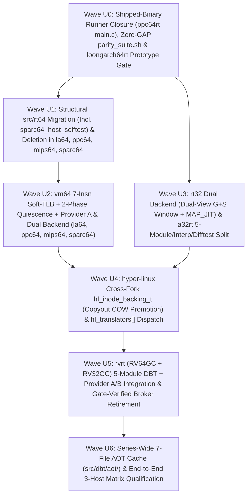

# `rt-series` Unification & Dual-Backend Architecture Plan

- **Copyright**: 2026 Moritz Angermann `<moritz@zw3rk.com>, zw3rk pte. ltd.`
- **License**: `Apache-2.0`
- **Date**: 2026-10-26 (Rev 3 — Hardened after fresh-context `astra` Reviews #1 and #2)
- **Review Records**:
  - Review #1: [`lode/reviews/2026-10-26-astra-unification-review.md`](../lode/reviews/2026-10-26-astra-unification-review.md) & [`dispositions`](../lode/reviews/2026-10-26-astra-unification-review-dispositions.md)
  - Review #2: [`lode/reviews/2026-10-26-astra-unification-review-2.md`](../lode/reviews/2026-10-26-astra-unification-review-2.md) & [`dispositions`](../lode/reviews/2026-10-26-astra-unification-review-2-dispositions.md)
- **Companion Documents**: [`README.md`](../README.md), [`SPEC.md`](../SPEC.md), [`PLAN.md`](../PLAN.md), [`docs/HOST-CONTRACT.md`](HOST-CONTRACT.md), [`docs/FEATURE-MATRIX.md`](FEATURE-MATRIX.md)

---

## 1. Executive Summary & Architectural Goals

Across Waves 1–4, the `zw3rk` translator family grew to **10 standalone repositories covering 11 guest Linux ABIs**:

| Generation | Repositories | Current Structural State |
|---|---|---|
| **Gen 1** (`a32rt`) | `a32rt` (`d84feb3`, 18 files, 18,369 LOC) | Flat `src/` layout + `include/a32host.h`; JIT (`src/jit.c`) + single-file AOT (`src/aot.c`, `Makefile:56`, `src/main.c:256`) + GDB stub (`src/gdb.c`); no reference interpreter (`--interp`) or `--difftest`; 7 files exceed 900 lines; Linux-only host syscalls (`svc #0` / `/dev/a32host`). |
| **Gen 2** (`rvrt`) | `rvrt` (`33385fc` / `ebba2ed`, 224 files, 66,452 LOC) | 8 subdirectories (`core/`, `fp/`, `jit/`, `aot/`, `loader/`, `memory/`, `linux/`, `runtime/`) + `include/rvrt.h` + `vendor/softfloat/` + `vendor/mbedtls/`; fragmented `family_p1..p7.c`, `file_caps_p1..p2.c`, `guest_memory_p1..p3.c`; ~30k LOC of user-space family MM/file/truncation/broker machinery used by both `-linux` and `-hl` suites; limited direct-ALU JIT (`src/jit/a64.c`, 11 integer opcodes, no block chaining/IBTC/RAS/Soft-TLB); `RV32GC` execution unqualified (`rvrt/docs/SUPPORT.md:18`). |
| **Gen 3** (`rt32`) | `i686rt` (`f40d6e3`, 73 files, 38,696 LOC), `mips32rt` (`aeaeeeb`, 37 files, 14,352 LOC), `ppc32rt` (`cab7ae6`, 50 files, 19,224 LOC), `sparc32rt` (`83b1f63`, 51 files, 16,093 LOC) | Clean 4-module layout (`src/rt32/`, `src/interp/`, `src/dbt/`, `src/os/`) + `include/a32host.h` with dual engines (`--interp`, `--dbt`, `--difftest`), block chaining, IBTC, RAS, and 4 GiB `[x20, wAddr, uxtw]` hardware memory lowering; currently bound to Linux host syscalls (`syscall(__NR_*)` / `svc #0`). |
| **Gen 3.5** (`rt64`) | `loongarch64rt` (`2064710`, 124 files, 44,046 LOC), `ppc64rt` (`70498a0`, 280 files, 68,135 LOC), `mips64rt` (`3ea43a7`, 123 files, 46,765 LOC), `sparc64rt` (`2bcf6d4`, 304 files, 78,868 LOC) | **Split-brain layout**: Phase 0 copied 81–252 files (168,783 total pinned LOC across the four `src/rt64/` trees) from `rvrt`, while Phases 1–7 implemented a Gen-3-style `src/core/` + `src/interp/` + `src/dbt/` + `src/os/` stack alongside it. Live dependencies on `src/rt64/` vary per repo (from 2 TUs in `loongarch64rt` to `host_contract*.c` + `sparc64_host_selftest` in `sparc64rt/src/main.c:17`), and `ppc64rt/src/main.c:99` is still a Phase-0 CLI stub (Phase 1–7 qualification ran through `tests/h3_run.sh` harness binaries). All four `rt64` DBTs currently call a C helper (`blr`) on every guest load/store in `emit_mem.c`. |

This plan defines the architecture and phased execution schedule to achieve **three overarching goals** without violating the zero-shared-library rule (`AGENTS.md` §2.1):

1. **Goal 1 — Uniform 5-Module Internal Architecture Across All 10 `<arch>rt` Translators**:
   - Align every repository (`a32rt`, `i686rt`, `mips32rt`, `ppc32rt`, `sparc32rt`, `rvrt`, `loongarch64rt`, `ppc64rt`, `mips64rt`, `sparc64rt`) onto a uniform 5-module internal layout (`src/core/`, `src/interp/`, `src/dbt/` [with `difftest.c` + `aot/`], `src/vm/`, `src/os/`), unified CLI surface (`--interp`, `--dbt`, `--difftest`, `--cache-dir`, `--pretranslate`), and ≤900-line Curated C11 file discipline.
   - Wire `ppc64rt/src/main.c` to its production runner, migrate the complete live dependency closure (including `sparc64_host_selftest`) out of `src/rt64/` in `loongarch64rt`, `ppc64rt`, `mips64rt`, and `sparc64rt`, delete the remaining `src/rt64/` trees, and upgrade 64-bit DBT memory lowering with an assembler- and mathematically-verified **7-instruction AArch64 Inline Soft-TLB** plus a two-phase stop-the-world worker quiescence protocol.
2. **Goal 2 — Consolidate macOS APFS / Inode / Truncation / Shared-Memory Semantics in `hyper-linux` (`hl`) While Preserving Native Linux Semantics**:
   - Extend `hyper-linux` (`be7721f`) from its current bounded RVRT carve-outs (`src/hl_file_identity.h`, `src/hl_posix_acl.h`, `src/rvrt_shared.h`, `src/rvrt_fsize_guest_bridge.h`, `src/rvrt_dir_broker.h`, `src/rvrt_scm_broker.h`, `src/fd_object.h`) into an inode-keyed VMM backing & truncation engine (`hl_inode_backing_t`, with cross-`fork_ipc` shared metadata and centralized host-copyout COW promotion) and a 10-translator dispatch table (`hl_translators[]`).
   - Simultaneously, provide a **host-page-bias-aware file-mapping + software guest-granule EOF/COW provider** in `src/vm/vm64.c` + `src/os/backend_linux.c` (with inode-to-DBT block invalidation on `ftruncate`/writes) so `rvrt` and the Class-B translators preserve exact 4 KiB/8 KiB guest file semantics on native 4K/16K/64K Linux kernels without `hl`.
3. **Goal 3 — Dual Host Backend (`backend_linux.c` vs `backend_darwin.c`) for Every `<arch>rt` Translator**:
   - Every `<arch>rt` repository builds two zero-dependency artifacts from the same source tree:
     - **Backend 1 (`_build/<arch>rt-linux-aarch64` via `src/os/backend_linux.c`)**: Static-PIE `aarch64-linux` musl ELF (`aarch64-unknown-linux-musl-gcc -static-pie`) running inside `hyper-linux` (`hl`) or directly on a native `aarch64-linux` kernel.
     - **Backend 2 (`_build/<arch>rt-darwin-arm64` via `src/os/backend_darwin.c`)**: Native macOS `arm64` Mach-O binary (`clang -target arm64-apple-macos13`) running guest Linux ELFs directly on macOS **with zero `Hypervisor.framework` dependency** via `libSystem`, `MAP_JIT` (`pthread_jit_write_protect_np`), and dual-view (`G` hardware-protected + `S` validated RW alias) sub-page mediation on 16 KiB hosts.

---

## 2. Target End-State Architecture

```text
                        ┌──────────────────────────────────────────────┐
                        │           Guest Linux ELF Binary             │
                        │  (arm32, i686, mips32, ppc32, sparc32,       │
                        │   rv32, rv64, la64, ppc64le, mips64, sparc64)│
                        └──────────────────────┬───────────────────────┘
                                               │
                                               ▼
┌──────────────────────────────────────────────────────────────────────────────────────────────┐
│                     UNIFIED <arch>rt TRANSLATOR ARCHITECTURE (All 10 Repos)                  │
│                                                                                              │
│  ┌────────────────────┐     ┌─────────────────────────────────────────────────────────────┐  │
│  │  1. src/core/      │     │  3. src/dbt/ (Dynamic Binary Translator + AOT Cache)        │  │
│  │  • cpu.h (ctx ABI) │     │  • dbt.c / a64_emit.c (block cache, chaining, IBTC, RAS)    │  │
│  │  • loader.c (ELF   │     │  • emit_int.c / emit_fp.c / emit_mem.c / emit_vec.c         │  │
│  │    + PT_INTERP)    │     │  • trampoline_a64.S (per-arch pinned ctx/base, x18 reserved)│  │
│  ├────────────────────┤     │  • difftest.c (--difftest lockstep interp vs DBT verifier)  │  │
│  │  2. src/interp/    │◄───►│  • aot/ (format, reader, writer, relocate, digest, auth)    │  │
│  │  • decode.c        │     └──────────────────────────────┬──────────────────────────────┘  │
│  │  • interp.c (pure  │                                    │                                 │
│  │    C11 oracle &    │                                    ▼                                 │
│  │    EXIT_UNDEF      │     ┌─────────────────────────────────────────────────────────────┐  │
│  │    fallback)       │     │  4. src/vm/ (Guest Virtual Address Space & Fault Recovery)  │  │
│  └────────────────────┘     │  • Class A (32-bit): vm32.c — 4 GiB window [x20, wAddr,uxtw]│  │
│                             │    (4K direct on 4K Linux/hl; Dual-View G+S shm/memfd alias │  │
│                             │     with N_sub=H/4096 intersection on 16K/64K hosts)        │  │
│                             │  • Class B (64-bit): vm64.c — VMA table + 7-insn Soft-TLB   │  │
│                             │    + 2-phase stop-the-world quiescence + inode block inval  │  │
│                             └──────────────────────────────┬──────────────────────────────┘  │
│                                                            │                                 │
│                                                            ▼                                 │
│  ┌────────────────────────────────────────────────────────────────────────────────────────┐  │
│  │  5. src/os/ (Guest Linux ABI Normalization — Common Across Both Backends)              │  │
│  │  • syscalls.c / syscalls_fs.c / syscalls_net.c / syscalls_mem.c                        │  │
│  │    (Validated copyin/copyout under syscall memory lease -> canonical rt_host_* calls)  │  │
│  │  • sigframe.c / signals.c (Sync fault PC recovery vs async siginfo_t + worker altstack)│  │
│  │  • threads.c / futex.c / exec.c (CLONE_VM threads, canonical rt_futex_key_t, execve)   │  │
│  └────────────────────────────┬───────────────────────────────────────────┬───────────────┘  │
│                               │                                           │                  │
│             Build Target A:   │                         Build Target B:   │                  │
│        _build/<arch>rt-linux  │                    _build/<arch>rt-darwin │                  │
│        (static-PIE aarch64)   ▼                    (macOS arm64 Mach-O)   ▼                  │
│  ┌─────────────────────────────────────────┐ ┌────────────────────────────────────────────┐  │
│  │  src/os/backend_linux.c                 │ │  src/os/backend_darwin.c                   │  │
│  │  • Raw Linux AArch64 `svc #0`           │ │  • Direct `blr` into macOS `libSystem.B`   │  │
│  │  • Signal-atomic `safe_syscall_a64.S`   │ │  • Signal-atomic park/commit gate          │  │
│  │  • Host-page-biased FD mmap + `/dev/...`│ │  • Linux->Darwin errno/open/stat/dirent/   │  │
│  │  • Host `mprotect` W^X + `IC IALLU`     │ │    sockaddr/kqueue/ulock + `MAP_JIT` APRR  │  │
│  └─────────┬──────────────────────┬────────┘ └──────────────────────┬─────────────────────┘  │
└────────────┼──────────────────────┼─────────────────────────────────┼────────────────────────┘
             │                      │                                 │
   (Mode 1a: Native)      (Mode 1b: VMM Guest)              (Mode 2: Standalone macOS)
             │                      │                                 │
             ▼                      ▼                                 │
┌─────────────────────┐  ┌─────────────────────────────────────────┐  │
│ Native AArch64      │  │           hyper-linux (`hl`)            │  │
│ Linux Host Kernel   │  │     (Hardware HVF VM + Unified VFS)     │  │
│                     │  │                                         │  │
│ • Hardware 4K/16K/  │  │ • Guest EL1 Stage-1 4 KiB page tables   │  │
│   64K MMU + VFS     │  │   over HVF Stage-2 primary/shared arenas│  │
│ • Native ext4/tmpfs │  │ • `hl_translators[]` auto-dispatch for  │  │
│   mmap & truncate   │  │   all 11 EM_* guest architectures       │  │
│ • Native namespaces │  │ • Cross-fork `hl_inode_backing_t` (COW  │  │
└─────────────────────┘  │   promotion on fault & host copyout)    │  │
                         │ • APFS FID, conservative ACLs, brokers  │  │
                         └────────────────────┬────────────────────┘  │
                                              │                       │
                                              ▼                       ▼
                         ┌──────────────────────────────────────────────────────────────────┐
                         │                macOS Kernel (XNU / Apple Silicon)                │
                         └──────────────────────────────────────────────────────────────────┘
```

---

## 3. Reproducible Baseline Audit Across All 11 Sibling Repositories

All file counts and line counts below are reproducibly measured from **pinned Git tree blobs** (never working-tree files) under `src/` and `include/` using (`astra` Review #2 `B13`):

```sh
python3 -c '
import subprocess
for repo, rev in [
    ("a32rt","d84feb3"), ("i686rt","f40d6e3"), ("rvrt","33385fc"),
    ("mips32rt","aeaeeeb"), ("ppc32rt","cab7ae6"), ("sparc32rt","83b1f63"),
    ("loongarch64rt","2064710"), ("ppc64rt","70498a0"), ("mips64rt","3ea43a7"),
    ("sparc64rt","2bcf6d4"), ("hyper-linux","be7721f")
]:
    paths = [p for p in subprocess.check_output(
        ["git", "-C", f"../{repo}", "ls-tree", "-r", "--name-only", rev, "src", "include"],
        text=True).splitlines() if p.endswith((".c", ".h", ".S"))]
    loc = sum(subprocess.check_output(["git", "-C", f"../{repo}", "show", f"{rev}:{p}"]).count(b"\n") for p in paths)
    print(f"{repo:15s} {rev}  files={len(paths):3d}  loc={loc:7d}")
'
```

| Repository | Pinned Commit | Total Pinned Files (`src/` + `include/`) | Total Pinned LOC (`src/` + `include/`) | Pinned `src/rt64/` Donor Partition (Files / LOC) | Active Non-`rt64` Partition (Files / LOC) | Current Layout, Live `rt64` Closure & Gaps |
|---|---|---:|---:|---:|---:|---|
| `rt-series` | `6608ba9` | — | — | — | — | Master spec, host contract, wave task cards, feature matrix, unification plan. |
| `a32rt` | `d84feb3` | 18 | 18,369 | 0 / 0 | 18 / 18,369 | Flat `src/` + `include/a32host.h`. Has JIT (`src/jit.c`), single-file AOT (`src/aot.c`, `Makefile:56`, `src/main.c:256`), and GDB stub (`src/gdb.c`). **7 files exceed 900 lines**: `src/syscalls.c` (4,330), `src/vfp_neon.c` (2,036), `src/a64_emit.c` (1,946), `src/decode_t32.c` (1,824), `src/jit.c` (1,740), `src/decode_a32.c` (1,118), `src/aot.c` (939). Missing `src/interp/`, `--difftest`, `backend_darwin.c`. |
| `i686rt` | `f40d6e3` | 73 | 38,696 | 0 / 0 | 73 / 38,696 | 4-module `src/{rt32,interp,dbt,os}/` + `include/a32host.h`. Has `--interp`, `--dbt`, `--difftest`. Missing `src/dbt/aot/`, `backend_darwin.c`. |
| `mips32rt` | `aeaeeeb` | 37 | 14,352 | 0 / 0 | 37 / 14,352 | 4-module `src/{rt32,interp,dbt,os}/` + `include/a32host.h`. All files ≤900 lines. Missing `src/dbt/aot/`, `backend_darwin.c`. |
| `ppc32rt` | `cab7ae6` | 50 | 19,224 | 0 / 0 | 50 / 19,224 | 4-module `src/{rt32,interp,dbt,os}/` + `include/a32host.h`. All files ≤900 lines. Missing `src/dbt/aot/`, `backend_darwin.c`. |
| `sparc32rt` | `83b1f63` | 51 | 16,093 | 0 / 0 | 51 / 16,093 | 4-module `src/{rt32,interp,dbt,os}/` + `include/a32host.h`. All files ≤900 lines. Missing `src/dbt/aot/`, `backend_darwin.c`. |
| `rvrt` | `33385fc` (advanced in `%113`) | 224 | 66,452 | — (donor) | 224 / 66,452 | 8 subdirectories (`core/`, `fp/`, `jit/`, `aot/`, `loader/`, `memory/`, `linux/`, `runtime/`) + `include/rvrt.h` + `vendor/{softfloat,mbedtls}`. Contains 75 files (30,450 LOC) in `src/runtime/`, 42 files (11,179 LOC) in `src/linux/`, 12 files (5,137 LOC) in `src/memory/`. Direct-ALU-only JIT (`src/jit/a64.c`, 635 LOC); no `--difftest`; `RV32GC` execution unqualified (`rvrt/docs/SUPPORT.md:18`). |
| `loongarch64rt` | `2064710` | 124 | 44,046 | **81 / 27,969** | 43 / 16,077 | Only 2 `src/rt64/` files (`src/rt64/runtime/worker_loop.c`, `src/rt64/linux/signal_core.c`) are linked in `loongarch64rt/Makefile:51-54`. `src/dbt/dbt.c:146-189` uses `MAP_JIT` on Darwin but erroneously calls `mprotect(..., PROT_READ\|PROT_EXEC)` on `MAP_JIT` pages and leaves `pthread_jit_write_protect_np(0)` (writable) at the end of `dbt_seal_page`. |
| `mips64rt` | `3ea43a7` | 123 | 46,765 | **81 / 28,355** | 42 / 18,410 | Only 5 `src/rt64/` files (`sha256.c`, `identity.c`, `family_broker.c`, `worker_loop.c`, `signal_core.c`) are linked in `mips64rt/Makefile:36-40`. `src/dbt/dbt.c:97` rounds JIT code pages to host page size (`sysconf(_SC_PAGESIZE)`) and uses `mprotect`. |
| `ppc64rt` | `70498a0` | 280 | 68,135 | **242 / 54,930** | 38 / 13,205 | `ppc64rt/Makefile:46` compiles all non-excluded `src/rt64/` files, but **critical gap**: `ppc64rt/src/main.c:99` is still the Phase-0 CLI stub (`(guest execution lands in Phase 1)`, returning 2); Phases 1–7 qualified execution via separate harness binaries (`ppc64rt/tests/h3_run.sh:292`). `src/dbt/cache.c:33` queries `_SC_PAGESIZE` and uses `mprotect`. |
| `sparc64rt` | `2bcf6d4` | 304 | 78,868 | **252 / 57,529** | 52 / 21,339 | **Live `src/rt64/` closure**: `sparc64rt/src/main.c:17` includes `runtime/host_contract.h` and calls `sparc64_host_parse`, `sparc64_host_selftest` (which invokes `host_contract_identity.c:707` -> family creation verifier at `host_contract_identity.c:452`, asserted by `tests/check_host_contract.sh:433`), `sparc64_host_check_authorities`, `sparc64_host_apply_sysroot`, `sparc64_host_resolve_image`, `sparc64_host_cache_admit`, and `sparc64_host_report_stats`. `include/a32host.h:86` already provides `a32h_page_round` host-page rounding, and `src/os/guest_run_priv.h:39` advertises an **8 KiB guest ABI page size** (`SPARC64_PAGE_SIZE = 8192`). |
| `hyper-linux` | `be7721f` | 182 | 141,338 | — | 182 / 141,338 | Full VMM + syscall layer (`src/` + `include/`). Enforces 4 KiB permissions via guest EL1 **Stage-1** page tables (`src/guest.c:27,325`) over an RWX Stage-2 primary slab. Contains `hl_file_identity.[ch]`, `hl_posix_acl.[ch]` (conservative ACL synthesis rejecting native Darwin ACLs per `src/hl_posix_acl.h:18`), `fd_object.[ch]`, `fork_ipc.[ch]`, and 38 `rvrt_*` files. |

*Note*: Across `loongarch64rt`, `mips64rt`, `ppc64rt`, and `sparc64rt`, the four carried `src/rt64/` donor trees total exactly **656 files / 168,783 pinned LOC** (`27,969 + 28,355 + 54,930 + 57,529`).

---

## 4. Pillar 1: Uniform 5-Module `<arch>rt` Layout, Register Conventions & Soft-TLB Architecture

Every `<arch>rt` repository remains a **standalone, zero-external-dependency repository** conforming to the 5-module internal layout (`src/core/`, `src/interp/`, `src/dbt/`, `src/vm/`, `src/os/`).

### 4.1 Verified Per-Engine AArch64 Register Conventions (`astra` Review #2 `B9`)

The table below records the **exact current register conventions** verified from each repository's `trampoline_a64.S` / `dbt.h` / `a64_emit.h`, and distinguishes preserved conventions from the targeted `x20` Soft-TLB base assignment in Class-B engines:

| Translator | Current Context Register (`reg_ctx`) | Current Memory / Window Register | Other Pinned Registers inside Emitted Code | Planned Unification Action |
|---|---|---|---|---|
| `a32rt` ([`a64_emit.h:20-36`](file:///Users/angerman/Projects/zw3rk/a32rt/src/a64_emit.h#L20-L36)) | `x19` (`A64_XCTX`) | `x20` (`A64_XG` 4 GiB window) | `w0..w14` = guest `r0..r14`; `x15..x17, x21, x22` = scratch/addr; `x23..x28` = chain/epoch/thumb; `v8..v31` = VFP cache | **Preserve as-is**. `x18` hard-blocked. |
| `i686rt` ([`emit.h:7`](file:///Users/angerman/Projects/zw3rk/i686rt/src/dbt/emit.h#L7)) | `x19` (`i686_ctx_t *`) | `x20` (`guest_base` 4 GiB window) | `w0..w7` = guest `eax..edi`; `x21` = lazy flags | **Preserve as-is**. `x18` hard-blocked. |
| `mips32rt`, `ppc32rt`, `sparc32rt` ([`ppc32rt/dbt.h:43`](file:///Users/angerman/Projects/zw3rk/ppc32rt/src/dbt/dbt.h#L43)) | `x19` (`<arch>_ctx_t *`) | `x20` (`guest_base` 4 GiB window) | `x28` = `&dbt->epoch` chaining epoch; `x15/w16` = exit PC/reason | **Preserve as-is**. `x18` hard-blocked. |
| `loongarch64rt` ([`trampoline_a64.S:35`](file:///Users/angerman/Projects/zw3rk/loongarch64rt/src/dbt/trampoline_a64.S#L35)) | `x28` (`la64_ctx_t *`) | None (uses `blr` C helper) | `x19..x27` saved in prologue, unused by emitter | **Keep `x28 = ctx`**; bind unused callee-saved **`x20 = &ctx->tlb[0]`** in `trampoline_a64.S`. |
| `mips64rt` ([`dbt.h:13`](file:///Users/angerman/Projects/zw3rk/mips64rt/src/dbt/dbt.h#L13)) | `x19` (`mips64_ctx_t *`) | `x20` (`guest_base`) | `x21..x28` saved in prologue | **Keep `x19 = ctx`**; repurpose **`x20 = &ctx->tlb[0]`** in `trampoline_a64.S` & `emit_mem.c`. |
| `sparc64rt` ([`trampoline_a64.S:12-44`](file:///Users/angerman/Projects/zw3rk/sparc64rt/src/dbt/trampoline_a64.S#L12-L44)) | `x19` (`sparc64_ctx_t *`) | None (uses `blr` C helper) | `x27` = chain entry; `x28` = `&dbt->epoch`; `x15` = exit PC; `w16` = exit reason; `x20` saved in prologue, unused by emitter | **Keep `x19 = ctx`, `x27 = chain`, `x28 = epoch`**; bind unused callee-saved **`x20 = &ctx->tlb[0]`** in `trampoline_a64.S`. |
| `ppc64rt` ([`trampoline_a64.S:10-42`](file:///Users/angerman/Projects/zw3rk/ppc64rt/src/dbt/trampoline_a64.S#L10-L42)) | `x0` (`cpu`, caller-saved!) | `x1 = mem_ops, x2 = mem_ctx` | `x19..x28` saved in prologue (`trampoline_a64.S:26-30`), currently unused by emitted blocks | **Migrate in Wave U2**: pin `x19 = cpu` and `x20 = &cpu->tlb[0]` in `ppc64_dbt_enter` prologue (updating `emit_*.c` and bumping AOT emitter version ID). |
| `rvrt` (Wave U5 Full DBT) | `x19` (`rv_ctx_t *`) | `x20` (`&ctx->tlb[0]`) | `x27` = chain entry; `x28` = `&dbt->epoch` | Adopt the `sparc64rt`/`mips64rt` (`x19 = ctx, x20 = tlb, x28 = epoch`) convention and bump `rvrt` AOT emitter identity (`v3 -> v4`). |

### 4.2 Guest ABI Page Size vs Translation Granule vs Host Kernel Page Size (`astra` Review #2 `B5`)

1. **Guest ABI Page Size (`GUEST_ABI_PAGE_SIZE`)**: `8192` (8 KiB) on `sparc64rt` (`src/os/guest_run_priv.h:39`); `4096` (4 KiB) on the other 9 translators. All guest `mmap`, `mprotect`, `munmap`, and EOF page-rounding rules (`align_up(file_size, GUEST_ABI_PAGE_SIZE)`) use `GUEST_ABI_PAGE_SIZE`.
2. **Software Translation & Protection Granule (`RT_TRANSLATION_GRANULE = 4096`)**: The 4 KiB page granularity of the Soft-TLB (`vm64.c`) and the Class-A sub-page permission array (`vm32.c`). On `sparc64rt`, each 8 KiB guest page populates two consecutive 4 KiB Soft-TLB entries.
3. **Host Kernel Page Size (`H = rt_host_page_size()`)**: Dynamically queried via `sysconf(_SC_PAGESIZE)` on **both** Linux and Darwin (`4096`, `16384`, or `65536`). The number of 4 KiB sub-pages per host page is dynamically computed as `N_sub = H / 4096` (`1`, `4`, or `16`, with mask `N_sub - 1`), never hardcoded to `4` or `& 3`.

### 4.3 Complete Load & Store Listings, Signed/BE Variants & Miss-Stub Contract (`astra` Review #2 `B2`, `B3`, `B4`, `B6`)

#### 1. Soft-TLB Entry Layout (32 Bytes per Entry)

```c
#define RT64_TLB_BITS 12u
#define RT64_TLB_SIZE (1u << RT64_TLB_BITS) /* 4096 entries = 128 KiB per thread */
#define RT64_TLB_INVALID_TAG (~UINT64_C(0)) /* Low bits [11:0] = 0xFFF -> never matches */

typedef struct {
    uint64_t  read_tag;  /* Offset  0: (gva & ~0xFFFULL) if PROT_READ & < EOF, else ~0ULL  */
    uintptr_t addend;    /* Offset  8: (uintptr_t)host_page_base - (gva & ~0xFFFULL)       */
    uint64_t  write_tag; /* Offset 16: (gva & ~0xFFFULL) if PROT_WRITE & !cow_clean & !smc */
    uintptr_t pad;       /* Offset 24: reserved / VMA generation witness                   */
} rt64_tlb_entry_t;
_Static_assert(sizeof(rt64_tlb_entry_t) == 32, "Soft-TLB entry must be 32 bytes");
```

#### 2. Complete Load vs. Store Fast-Path Listings (`B3`, `B4`)

Because `read_tag` is at offset `0`, `addend` is at offset `8`, and `write_tag` is at offset `16`:
- **Loads** use `ldp x2, x3, [x2, #0]` -> `x2 = read_tag`, `x3 = addend`.
- **Stores** use `ldp x3, x2, [x2, #8]` -> `x3 = addend`, `x2 = write_tag` (note the swapped destination pair `x3, x2` so `x2` still receives the tag and `x3` still receives `addend`!).
- The store value register (`x0` below) is strictly disjoint from `reg_addr` (`x1`) and the lookup scratch registers (`x2, x3, x4`), so instructions 1–6 preserve `x0` untouched into both instruction 7 (`str`) and `.L_tlb_miss_site_k`.

```armasm
// --- 7-INSTRUCTION LOAD FAST PATH (N in {1,2,4,8}; example N=8, x1=gva, x0=dst) ---
    ubfx  x2, x1, #12, #12                  // 1. x2 = (gva >> 12) & 0xFFF
    add   x2, x20, x2, lsl #5               // 2. x2 = &ctx->tlb[index]
    ldp   x2, x3, [x2, #0]                  // 3. x2 = read_tag (+0), x3 = addend (+8)
    and   x4, x1, #0xfffffffffffff007       // 4. (bic x4, x1, #(0xfff - (N-1)))
    sub   x4, x4, x2                        // 5. 0 iff (VPN == read_tag) && ((gva & (N-1)) == 0)
    cbnz  x4, .L_tlb_miss_site_k            // 6. jump to per-site cold stub on miss/misalign
.L_tlb_mem_insn_k:
    ldr   x0, [x1, x3]                      // 7. host load (see signed/BE table below)
.L_tlb_cont_k:

// --- 7-INSTRUCTION STORE FAST PATH (N in {1,2,4,8}; example N=8, x1=gva, x0=val) ---
    ubfx  x2, x1, #12, #12                  // 1. x2 = (gva >> 12) & 0xFFF
    add   x2, x20, x2, lsl #5               // 2. x2 = &ctx->tlb[index]
    ldp   x3, x2, [x2, #8]                  // 3. x3 = addend (+8), x2 = write_tag (+16) [SWAPPED!]
    and   x4, x1, #0xfffffffffffff007       // 4. (bic x4, x1, #(0xfff - (N-1)))
    sub   x4, x4, x2                        // 5. 0 iff (VPN == write_tag) && ((gva & (N-1)) == 0)
    cbnz  x4, .L_tlb_miss_site_k            // 6. jump to per-site cold stub (x0 and x1 intact!)
.L_tlb_mem_insn_k:
    str   x0, [x1, x3]                      // 7. host store (for BE stores, rev into x4 after step 5)
.L_tlb_cont_k:
```

**Frozen Instruction-7 Lowering Table by Width, Signedness & Endianness (`B4`)**:

| Access Kind | Little-Endian (`rvrt`, `loongarch64rt`, `ppc64rt` natural) | Big-Endian (`mips64rt`, `sparc64rt`, `ppc64rt` byte-reversed) |
|---|---|---|
| **U8 Load** | `ldrb w0, [x1, x3]` | `ldrb w0, [x1, x3]` |
| **S8 Load (to 64-bit reg)** | `ldrsb x0, [x1, x3]` | `ldrsb x0, [x1, x3]` |
| **U16 Load** | `ldrh w0, [x1, x3]` | `ldrh w0, [x1, x3]` ; `rev16 w0, w0` |
| **S16 Load (to 64-bit reg)** | `ldrsh x0, [x1, x3]` | `ldrh w0, [x1, x3]` ; `rev16 w0, w0` ; `sxth x0, w0` |
| **U32 Load** | `ldr w0, [x1, x3]` | `ldr w0, [x1, x3]` ; `rev w0, w0` |
| **S32 Load (to 64-bit reg)** | `ldrsw x0, [x1, x3]` | `ldr w0, [x1, x3]` ; `rev w0, w0` ; `sxtw x0, w0` |
| **U64 / S64 Load** | `ldr x0, [x1, x3]` | `ldr x0, [x1, x3]` ; `rev x0, x0` |
| **8/16/32/64-bit Store** | `strb w0` / `strh w0` / `str w0` / `str x0, [x1, x3]` | `rev16 w4, w0` / `rev w4, w0` / `rev x4, x0` (after `cbnz`) ; `strh w4` / `str w4` / `str x4, [x1, x3]` (preserves `x0`!) |

#### 3. Per-Site Miss Stub & Hardware Fault PC-Recovery Contract (`B4`)

Every emitted memory operation `k` in a translated block emits a cold out-of-line stub `.L_tlb_miss_site_k` at the end of the block and registers an entry in the block's compact **Memory Site Recovery Table (`dbt_mem_site_t`)**:

```c
typedef struct {
    uint32_t host_insn_offset; /* Byte offset of .L_tlb_mem_insn_k from block->rx_code */
    uint32_t cont_insn_offset; /* Byte offset of .L_tlb_cont_k from block->rx_code     */
    uint64_t guest_pc;         /* Exact faulting guest PC                              */
    uint64_t guest_npc;        /* Exact next/delay-slot PC (MIPS64 / SPARC64)          */
    uint32_t insn_word;        /* Raw guest instruction word                           */
    uint8_t  width;            /* 1, 2, 4, or 8                                        */
    uint8_t  flags;            /* MEM_SITE_STORE | MEM_SITE_SIGNED | MEM_SITE_BE | MEM_SITE_IN_DELAY_SLOT */
    uint8_t  val_or_dst_reg;   /* Host/guest register index for load result / store val */
    uint8_t  addr_reg;         /* Host register holding gva                            */
} dbt_mem_site_t;
```

- **Cold Miss Stub (`.L_tlb_miss_site_k`)**:
  1. Preserves caller-saved registers (`x0..x17`, `x30`, and `NZCV` via `mrs x15, nzcv`) and calls `vm64_tlb_miss_helper(ctx, gva, val, &block->sites[k])`.
  2. **Case 1 (Aligned TLB Fill / COW Promotion / SMC Invalidation)**: `vm64_tlb_miss_helper` fills `ctx->tlb[index]` (or promotes a `COW_CLEAN` page to `COW_DIRTY`, or invalidates translated blocks on a watched code page and marks the current block stale if self-modified), performs the load/store, writes the loaded value (if a load) to the saved register slot, restores `NZCV`/registers, and jumps to `.L_tlb_cont_k` (or exits to dispatcher if self-modifying code invalidated the current block).
  3. **Case 2 (Unaligned or Cross-Page Access)**: On architectures forbidding unaligned access (`sparc64rt`, strict `mips64rt`), commits `ctx->pc = site->guest_pc` (plus `npc`/delay-slot state), sets `ctx->fault_addr = gva`, and returns `EXIT_FAULT_BUS_ADRALN`. On architectures permitting unaligned access (`loongarch64rt`, `ppc64rt`, `rvrt`), validates **both** touched 4 KiB pages before reading/writing any bytes; if either page faults, commits `ctx->pc` with zero partial memory mutation and returns `EXIT_FAULT`.
- **Hardware Fault at `.L_tlb_mem_insn_k` (Instruction 7)**:
  - If a host `SIGSEGV` or `SIGBUS` occurs at `.L_tlb_mem_insn_k` (e.g., native Linux kernel `SIGBUS` on a concurrently truncated `MAP_SHARED` file), `signals.c` binary-searches the active block's `dbt_mem_site_t` table by `host_pc`, reconstructs `ctx->pc = site->guest_pc` and `ctx->npc = site->guest_npc` (leaving the guest destination register unmodified), and delivers the guest `SIGBUS`/`SIGSEGV`.

#### 4. Two-Phase Stop-The-World Quiescence & Inode-to-Block Invalidation Transaction (`B2`, `B6`)

To prevent any worker from refilling its Soft-TLB from a mutating VMA table, executing stale translated blocks from a truncated/written executable file, or racing with host `munmap` while blocked in a syscall (`B2`, `B6`):

1. **Worker Execution States & Syscall Memory Leases**:
   - Every worker thread `ctx` transitions atomically between three states:
     - `RT_WORKER_RUNNING`: executing guest code in DBT or interpreter;
     - `RT_WORKER_SYSCALL_LEASE`: inside a host syscall that reads/writes guest memory (protected by an active reader lease `ctx->lease_active = 1`);
     - `RT_WORKER_PARKED`: safe-point parked (inside a blocking syscall with zero guest memory pointers held, or parked on `g_vm_park_cond`).
   - **Rule for Blocking Syscalls**: Any potentially blocking syscall (`read`/`write` on pipe/socket/FIFO/tty, `recvfrom`, `ppoll`, `epoll_pwait`, `futex`) **never holds a raw guest pointer across the blocking host call**. It either stages through a thread-local bounce buffer or drops `RT_WORKER_SYSCALL_LEASE -> RT_WORKER_PARKED` before blocking, and re-acquires `RT_WORKER_SYSCALL_LEASE` (re-validating the target VMA!) before copying out to guest memory.
2. **5-Step Stop-The-World Mutation & Block-Invalidation Transaction**:
   Whenever `munmap`, `mprotect`, `mremap`, `ftruncate`/`truncate`/`openat(O_TRUNC)`, or a write to a watched executable file occurs:
   - **Step 1 (Begin Transaction)**: Acquire `g_vm_mutation_lock` and set `atomic_store(&g_vm_mutating, 1)`. Any worker entering `.L_tlb_miss_site_k`, `interp_step`, or `worker_enter_syscall_lease()` observes `g_vm_mutating != 0` and immediately parks on `g_vm_park_cond` (**preventing any Soft-TLB refill during mutation**).
   - **Step 2 (Park & Drain All Sibling Workers)**: Set `atomic_store(&peer->yield_requested, 1)` on all active workers and wait until every sibling worker has reached `RT_WORKER_PARKED` and `lease_active == 0`.
   - **Step 3 (Mutate VMA / Inode State & Invalidate Dependent DBT Blocks)**:
     - Update the VMA / sub-page / inode `file_size` and `backing_generation`.
     - If the mutation shrinks, unmaps, removes `PROT_EXEC`, or modifies an executable file backing `(inode_id, [start_off, end_off))`, scan the DBT block table’s `(backing_inode_id, file_offset_start, file_offset_end)` index and invalidate every overlapping `dbt_block_t`, unlinking direct block chains and clearing IBTC/RAS entries (`B6`).
     - Flush every worker's `ctx->tlb[]` directly while all workers are parked and increment `g_vm_tlb_epoch`.
   - **Step 4 (Reclaim / Update Host Mappings)**: Execute host `mprotect` / `munmap` / `ftruncate` while zero workers or syscall leases can reference the old host backing.
   - **Step 5 (Release Transaction)**: Set `atomic_store(&g_vm_mutating, 0)` and broadcast `g_vm_park_cond` so parked workers resume against the new VMA/TLB state.

### 4.4 Class-A (`vm32.c`) Dual-View Backing (`G` + `S`) on 16/64 KiB Host Pages (`astra` Review #2 `B1`, `B5`, `B14`)

To solve `astra` Critical `B1` (where narrowing a 16 KiB or 64 KiB host page in the 4 GiB window `[G, G+4GiB)` to `PROT_READ` or `PROT_NONE` causes host syscalls like `read`/`pread64`/`recvfrom` or `interp_step` to fault with `EFAULT`/`SIGSEGV` when accessing a valid writable 4 KiB neighbor sub-page):

1. **Dynamic Sub-Page Array (`N_sub = rt_host_page_size() / 4096`)**:
   - On 4 KiB hosts (`N_sub == 1`), `vm32.c` uses a single 4 GiB window `[G, G + 4 GiB)` with direct hardware 4 KiB `mprotect`.
   - On >4 KiB hosts (`N_sub == 4` on 16 KiB Darwin/Linux; `N_sub == 16` on 64 KiB Linux), `vm32.c` tracks permissions per 4 KiB guest page (`uint8_t vma_page_prot[1048576]`, 1 MiB total for the entire 4 GiB space) and computes the host page's hardware protection as the intersection across all `N_sub` sub-pages:
     ```c
     int host_prot = vma_page_prot[base_vpn];
     for (size_t i = 1; i < n_sub; ++i)
         host_prot &= vma_page_prot[base_vpn + i];
     ```
2. **Dual-View Shared-Backing Alias (`G` = Hardware-Protected DBT Window, `S` = Validated RW Alias Window)**:
   - On >4 KiB hosts, the 4 GiB guest memory backing is allocated from a shared memory object (`shm_open` / `mach_vm_remap` on Darwin; `memfd_create` on 16K/64K Linux) mapped `MAP_SHARED` at **two disjoint 4 GiB virtual address ranges** in the translator process:
     - **`G` (`x20`, `[G, G + 4 GiB)`)**: Protected per host page with the intersection `host_prot`. Emitted DBT `[x20, wAddr, uxtw]` loads and stores execute directly against `G`.
     - **`S` (`ctx->rw_alias_base`, `[S, S + 4 GiB)`)**: Mapped `PROT_READ | PROT_WRITE` over the **exact same underlying physical pages** as `G` (for all mapped guest pages).
3. **Complete Coverage of Syscalls, Interpreter, Instruction Fetch, Futex & Signal Frames via `S`**:
   - **Syscall Copyin/Copyout & Kernel I/O (`read`, `write`, `pread64`, `pwrite64`, `recvfrom`, `getdents64`)**:
     - Under the `RT_WORKER_SYSCALL_LEASE` (§4.3.4), `vm32_validate_range(gva, len, req_prot)` checks `vma_page_prot[vpn]` for every 4 KiB guest page in `[gva, gva + len)`.
     - If the entire buffer is valid, `syscalls.c` passes **`S + gva`** (the `PROT_READ | PROT_WRITE` alias!) to the host kernel (`rt_host_read`, `rt_host_pread64`, `rt_host_recvfrom`, `memcpy`), so the host kernel **never hits a narrowed `PROT_READ`/`PROT_NONE` host page in `G`**!
     - If a buffer passed to `read`/`pread64`/`write` starts in valid 4 KiB pages and crosses into an unmapped/unwritable 4 KiB page mid-buffer, `vm32.c` clamps the I/O length to the valid 4 KiB prefix (matching Linux partial-transfer semantics before returning `EFAULT` when the prefix is 0 bytes).
   - **Mixed-Page DBT Fault -> Single-Step Interpreter via `S`**:
     - When a DBT instruction accesses `[x20, wAddr, uxtw]` (`G + gva`) on a mixed-permission host page whose `host_prot` is narrower than `vma_page_prot[gva >> 12]`, the hardware traps into `signals.c`.
     - `signals.c` checks `vma_page_prot[gva >> 12]`: if disallowed, it delivers the guest `SIGSEGV`; if allowed, it reconstructs the guest PC via the block's `dbt_mem_site_t` table and executes one `interp_step(ctx)`.
     - Because `interp_step`, instruction fetch, futex, and `sigframe.c` validate `vma_page_prot[vpn]` in software and read/write **`S + gva`**, `interp_step` completes atomically against the coherent physical page without ever faulting or widening `G`'s protection!
   - *(Instrumentation requirement, `B14`)*: Wave U3 instruments `ctx->stats.mixed_page_traps` vs total memory accesses rather than assuming an unmeasured uniform-page percentage.

---

## 5. Pillar 2: Inode/Truncation/Shared-Memory Providers Across Native Linux and `hyper-linux`

### 5.1 Provider A: Host-Page-Biased File Mapping + Software Guest-Granule EOF/COW (`vm64.c` on Native Linux & Darwin, `astra` Review #2 `B5`, `B6`)

To support 4 KiB/8 KiB guest file mappings (`MAP_SHARED` and `MAP_PRIVATE`) across **all** host page sizes (`4 KiB`, `16 KiB`, `64 KiB` Linux and `16 KiB` Darwin) without `rvrt`'s 30k-LOC user-space family broker:

1. **Host-Page-Biased File Mapping (`bias = file_offset & (rt_host_page_size() - 1)`)**:
   - When a guest calls `mmap(gva, len, prot, flags, guest_fd, file_offset)` where `file_offset` is aligned to `GUEST_ABI_PAGE_SIZE` (4 KiB / 8 KiB) but not to `H = rt_host_page_size()` (16 KiB / 64 KiB), `vm64.c` rounds `aligned_off = file_offset & ~(H - 1)` and `bias = file_offset - aligned_off` (matching the proven pattern in [`hyper-linux/src/rvrt_shared.c:94`](file:///Users/angerman/Projects/zw3rk/hyper-linux/src/rvrt_shared.c#L94)), maps `rt_host_map_file(..., aligned_off)`, and sets the VMA's host pointer for guest page `p` to `host_map_base + bias + (p - vma_start)`.
2. **Software Guest-Granule EOF & Clean/Dirty `MAP_PRIVATE` Enforcement in `vm64.c`**:
   - Relying on the host kernel's `SIGBUS` or host-page COW alone is insufficient when `rt_host_page_size() > GUEST_ABI_PAGE_SIZE` (`B5`, because offset `8192` of a file shrunk to `4096` bytes still lies inside the first 16 KiB host page!).
   - Therefore, `vm64.c` maintains an in-process inode table (`vm64_inode_t`, keyed by `(st_dev, st_ino)`) tracking `file_size`, `backing_generation`, and per-4 KiB-page state (`PAGE_SHARED`, `PAGE_COW_CLEAN`, `PAGE_COW_DIRTY`):
     - **Soft-TLB EOF Guard**: `.L_tlb_miss_site_k` and `vm64_validate_range()` check `page_file_offset >= align_up(inode->file_size, GUEST_ABI_PAGE_SIZE)`. Any access to a whole removed 4 KiB/8 KiB guest page past EOF immediately raises guest `SIGBUS` (`BUS_ADRERR`) (or `EFAULT` in syscall copyin/copyout), even on 16 KiB / 64 KiB hosts!
     - **4 KiB `PAGE_COW_CLEAN` -> `PAGE_COW_DIRTY` Promotion**: Every writable `MAP_PRIVATE` file page starts as `PAGE_COW_CLEAN` with `write_tag = ~0ULL` in the Soft-TLB. On the first guest store (via `.L_tlb_miss_site_k`) **or** the first host syscall copyout (`vm64_copyout`), `vm64.c` copies that 4 KiB guest page into a dedicated private anonymous 4 KiB slot, marks it `PAGE_COW_DIRTY`, and enables `write_tag` pointing at the private copy.
     - **Truncate Reconciliation (`ftruncate` / `truncate` / `openat(O_TRUNC)`)**: Runs the **5-Step Stop-The-World Transaction (§4.3.4)**: updates `inode->file_size`, invalidates any overlapping `PROT_EXEC` DBT blocks (`B6`), zeroes trailing bytes `[new_size, align_up(new_size, 4096))` on `PAGE_SHARED` and `PAGE_COW_CLEAN` pages while **leaving `PAGE_COW_DIRTY` partial final pages untouched**, and flushes all Soft-TLB entries for removed pages `>= align_up(new_size, GUEST_ABI_PAGE_SIZE)`.

### 5.2 Provider B: Cross-`fork_ipc` `hl_inode_backing_t` & Centralized Copyout COW Promotion in `hyper-linux` (`astra` Review #2 `B7`, `B8`)

Inside `hyper-linux` (`hl`), where guests execute in HVF VMs with guest EL1 Stage-1 4 KiB page tables and `fork()` spawns a child `hl` process over `src/fork_ipc.c`:

1. **Cross-`fork_ipc` Shared Inode Authority (`hl_inode_backing_t`, `B7`)**:
   - Each `hl_inode_backing_t` (keyed by 16-byte APFS `hl_apfs_fid_t` from `src/hl_file_identity.h` or `(dev, ino)` for memfds) allocates a 4 KiB host `MAP_SHARED` control block (`hl_inode_ctrl_t`) containing `_Atomic uint64_t file_size`, `_Atomic uint64_t size_generation`, `_Atomic uint64_t code_generation`, and a lock/futex word.
   - Across `fork_ipc.c` (`src/fork_ipc.c:1620`), the parent exports:
     1. The `hl_inode_ctrl_t` shared descriptor via `SCM_RIGHTS` (so parent and child VMs observe the **same** atomic `file_size` and `size_generation`), and
     2. The per-4 KiB-page `PTE_COW_CLEAN` vs `PTE_COW_DIRTY` bitmap in the `guest_region_t` fork wire record (so a page dirtied by the parent before `fork()` remains `PTE_COW_DIRTY` in both parent and child, while post-fork writes promote independently).
   - **Cross-Process Truncate Invalidation**: When any `hl` process in a fork family executes `ftruncate` / `truncate` / `openat(O_TRUNC)`:
     - It updates `ctrl->file_size` and increments `ctrl->size_generation`, reconciles its own Stage-1 PTEs, and notifies sibling `hl` VMs via the fork-family notification channel (or before any vCPU entry / file-backed syscall copyin/copyout when `vm->seen_inode_gen != ctrl->size_generation`), causing every relative VM to reconcile its Stage-1 PTEs (`MAP_SHARED`, `PTE_COW_CLEAN`, `PTE_COW_DIRTY`) and set `SHIM_TLBI_MAILBOX` (`src/guest.h:80`) before observing the truncated mapping.
2. **Centralized COW Promotion on Both Stage-1 Faults AND Host Syscall Copyouts (`B8`)**:
   - In `hyper-linux`, `PTE_COW_CLEAN` pages (`MAP_PRIVATE` with guest `PROT_WRITE`) are mapped read-only in EL1 Stage-1 PTEs to trap first guest writes, **and** `hl`'s host-side memory accessors (`guest_writable_ptr`, `guest_write`, `sys_read` at [`src/syscall_io.c:1611`](file:///Users/angerman/Projects/zw3rk/hyper-linux/src/syscall_io.c#L1611), `sys_recvfrom` at [`src/syscall_net.c:1931`](file:///Users/angerman/Projects/zw3rk/hyper-linux/src/syscall_net.c#L1931), `sys_getdents64`, `futex`) invoke a single funnel **`hl_ensure_writable_and_promote_cow(g, gva, len)`**:
     - Checks the VMA's logical ` guest_region_t.prot & LINUX_PROT_WRITE` (so `sys_read` into a clean `MAP_PRIVATE` `PROT_WRITE` buffer never fails the Stage-1 read-only check!);
     - Marks every touched `PTE_COW_CLEAN` 4 KiB page as `PTE_COW_DIRTY`, installs the writable Stage-1 PTE, invalidates any cached translations covering that GPA range, and sets `SHIM_TLBI_MAILBOX` before writing the syscall's output bytes.
     - Consequently, bytes written by `read()`, `pread64()`, or `recvfrom()` into a `MAP_PRIVATE` page are guaranteed to be classified `PTE_COW_DIRTY` and preserved across subsequent partial-page `ftruncate` shrinks!

---

## 6. Pillar 3: Complete Frozen Host Backend Contract (`src/os/backend.h`)

Updated to incorporate all three missing contracts identified in `astra` Review #2 `B11` (race-free signal-atomic blocking syscalls, canonical `rt_futex_key_t`, and separate synchronous fault vs. asynchronous `siginfo_t` + per-worker `sigaltstack`):

```c
/* src/os/backend.h — Complete Host OS Backend Interface (Rev 3)
 * Copyright 2026 Moritz Angermann <moritz@zw3rk.com>, zw3rk pte. ltd.
 * SPDX-License-Identifier: Apache-2.0
 */
#ifndef RT_OS_BACKEND_H
#define RT_OS_BACKEND_H

#include <stddef.h>
#include <stdint.h>
#include <stdatomic.h>
#include <signal.h>
#include <time.h>
#include <sys/types.h>
#include <sys/uio.h>

typedef enum {
    RT_BACKEND_LINUX  = 1, /* Static-PIE aarch64-linux (native Linux or hyper-linux) */
    RT_BACKEND_DARWIN = 2, /* Standalone macOS arm64 Mach-O (libSystem + MAP_JIT)    */
} rt_backend_kind_t;

/* 1. Backend identity & dynamic host page size (queried via sysconf(_SC_PAGESIZE)) */
rt_backend_kind_t rt_host_backend_kind(void);
int               rt_host_is_hyper_linux(void);
size_t            rt_host_page_size(void); /* 4096, 16384, or 65536 — never hardcoded */

/* 2. Low-level host memory & shared-alias primitives consumed by src/vm/vm{32,64}.c */
int   rt_host_map_anon(void *hint_addr, size_t len, int linux_prot, int fixed,
                       int noreplace, void **out_host_addr);
int   rt_host_map_file(void *hint_addr, size_t len, int linux_prot, int shared,
                       int fixed, int host_fd, uint64_t aligned_file_offset,
                       void **out_host_addr);
/* Dual-view shared backing for Class-A >4K hosts (G = protected window, S = RW alias) */
int   rt_host_create_dual_window32(void **out_window_g, void **out_alias_s);
int   rt_host_protect(void *host_addr, size_t len, int linux_prot);
int   rt_host_unmap(void *host_addr, size_t len);
int   rt_host_msync(void *host_addr, size_t len, int linux_flags);
int   rt_host_madvise(void *host_addr, size_t len, int linux_advice);

/* 3. JIT W^X code cache allocation & thread-local APRR publication */
void *rt_host_jit_alloc(size_t size);
void  rt_host_jit_thread_init(void); /* sets pthread_jit_write_protect_np(1) on Darwin */
void  rt_host_jit_begin_write(void *buf, size_t size);
int   rt_host_jit_seal_rx(void *buf, size_t size);
void  rt_host_jit_free(void *buf, size_t size);

/* 4. Race-free signal-atomic blocking syscall commitment (resolves B11.1):
 *    - Every worker owns an atomic `sig_seq` incremented whenever a guest signal
 *      is queued to that worker.
 *    - On Linux, `backend_linux.c` routes blocking calls through `safe_syscall_a64.S`
 *      (ldar sig_seq; cmp expected_seq; b.ne abort; svc #0): if a signal arrives
 *       anywhere in [window_begin, post_svc), the host signal handler rewrites
 *      ucontext PC to `safe_syscall_abort` returning -LINUX_EINTR without racing.
 *    - On Darwin, `backend_darwin.c` pairs a per-worker wakeup pipe/kqueue token
 *      with an atomic `in_blocking_call` state checked under `sig_seq` before blocking. */
typedef struct {
    _Atomic uint32_t sig_seq;
    _Atomic uint32_t in_commit_window;
    int              wake_pipe_rd;
    int              wake_pipe_wr;
} rt_worker_sync_t;

int   rt_host_worker_sync_init(rt_worker_sync_t *ws);
void  rt_host_worker_sync_destroy(rt_worker_sync_t *ws);
void  rt_host_worker_notify_signal(rt_worker_sync_t *ws, uint64_t host_tid);

/* 5. Filesystem & descriptor operations (blocking calls take ws + expected_seq) */
int64_t rt_host_openat(int dirfd, const char *path, int linux_flags, uint32_t mode);
int64_t rt_host_close(int fd);
int64_t rt_host_read(int fd, void *buf, size_t count,
                     rt_worker_sync_t *ws, uint32_t expected_seq);
int64_t rt_host_write(int fd, const void *buf, size_t count,
                      rt_worker_sync_t *ws, uint32_t expected_seq);
int64_t rt_host_pread64(int fd, void *buf, size_t count, int64_t offset);
int64_t rt_host_pwrite64(int fd, const void *buf, size_t count, int64_t offset);
int64_t rt_host_readv(int fd, const struct iovec *iov, int iovcnt,
                      rt_worker_sync_t *ws, uint32_t expected_seq);
int64_t rt_host_writev(int fd, const struct iovec *iov, int iovcnt,
                       rt_worker_sync_t *ws, uint32_t expected_seq);
int64_t rt_host_lseek(int fd, int64_t offset, int linux_whence);
int64_t rt_host_fstatat(int dirfd, const char *path, void *linux_statx_out, int linux_flags);
int64_t rt_host_ftruncate(int fd, int64_t length);
int64_t rt_host_fallocate(int fd, int mode, int64_t offset, int64_t len);
int64_t rt_host_fsync(int fd, int datasync_only);
int64_t rt_host_getdents64(int fd, void *linux_dirent64_buf, size_t buf_size);
int64_t rt_host_fcntl(int fd, int linux_cmd, uint64_t arg);
int64_t rt_host_ioctl(int fd, uint64_t linux_req, void *arg);
int64_t rt_host_dup(int oldfd);
int64_t rt_host_dup3(int oldfd, int newfd, int linux_flags);
int64_t rt_host_pipe2(int fds[2], int linux_flags);
int64_t rt_host_readlinkat(int dirfd, const char *path, char *buf, size_t bufsiz);
int64_t rt_host_unlinkat(int dirfd, const char *path, int linux_flags);
int64_t rt_host_mkdirat(int dirfd, const char *path, uint32_t mode);
int64_t rt_host_renameat2(int olddirfd, const char *oldpath,
                          int newdirfd, const char *newpath, unsigned int flags);
int64_t rt_host_symlinkat(const char *target, int newdirfd, const char *linkpath);
int64_t rt_host_linkat(int olddirfd, const char *oldpath,
                       int newdirfd, const char *newpath, int flags);
int64_t rt_host_faccessat2(int dirfd, const char *path, int mode, int flags);
int64_t rt_host_fchmodat(int dirfd, const char *path, uint32_t mode, int flags);
int64_t rt_host_fchownat(int dirfd, const char *path, uint32_t uid, uint32_t gid, int flags);
int64_t rt_host_utimensat(int dirfd, const char *path, const struct timespec times[2], int flags);
int64_t rt_host_getcwd(char *buf, size_t size);
int64_t rt_host_chdir(const char *path);
int64_t rt_host_fchdir(int fd);

/* 6. Networking & I/O multiplexing */
int64_t rt_host_socket(int linux_domain, int linux_type, int protocol);
int64_t rt_host_socketpair(int linux_domain, int linux_type, int protocol, int sv[2]);
int64_t rt_host_bind(int fd, const void *linux_addr, uint32_t addrlen);
int64_t rt_host_connect(int fd, const void *linux_addr, uint32_t addrlen,
                        rt_worker_sync_t *ws, uint32_t expected_seq);
int64_t rt_host_listen(int fd, int backlog);
int64_t rt_host_accept4(int fd, void *linux_addr_out, uint32_t *addrlen_inout, int linux_flags,
                        rt_worker_sync_t *ws, uint32_t expected_seq);
int64_t rt_host_sendto(int fd, const void *buf, size_t len, int linux_flags,
                       const void *linux_dest_addr, uint32_t addrlen,
                       rt_worker_sync_t *ws, uint32_t expected_seq);
int64_t rt_host_recvfrom(int fd, void *buf, size_t len, int linux_flags,
                         void *linux_src_addr_out, uint32_t *addrlen_inout,
                         rt_worker_sync_t *ws, uint32_t expected_seq);
int64_t rt_host_getsockname(int fd, void *linux_addr_out, uint32_t *addrlen_inout);
int64_t rt_host_getpeername(int fd, void *linux_addr_out, uint32_t *addrlen_inout);
int64_t rt_host_setsockopt(int fd, int linux_level, int linux_optname,
                           const void *optval, uint32_t optlen);
int64_t rt_host_getsockopt(int fd, int linux_level, int linux_optname,
                           void *optval, uint32_t *optlen_inout);
int64_t rt_host_shutdown(int fd, int how);
int64_t rt_host_ppoll(void *linux_pollfds, size_t nfds,
                      const struct timespec *rel_timeout, const uint64_t *linux_sigmask,
                      rt_worker_sync_t *ws, uint32_t expected_seq);
int64_t rt_host_epoll_create1(int linux_flags);
int64_t rt_host_epoll_ctl(int epfd, int op, int fd, const void *linux_epoll_event);
int64_t rt_host_epoll_pwait(int epfd, void *linux_epoll_events_out, int maxevents,
                            int timeout_ms, const uint64_t *linux_sigmask,
                            rt_worker_sync_t *ws, uint32_t expected_seq);

/* 7. Canonical Futex Key & Synchronization (resolves B11.2, matching rvrt/src/linux/futex_key.c):
 *    - Private futexes (FUTEX_PRIVATE_FLAG): kind = RT_FUTEX_KEY_PRIVATE, owner_id = mm_id, offset = gva.
 *    - Shared anon/shm futexes: kind = RT_FUTEX_KEY_SHARED_ANON, owner_id = backing_object_id, offset = byte_offset.
 *    - Shared file-backed futexes: kind = RT_FUTEX_KEY_SHARED_FILE, owner_id = inode_id, mount_id = dev_or_fsid, offset = file_offset.
 *    This guarantees alias mappings at different VAs and forked relatives match the exact same wait key on both Linux and Darwin! */
typedef enum {
    RT_FUTEX_KEY_PRIVATE     = 1,
    RT_FUTEX_KEY_SHARED_ANON = 2,
    RT_FUTEX_KEY_SHARED_FILE = 3,
} rt_futex_key_kind_t;

typedef struct {
    uint32_t kind;
    uint32_t reserved;
    uint64_t owner_id; /* mm_id, anon_shm_id, or inode_id */
    uint64_t mount_id; /* 0 for private/anon; st_dev or APFS FSID for file */
    uint64_t offset;   /* guest VA (private) or backing byte offset (shared) */
} rt_futex_key_t;

int64_t rt_host_futex_wait_bitset( _Atomic uint32_t *host_uaddr, const rt_futex_key_t *key,
                                   uint32_t val, const struct timespec *timeout,
                                   int is_abs_timeout, int clock_realtime, uint32_t bitset,
                                   rt_worker_sync_t *ws, uint32_t expected_seq);
int64_t rt_host_futex_wake_bitset( _Atomic uint32_t *host_uaddr, const rt_futex_key_t *key,
                                   int count, uint32_t bitset);
int64_t rt_host_futex_requeue( _Atomic uint32_t *host_uaddr1, const rt_futex_key_t *key1,
                               int wake_count, const rt_futex_key_t *key2, int requeue_count,
                               const uint32_t *cmp_val);
int64_t rt_host_clock_gettime(int linux_clk_id, struct timespec *tp);
int64_t rt_host_clock_getres(int linux_clk_id, struct timespec *res);
int64_t rt_host_clock_nanosleep(int linux_clk_id, int linux_flags,
                                const struct timespec *req, struct timespec *rem,
                                rt_worker_sync_t *ws, uint32_t expected_seq);
int64_t rt_host_getrandom(void *buf, size_t buflen, unsigned int linux_flags);

/* 8. Process, thread, per-worker host sigaltstack, and split sync-fault / async-signal delivery (resolves B11.3) */
int     rt_host_worker_altstack_init(void **out_stack_mem, size_t *out_stack_size);
void    rt_host_worker_altstack_destroy(void *stack_mem, size_t stack_size);
int     rt_host_spawn_worker(void *(*fn)(void *), void *arg, uint64_t *out_host_tid);
int64_t rt_host_fork(void);
int64_t rt_host_execve(const char *path, char *const argv[], char *const envp[]);
int64_t rt_host_wait4(int64_t pid, int *linux_status_out, int linux_options, void *rusage_out,
                      rt_worker_sync_t *ws, uint32_t expected_seq);
int64_t rt_host_waitid(int idtype, int64_t id, void *linux_siginfo_out, int linux_options,
                       void *rusage_out, rt_worker_sync_t *ws, uint32_t expected_seq);
int64_t rt_host_kill(int64_t pid, int linux_sig);
int64_t rt_host_tgkill(int64_t tgid, int64_t tid, int linux_sig);
int     rt_host_sigprocmask(int linux_how, const uint64_t *new_set, uint64_t *old_set);
void    rt_host_exit_thread(int status) __attribute__((noreturn));
void    rt_host_exit_group(int status) __attribute__((noreturn));

/* Synchronous trap/fault info (SIGSEGV, SIGBUS, SIGILL, SIGFPE, SIGTRAP) */
typedef struct {
    int       linux_si_signo;
    int       linux_si_code;   /* SEGV_MAPERR, SEGV_ACCERR, BUS_ADRALN, BUS_ADRERR, etc. */
    uintptr_t fault_addr;
    uintptr_t host_pc;
    int       is_write;
    void     *host_ucontext;
} rt_host_sync_fault_t;

/* Asynchronous signal info (SIGINT, SIGTERM, SIGCHLD, SIGUSR1/2, RT signals, timers) */
typedef struct {
    int       linux_si_signo;
    int       linux_si_code;   /* SI_USER, SI_TKILL, SI_QUEUE, SI_TIMER, CLD_EXITED, etc. */
    int32_t   sender_pid;
    uint32_t  sender_uid;
    int32_t   exit_status_or_sig;
    int32_t   timer_overrun;
    uint64_t  sigval_u64;      /* sival_int / sival_ptr */
} rt_host_async_siginfo_t;

typedef void (*rt_host_sync_fault_fn)(const rt_host_sync_fault_t *fault);
typedef void (*rt_host_async_sig_fn)(const rt_host_async_siginfo_t *sig);

int     rt_host_install_signal_handlers(rt_host_sync_fault_fn on_sync_fault,
                                        rt_host_async_sig_fn  on_async_sig);

#endif /* RT_OS_BACKEND_H */
```

---

## 7. Phased Muse Spark Execution Schedule & Strict Acceptance Gates (Waves U0–U6)

Updated to resolve `astra` Review #2 `B10` (preserving `sparc64_host_selftest` in `sparc64rt`) and `B12` (explicit prototype gate, zero-`GAP` policy vs. oracle-skip rules, provider-staged COW acceptance, and continuous AOT preservation gates in every wave).



### Wave U0 — Pre-Unification Closure & Prototype Gate
- **Scope**:
  1. Wire [`ppc64rt/src/main.c`](file:///Users/angerman/Projects/zw3rk/ppc64rt/src/main.c) to its real ELF64 loader, interpreter, DBT, and `--difftest` runner so `_build/ppc64rt` executes guest ELFs directly.
  2. Standardize `tests/parity_suite.sh` across all 7 Wave-3/Wave-4 repositories (`mips32rt`, `ppc32rt`, `sparc32rt`, `loongarch64rt`, `ppc64rt`, `mips64rt`, `sparc64rt`). **Zero-GAP Rule (`B12`)**: No translator test row may exit `GAP`; only an external cross-compiler or `qemu-<arch>` comparison oracle check may report `ORACLE-SKIP` when the external host tool is not installed, while the translator's own `--interp`, `--dbt`, and `--difftest` execution of every prebuilt/assembled P1–P7 and H1–H4 fixture is mandatory (`0 FAIL, 0 GAP`).
  3. **Prototype Gate (`loongarch64rt`)**: Implement and validate the `src/os/backend.h` contract, the 7-instruction Soft-TLB (load + store + signed + unaligned/cross-page + 2-phase quiescence), and `backend_darwin.c` (`MAP_JIT` without `mprotect`) in `loongarch64rt` before freezing `backend.h` for Waves U1–U3.
- **Acceptance Gate (`RC-U0`)**:
  - `_build/ppc64rt` executes P1–P7 and H1–H4 guest binaries directly via `main.c` (`--interp`, `--dbt`, `--difftest`);
  - `tests/parity_suite.sh` reports `0 FAIL, 0 GAP` across all 7 repositories;
  - `loongarch64rt` prototype passes `tests/parity_suite.sh` and the new Soft-TLB load/store/signed/unaligned/cross-page/quiescence torture suite on both `_build/loongarch64rt-linux-aarch64` and `_build/loongarch64rt-darwin-arm64`.

### Wave U1 — Structural Migration (Including `sparc64_host_selftest`) & Deletion of `src/rt64/`
- **Scope**:
  1. Migrate the complete reachable symbol closure from `src/rt64/` into `src/os/` and `src/dbt/aot/` in each of the four `rt64` repositories:
     - `loongarch64rt`: `worker_loop.c`, `signal_core.c`;
     - `mips64rt`: `sha256.c`, `identity.c`, `family_broker.c`, `worker_loop.c`, `signal_core.c`;
     - `ppc64rt`: verify zero live runtime calls into `src/rt64/` after Wave U0 `main.c` wiring;
     - `sparc64rt`: migrate the complete CLI, authority, sysroot, image-resolution, AOT cache admission, stats, **and `sparc64_host_selftest` closure** ([`host_contract_identity.c:452,707`](file:///Users/angerman/Projects/zw3rk/sparc64rt/src/rt64/runtime/host_contract_identity.c#L707), required by [`tests/check_host_contract.sh:433`](file:///Users/angerman/Projects/zw3rk/sparc64rt/tests/check_host_contract.sh#L433), `B10`) into `src/os/host_contract*.c` and `src/dbt/aot/`.
  2. `git rm -r src/rt64` across `loongarch64rt`, `ppc64rt`, `mips64rt`, and `sparc64rt`.
- **Acceptance Gate (`RC-U1`)**:
  - `test ! -d src/rt64` in all 4 repos;
  - `make check check-line-limits`, `tests/parity_suite.sh` (`0 FAIL, 0 GAP`), and Phase 6 host-contract + **continuous AOT cache preservation tests** (`sparc64rt/tests/check_host_contract.sh`, `mips64rt/tests/test_p6_host.sh`, `loongarch64rt/tests/test_p6_smoke.sh`, `ppc64rt/tests/test_p6_host_contract.c`) pass 100% identically before and after `src/rt64/` deletion.

### Wave U2 — `vm64` 7-Instruction Soft-TLB, 2-Phase Quiescence, Provider A & Dual Backends (`loongarch64rt`, `ppc64rt`, `mips64rt`, `sparc64rt`)
- **Scope**:
  1. Roll out `src/vm/vm64.c` (with the 32-byte `rt64_tlb_entry_t`, 2-phase stop-the-world worker quiescence + syscall memory leases from §4.3.4, inode-to-DBT block invalidation from `B6`, and Provider A host-page-biased file mapping + software guest-granule EOF/COW from §5.1) across `loongarch64rt`, `ppc64rt`, `mips64rt`, and `sparc64rt`.
  2. Emit the 7-instruction Soft-TLB fast path (with `ldp x2, x3, [x2, #0]` for loads, `ldp x3, x2, [x2, #8]` for stores, frozen signed/BE sequences, and per-site `.L_tlb_miss_site_k` + `dbt_mem_site_t` PC recovery) in `src/dbt/emit_mem.c` across all four repos; pin `x19 = cpu, x20 = &cpu->tlb[0]` in `ppc64rt/src/dbt/trampoline_a64.S` and `x20 = &ctx->tlb[0]` in `sparc64rt`/`loongarch64rt`/`mips64rt`.
  3. Build both `_build/<arch>rt-linux-aarch64` (`backend_linux.c`) and `_build/<arch>rt-darwin-arm64` (`backend_darwin.c`).
- **Acceptance Gate (`RC-U2`)**:
  - All 4 `rt64` repos pass `make check check-line-limits`, `tests/parity_suite.sh` (`0 FAIL, 0 GAP`), Phase 6 AOT/host-contract tests, and the Soft-TLB/quiescence/executable-truncate/dirty-COW suite on **Native Linux (Provider A)** and **Standalone Darwin (`backend_darwin.c`)**, plus existing `hyper-linux` (`hl`) guest suites (cross-fork `hl` Provider B truncation tests run in `RC-U4` once Wave U4 lands).

### Wave U3 — `rt32` Dual Backend (Dual-View `G` + `S` Window) & `a32rt` 5-Module Alignment (`i686rt`, `mips32rt`, `ppc32rt`, `sparc32rt`, `a32rt`)
- **Scope**:
  - Lanes `U3-mips32`, `U3-ppc32`, `U3-sparc32`, `U3-i686`:
    1. Reorganize `src/rt32/vm*.c` into `src/vm/vm32*.c` with the **Dual-View (`G` + `S`) shared-backing window** (§4.4) and dynamic `N_sub = rt_host_page_size() / 4096` intersection protection.
    2. Route all syscall copyin/copyout (`read`, `write`, `pread64`, `pwrite64`, `recvfrom`, `getdents64`), `interp_step`, instruction fetch, futex, and `sigframe` accesses through validated `S + gva` helpers under `RT_WORKER_SYSCALL_LEASE`.
    3. Add `src/os/backend_linux.c` and `src/os/backend_darwin.c` (`MAP_JIT` APRR W^X).
  - Lane `U3-a32`:
    1. Split the 7 files exceeding 900 lines in `a32rt/src/` (`syscalls.c`, `vfp_neon.c`, `a64_emit.c`, `decode_t32.c`, `jit.c`, `decode_a32.c`, `aot.c`) into `src/{core,interp,dbt,vm,os}/` so every file is ≤900 lines, **preserving `a32rt`'s existing AOT (`src/aot.c`) and GDB (`src/gdb.c`) functionality**.
    2. Implement `a32rt/src/interp/` (A32, Thumb-2, VFPv4/NEON reference interpreter) and `a32rt/src/dbt/difftest.c`.
    3. Add `src/os/backend_linux.c` and `src/os/backend_darwin.c`.
- **Acceptance Gate (`RC-U3`)**:
  - All 5 Class-A repositories pass `make check check-line-limits` (0 files >900 lines), build both `-linux-aarch64` and `-darwin-arm64` binaries, and pass mixed-permission 16 KiB page tests (`read`, `pread64`, `recvfrom`, `getdents64`, copyin, and concurrent DBT + `interp_step` on neighboring 4 KiB quarters);
  - `a32rt` passes all M0–M8 tests and **existing `a32rt` AOT cache tests** under `--interp`, `--dbt`, and `--difftest`.

### Wave U4 — `hyper-linux` Cross-Fork `hl_inode_backing_t` (Provider B) & Translator Dispatch (`hyper-linux`)
- **Scope** (gated on user session `%92` idle/merged):
  1. Implement `src/inode_backing.[ch]` (`hl_inode_backing_t` + cross-`fork_ipc` shared `hl_inode_ctrl_t` descriptor + per-page `PTE_COW_CLEAN`/`PTE_COW_DIRTY` fork bitmap) in `hyper-linux` (§5.2).
  2. Implement `hl_ensure_writable_and_promote_cow(g, gva, len)` across all `hyper-linux` host copyout paths (`sys_read` at `syscall_io.c:1611`, `sys_recvfrom` at `syscall_net.c:1931`, `guest_write`, `sys_getdents64`, `futex`, `B8`) so syscall writes into clean `MAP_PRIVATE` pages succeed and promote the 4 KiB page to `PTE_COW_DIRTY`.
  3. Implement exact Linux `ftruncate`/`truncate`/`openat(O_TRUNC)` reconciliation across fork relatives in `hyper-linux/src/syscall_fs.c` (removing the `EBUSY` refusal at `syscall_fs.c:5749` and the `EOPNOTSUPP` restrictions on shared `MAP_FIXED`, initial `PROT_NONE`, and read-only `MAP_SHARED` descriptors at `syscall.c:2291-2314`).
  4. Add `src/translator_dispatch.[ch]` (`hl_translators[]` covering the 10 qualified guest architectures; `EM_RISCV` `ELFCLASS32` slot stays gated until Wave U5 qualifies `RV32GC`).
- **Acceptance Gate (`RC-U4`)**:
  - `hyper-linux` passes single-process and **cross-`fork_ipc`** conformance tests for `MAP_SHARED` + `ftruncate` `SIGBUS`, clean vs. dirty `MAP_PRIVATE` COW shrink/regrow (including **host `read`/`recvfrom` into clean `MAP_PRIVATE` followed by partial `ftruncate`**), read-only `MAP_SHARED`, shared `MAP_FIXED`, APFS `hl_apfs_fid_t`, and existing `rvrt` `-hl` AOT/file/fork suites;
  - All 4 `rt64` translators and all 5 `rt32` translators pass their full parity and truncation/COW suites running inside `hl`.

### Wave U5 — `rvrt` (`RV64GC` + `RV32GC`) Unification, Provider A/B Integration & Gate-Verified Broker Retirement
- **Scope** (gated on user session `%113` idle/merged and Wave U4 complete):
  1. Integrate `src/vm/vm64.c` (7-instruction Soft-TLB, 2-phase stop-the-world quiescence, inode-to-DBT block invalidation, and Provider A) + `src/os/backend_linux.c` and `src/os/backend_darwin.c` into `rvrt`.
  2. Upgrade `rvrt/src/dbt/` to the full series DBT (`x19 = ctx, x20 = tlb, x28 = epoch`, bumping `rvrt` AOT emitter version `v3 -> v4` while preserving format v2 codec/reader/writer compatibility).
  3. Qualify `RV32GC` (`EM_RISCV` `ELFCLASS32` ILP32D) end-to-end (`--interp`, `--dbt`, `--difftest`, static/dynamic musl & glibc C/C++17) and enable the `EM_RISCV` `ELFCLASS32` entry in `hyper-linux`'s `hl_translators[]` table.
  4. Retire each user-space `family_file*` / `file_caps*` / `family_mm*` component **only after** verifying that `rvrt` passes **every existing `-linux` AND `-hl` target in `rvrt/Makefile`** (`test-file-exec-truncate-{linux,hl}`, `test-file-jit-{linux,hl}`, `test-r5-file-mmap-threads-{linux,hl}`, `test-r5-fork-*-{linux,hl}`, `test-aot-*-{linux,hl}`).
- **Acceptance Gate (`RC-U5`)**:
  - `rvrt` passes `make check check-line-limits`, all existing `-linux` and `-hl` regression targets in `rvrt/Makefile` (including AOT cold/warm/rebase/multiblock/dynamic), and all `RV64GC` + `RV32GC` parity suites across native Linux, `hyper-linux`, and standalone Darwin.

### Wave U6 — Series-Wide 7-File AOT Cache (`src/dbt/aot/`) & Final 3-Host Matrix Qualification
- **Scope**:
  - Ensure all 10 `<arch>rt` repositories expose the unified `src/dbt/aot/` persistent cache (`--cache-dir`, `--pretranslate`, `--cache-authority=auto|hyper-linux-apfs-acl-v1`), migrating `a32rt/src/aot.c` to the v2 structural format without regressing existing `a32rt` cache tests.
  - Update [`docs/FEATURE-MATRIX.md`](FEATURE-MATRIX.md) and [`SPEC.md`](../SPEC.md) in `rt-series`.
- **Acceptance Gate (`RC-U6`)**:
  - All 10 `<arch>rt` repositories pass `make check check-line-limits`, `tests/parity_suite.sh` (`0 FAIL, 0 GAP`), and AOT cold/warm/rebase/mutation-rejection tests across all three host environments (**Native Linux**, **`hyper-linux`**, and **Standalone macOS `backend_darwin.c`**).

---

## 8. Explicit 3-Host Semantic Support Matrix

| Capability | Mode 1a: `_build/<arch>rt-linux-aarch64` on Native Linux | Mode 1b: `_build/<arch>rt-linux-aarch64` inside `hyper-linux` (`hl`) | Mode 2: `_build/<arch>rt-darwin-arm64` Standalone macOS Mach-O |
|---|---|---|---|
| **Hypervisor / Entitlements Needed** | None (native Linux user process) | `Hypervisor.framework` (`com.apple.security.hypervisor` on `hl`) | **None** (ordinary unprivileged macOS Mach-O process) |
| **4 KiB / 8 KiB Guest Page Protection** | Enforced (direct 4K MMU on 4K kernels; Dual-View `G+S` / Soft-TLB `N_sub = H/4096` on 16K/64K Linux kernels) | Enforced (guest EL1 Stage-1 4 KiB page tables in `hl`) | Enforced (Soft-TLB 4 KiB tags in Class B; Dual-View `G+S` `N_sub=4` intersection + fault/single-step mediation in Class A) |
| **Syscall Copyin/Copyout & `interp_step` on Mixed Sub-Pages** | Direct on 4K kernels; via validated `S + gva` RW alias (`Class A`) or `vm64` sub-page table (`Class B`) on 16K/64K kernels | Direct via `hl` Stage-1 table + `hl_ensure_writable_and_promote_cow` | Via validated `S + gva` RW alias (`Class A`, `B1`) or `vm64` sub-page table (`Class B`) — never faults on narrowed `G` pages |
| **JIT W^X & Executable-File Truncation Invalidation** | `mprotect(RX)` + 2-phase stop-the-world inode-to-DBT block invalidation (`B2`, `B6`) | `mprotect(RX)` + `IC IALLU` + `hl_inode_ctrl_t` `code_generation` invalidation | `MAP_JIT` + `pthread_jit_write_protect_np(0/1)` + 2-phase stop-the-world inode-to-DBT block invalidation |
| **`MAP_SHARED` + `ftruncate` EOF `SIGBUS` & Dirty `MAP_PRIVATE` COW** | Enforced by Provider A (§5.1: host-page-biased FD `mmap` + software guest-granule EOF & 4 KiB COW table) | Enforced by Provider B (§5.2: cross-`fork_ipc` `hl_inode_backing_t` + copyout COW promotion) | Enforced in-process by Provider A (§5.1); cross-process `MAP_SHARED` truncation delegated to `hl` |
| **Futex Keying & Blocking Syscall Signal Atomicity** | Canonical `rt_futex_key_t` + `safe_syscall_a64.S` atomic `sig_seq` window (`B11`) | Canonical `rt_futex_key_t` + `safe_syscall_a64.S` atomic `sig_seq` window | Canonical `rt_futex_key_t` (`__ulock` / cond) + `rt_worker_sync_t` atomic `sig_seq` wakeup pipe/kqueue gate |
| **Cross-Arch `fork`/`execve`, Containers, `chroot`, Full `/proc`** | Native Linux kernel + `binfmt_misc` | Full support via `hl` `fork_ipc`, `hl_translators[]`, and VMM VFS | Single-arch `fork`/`execve` + synthesized `/proc/self/{maps,exe,cmdline,stat,status,auxv}`; containers/namespaces require `hl` |
