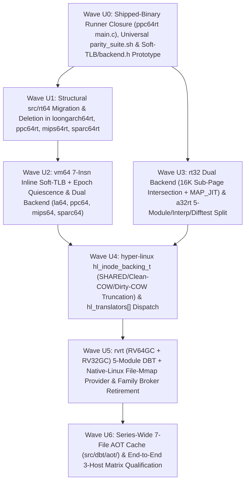

# `rt-series` Unification & Dual-Backend Architecture Plan

- **Copyright**: 2026 Moritz Angermann `<moritz@zw3rk.com>, zw3rk pte. ltd.`
- **License**: `Apache-2.0`
- **Date**: 2026-10-26 (Rev 2 — Updated after `astra` [`2026-10-26-astra-unification-review.md`](../lode/reviews/2026-10-26-astra-unification-review.md))
- **Status**: Reviewed & Hardened (`astra` Critical #1–#4, Major #5–#12, Minor #13–#15 resolved; see [`2026-10-26-astra-unification-review-dispositions.md`](../lode/reviews/2026-10-26-astra-unification-review-dispositions.md))
- **Companion Documents**: [`README.md`](../README.md), [`SPEC.md`](../SPEC.md), [`PLAN.md`](../PLAN.md), [`docs/HOST-CONTRACT.md`](HOST-CONTRACT.md), [`docs/FEATURE-MATRIX.md`](FEATURE-MATRIX.md)

---

## 1. Executive Summary & Architectural Goals

Across Waves 1–4, the `zw3rk` translator family grew to **10 standalone repositories covering 11 guest Linux ABIs**:

| Generation | Repositories | Current Structural State |
|---|---|---|
| **Gen 1** (`a32rt`) | `a32rt` (`d84feb3`, 18 files, 18,369 LOC) | Flat `src/` layout + `include/a32host.h`; JIT + single-file `src/aot.c` (`a32rt/Makefile:56`, `src/main.c:256`), no reference interpreter (`--interp`), no `--difftest`; 7 files exceed 900 lines; Linux-only host syscalls (`svc #0` / `/dev/a32host`). |
| **Gen 2** (`rvrt`) | `rvrt` (`33385fc` / `ebba2ed`, 224 files, 66,452 LOC) | 8 subdirectories (`core/`, `fp/`, `jit/`, `aot/`, `loader/`, `memory/`, `linux/`, `runtime/`) + `vendor/softfloat/` + `vendor/mbedtls/`; fragmented `family_p1..p7.c`, `file_caps_p1..p2.c`, `guest_memory_p1..p3.c`; ~30k LOC of user-space family MM/file/truncation/broker machinery used by both `-linux` and `-hl` suites; limited direct-ALU JIT (`src/jit/a64.c`, 11 integer opcodes, no block chaining/IBTC/RAS/Soft-TLB); `RV32GC` execution unqualified (`rvrt/docs/SUPPORT.md:18`). |
| **Gen 3** (`rt32`) | `i686rt` (`f40d6e3`, 73 files, 38,696 LOC), `mips32rt` (`aeaeeeb`, 37 files, 14,352 LOC), `ppc32rt` (`cab7ae6`, 50 files, 19,224 LOC), `sparc32rt` (`83b1f63`, 51 files, 16,093 LOC) | Clean 4-module layout (`src/rt32/`, `src/interp/`, `src/dbt/`, `src/os/`) + `include/a32host.h` with dual engines (`--interp`, `--dbt`, `--difftest`), block chaining, IBTC, RAS, and 4 GiB `[x20, wAddr, uxtw]` hardware memory lowering; currently bound to Linux host syscalls (`syscall(__NR_*)` / `svc #0`). |
| **Gen 3.5** (`rt64`) | `loongarch64rt` (`2064710`, 124 files, 44,046 LOC), `ppc64rt` (`70498a0`, 280 files, 68,135 LOC), `mips64rt` (`3ea43a7`, 123 files, 46,765 LOC), `sparc64rt` (`2bcf6d4`, 304 files, 78,868 LOC) | **Split-brain layout**: Phase 0 copied 75–225 files (168,783 total LOC across the four `src/rt64/` trees) from `rvrt`, while Phases 1–7 implemented a Gen-3-style `src/core/` + `src/interp/` + `src/dbt/` + `src/os/` stack alongside it. Live dependencies on `src/rt64/` vary per repo (from 2 TUs in `loongarch64rt` to `host_contract*.c` in `sparc64rt/src/main.c:17`), and `ppc64rt/src/main.c:99` is still a Phase-0 CLI stub (Phase 1–7 qualification ran through `tests/h3_run.sh` harness binaries). All four `rt64` DBTs currently call a C helper (`blr`) on every guest load/store in `emit_mem.c`. |

This plan defines the architecture and phased execution schedule to achieve **three overarching goals** without violating the zero-shared-library rule (`AGENTS.md` §2.1):

1. **Goal 1 — Uniform 5-Module Internal Architecture Across All 10 `<arch>rt` Translators**:
   - Align every repository (`a32rt`, `i686rt`, `mips32rt`, `ppc32rt`, `sparc32rt`, `rvrt`, `loongarch64rt`, `ppc64rt`, `mips64rt`, `sparc64rt`) onto a uniform 5-module internal layout (`src/core/`, `src/interp/`, `src/dbt/` [with `difftest.c` + `aot/`], `src/vm/`, `src/os/`), unified CLI surface (`--interp`, `--dbt`, `--difftest`, `--cache-dir`, `--pretranslate`), and ≤900-line Curated C11 file discipline.
   - Migrate the live dependency closure out of `src/rt64/` in `loongarch64rt`, `ppc64rt`, `mips64rt`, and `sparc64rt`, wire `ppc64rt/src/main.c` to its production runner, delete the remaining carried `src/rt64/` trees, and upgrade 64-bit DBT memory lowering with an assembler-verified **7-instruction AArch64 Inline Soft-TLB**.
2. **Goal 2 — Consolidate macOS APFS / Inode / Truncation / Shared-Memory Semantics in `hyper-linux` (`hl`) Without Regressing Native Linux**:
   - Extend `hyper-linux` (`be7721f`) from its current bounded RVRT carve-outs (`src/hl_file_identity.h`, `src/hl_posix_acl.h`, `src/rvrt_shared.h`, `src/rvrt_fsize_guest_bridge.h`, `src/rvrt_dir_broker.h`, `src/rvrt_scm_broker.h`, `src/fd_object.h`) into an inode-keyed VMM backing & truncation engine (`hl_inode_backing_t`) and a 10-translator dispatch table (`hl_translators[]`).
   - Simultaneously, provide a **native-Linux direct file-mmap memory provider** in `src/vm/vm64.c` + `src/os/backend_linux.c` so that when `rvrt` (and the other Class-B translators) run on a native `aarch64-linux` kernel without `hl`, the Linux kernel's own page cache and `mm/truncate.c` enforce `MAP_SHARED`, clean/dirty `MAP_PRIVATE` COW, and `ftruncate` `SIGBUS` semantics natively — allowing `rvrt`'s user-space `family_*` file/MM brokers to be retired only after passing **both** `-linux` and `-hl` conformance suites.
3. **Goal 3 — Dual Host Backend (`backend_linux.c` vs `backend_darwin.c`) for Every `<arch>rt` Translator**:
   - Every `<arch>rt` repository builds two zero-dependency artifacts from the same source tree:
     - **Backend 1 (`_build/<arch>rt-linux-aarch64` via `src/os/backend_linux.c`)**: Static-PIE `aarch64-linux` musl ELF (`aarch64-unknown-linux-musl-gcc -static-pie`) running inside `hyper-linux` (`hl`, with guest EL1 Stage-1 4 KiB page tables over HVF Stage-2 memory and `hl`'s VFS/APFS/fork/broker layer) or directly on a native `aarch64-linux` kernel.
     - **Backend 2 (`_build/<arch>rt-darwin-arm64` via `src/os/backend_darwin.c`)**: Native macOS `arm64` Mach-O binary (`clang -target arm64-apple-macos13`) running guest Linux ELFs directly on macOS **with zero `Hypervisor.framework` dependency** via `libSystem`, `MAP_JIT` (`pthread_jit_write_protect_np`), and explicit 4 KiB sub-page protection over 16 KiB Darwin pages.

---

## 2. Target End-State Architecture

```text
                        ┌──────────────────────────────────────────────┐
                        │           Guest Linux ELF Binary             │
                        │  (arm32, i686, mips32, ppc32, sparc32,       │
                        │   rv32, rv64, la64, ppc64le, mips64, sparc64)│
                        └──────────────────────┬───────────────────────┘
                                               │
                                               ▼
┌──────────────────────────────────────────────────────────────────────────────────────────────┐
│                     UNIFIED <arch>rt TRANSLATOR ARCHITECTURE (All 10 Repos)                  │
│                                                                                              │
│  ┌────────────────────┐     ┌─────────────────────────────────────────────────────────────┐  │
│  │  1. src/core/      │     │  3. src/dbt/ (Dynamic Binary Translator + AOT Cache)        │  │
│  │  • cpu.h (ctx ABI) │     │  • dbt.c / a64_emit.c (block cache, chaining, IBTC, RAS)    │  │
│  │  • loader.c (ELF   │     │  • emit_int.c / emit_fp.c / emit_mem.c / emit_vec.c         │  │
│  │    + PT_INTERP)    │     │  • trampoline_a64.S (per-arch pinned ctx/base, x18 reserved)│  │
│  ├────────────────────┤     │  • difftest.c (--difftest lockstep interp vs DBT verifier)  │  │
│  │  2. src/interp/    │◄───►│  • aot/ (format, reader, writer, relocate, digest, auth)    │  │
│  │  • decode.c        │     └──────────────────────────────┬──────────────────────────────┘  │
│  │  • interp.c (pure  │                                    │                                 │
│  │    C11 oracle &    │                                    ▼                                 │
│  │    EXIT_UNDEF      │     ┌─────────────────────────────────────────────────────────────┐  │
│  │    fallback)       │     │  4. src/vm/ (Guest Virtual Address Space & Fault Recovery)  │  │
│  └────────────────────┘     │  • Class A (32-bit): vm32.c — 4 GiB window [x20, wAddr,uxtw]│  │
│                             │    (4K hardware pages on Linux/hl; 16K sub-page intersection│  │
│                             │     + fault/Soft-TLB mediation on standalone Darwin)        │  │
│                             │  • Class B (64-bit): vm64.c — VMA table + 7-insn Soft-TLB   │  │
│                             │    + epoch/quiescence invalidation + 4K/8K guest page guard │  │
│                             └──────────────────────────────┬──────────────────────────────┘  │
│                                                            │                                 │
│                                                            ▼                                 │
│  ┌────────────────────────────────────────────────────────────────────────────────────────┐  │
│  │  5. src/os/ (Guest Linux ABI Normalization — Common Across Both Backends)              │  │
│  │  • syscalls.c / syscalls_fs.c / syscalls_net.c / syscalls_mem.c                        │  │
│  │    (Target nr/struct/endian/32-to-64 conversion -> canonical rt_host_* calls)          │  │
│  │  • sigframe.c / signals.c (Guest rt_sigframe, endianness, altstack, sigmask)           │  │
│  │  • threads.c / futex.c / exec.c (CLONE_VM threads, futex table, binfmt execve)         │  │
│  └────────────────────────────┬───────────────────────────────────────────┬───────────────┘  │
│                               │                                           │                  │
│             Build Target A:   │                         Build Target B:   │                  │
│        _build/<arch>rt-linux  │                    _build/<arch>rt-darwin │                  │
│        (static-PIE aarch64)   ▼                    (macOS arm64 Mach-O)   ▼                  │
│  ┌─────────────────────────────────────────┐ ┌────────────────────────────────────────────┐  │
│  │  src/os/backend_linux.c                 │ │  src/os/backend_darwin.c                   │  │
│  │  • Raw Linux AArch64 `svc #0`           │ │  • Direct `blr` into macOS `libSystem.B`   │  │
│  │  • Restart-safe `safe_syscall_a64.S`    │ │  • Linux->Darwin errno/open/stat/dirent/   │  │
│  │  • Direct host FD mmap + `/dev/a32host` │ │    sockaddr/kqueue/ulock translation       │  │
│  │  • Host `mprotect` W^X + `IC IALLU`     │ │  • `MAP_JIT` + `pthread_jit_write_protect` │  │
│  └─────────┬──────────────────────┬────────┘ └──────────────────────┬─────────────────────┘  │
└────────────┼──────────────────────┼─────────────────────────────────┼────────────────────────┘
             │                      │                                 │
   (Mode 1a: Native)      (Mode 1b: VMM Guest)              (Mode 2: Standalone macOS)
             │                      │                                 │
             ▼                      ▼                                 │
┌─────────────────────┐  ┌─────────────────────────────────────────┐  │
│ Native AArch64      │  │           hyper-linux (`hl`)            │  │
│ Linux Host Kernel   │  │     (Hardware HVF VM + Unified VFS)     │  │
│                     │  │                                         │  │
│ • Hardware 4K/16K/  │  │ • Guest EL1 Stage-1 4 KiB page tables   │  │
│   64K MMU + VFS     │  │   over HVF Stage-2 primary/shared arenas│  │
│ • Native ext4/tmpfs │  │ • `hl_translators[]` auto-dispatch for  │  │
│   mmap & truncate   │  │   all 11 EM_* guest architectures       │  │
│ • Native namespaces │  │ • Unified VFS & Inode Backing Engine:   │  │
└─────────────────────┘  │   - `hl_inode_backing_t` (SHARED/COW)   │  │
                         │   - APFS FSID+FILEID64 (`hl_apfs_fid`)  │  │
                         │   - Conservative POSIX ACL xattr synth  │  │
                         │   - Directory/SCM/FSIZE/procfs brokers  │  │
                         └────────────────────┬────────────────────┘  │
                                              │                       │
                                              ▼                       ▼
                         ┌──────────────────────────────────────────────────────────────────┐
                         │                macOS Kernel (XNU / Apple Silicon)                │
                         └──────────────────────────────────────────────────────────────────┘
```

---

## 3. Reproducible Baseline Audit Across All 11 Sibling Repositories

All file counts and line counts below are reproducibly generated from tracked `.c`, `.h`, and `.S` blobs under `src/` and `include/` at the pinned commits using:

```sh
git -C <repo> ls-files src include | grep -E '\.(c|h|S)$' | xargs wc -l
```

| Repository | Pinned Commit | Tracked `.c/.h/.S` Files (`src/` + `include/`) | Tracked LOC (`src/` + `include/`) | Current Layout, Live `rt64` Closure & Gaps |
|---|---|---:|---:|---|
| `rt-series` | `3c10dc1` | — | — | Master spec, host contract, wave task cards, feature matrix. |
| `a32rt` | `d84feb3` | 18 | 18,369 | Flat `src/` + `include/a32host.h`. Has JIT (`src/jit.c`) and single-file AOT (`src/aot.c`, `Makefile:56`, `src/main.c:256`), plus GDB stub (`src/gdb.c`). **7 files exceed 900 lines**: `src/syscalls.c` (4,330), `src/vfp_neon.c` (2,036), `src/a64_emit.c` (1,946), `src/decode_t32.c` (1,824), `src/jit.c` (1,740), `src/decode_a32.c` (1,118), `src/aot.c` (939). Missing `src/interp/`, `--difftest`, `backend_darwin.c`. |
| `i686rt` | `f40d6e3` | 73 | 38,696 | 4-module `src/{rt32,interp,dbt,os}/` + `include/a32host.h`. Has `--interp`, `--dbt`, `--difftest`. Missing `src/dbt/aot/`, `backend_darwin.c`. |
| `mips32rt` | `aeaeeeb` | 37 | 14,352 | 4-module `src/{rt32,interp,dbt,os}/` + `include/a32host.h`. All files ≤900 lines. Missing `src/dbt/aot/`, `backend_darwin.c`. |
| `ppc32rt` | `cab7ae6` | 50 | 19,224 | 4-module `src/{rt32,interp,dbt,os}/` + `include/a32host.h`. All files ≤900 lines. Missing `src/dbt/aot/`, `backend_darwin.c`. |
| `sparc32rt` | `83b1f63` | 51 | 16,093 | 4-module `src/{rt32,interp,dbt,os}/` + `include/a32host.h`. All files ≤900 lines. Missing `src/dbt/aot/`, `backend_darwin.c`. |
| `rvrt` | `33385fc` (advanced to `ebba2ed` in active session `%113`) | 224 | 66,452 | 8 subdirectories (`core/`, `fp/`, `jit/`, `aot/`, `loader/`, `memory/`, `linux/`, `runtime/`) + `include/rvrt.h` + `vendor/{softfloat,mbedtls}`. Contains 75 files (30,450 LOC) in `src/runtime/`, 42 files (11,179 LOC) in `src/linux/`, 12 files (5,137 LOC) in `src/memory/`. Direct-ALU-only JIT (`src/jit/a64.c`, 635 LOC); no `--difftest`; `RV32GC` execution unqualified (`rvrt/docs/SUPPORT.md:18`). |
| `loongarch64rt` | `2064710` | 124 | 44,046 | Active stack in `src/{core,interp,dbt,os,linux}/` (49 files, 15,541 LOC) + **75 carried `src/rt64/` files (28,505 LOC)** of which only 2 (`src/rt64/runtime/worker_loop.c`, `src/rt64/linux/signal_core.c`) are linked in `loongarch64rt/Makefile:51-54`. `src/dbt/dbt.c:146-189` uses `MAP_JIT` on Darwin but erroneously calls `mprotect(..., PROT_READ\|PROT_EXEC)` on `MAP_JIT` pages and leaves `pthread_jit_write_protect_np(0)` (writable) at the end of `dbt_seal_page`. |
| `mips64rt` | `3ea43a7` | 123 | 46,765 | Active stack in `src/{core,interp,dbt,os}/` (47 files, 18,260 LOC) + **76 carried `src/rt64/` files (28,505 LOC)** of which 5 (`sha256.c`, `identity.c`, `family_broker.c`, `worker_loop.c`, `signal_core.c`) are linked in `mips64rt/Makefile:36-40`. `src/dbt/dbt.c:97` rounds JIT code pages to host page size (`sysconf(_SC_PAGESIZE)`) and uses `mprotect` (no `MAP_JIT` yet). |
| `ppc64rt` | `70498a0` | 280 | 68,135 | Active stack in `src/{core,interp,dbt,os,loader}/` (57 files, 19,482 LOC) + **223 carried `src/rt64/` files (48,653 LOC)** compiled via `find src -name '*.c'` (`ppc64rt/Makefile:46`). **Critical gap**: `ppc64rt/src/main.c:99` is still the Phase-0 CLI stub (`(guest execution lands in Phase 1)`, returning 2); Phases 1–7 qualified execution via separate harness binaries (`ppc64rt/tests/h3_run.sh:292`). `src/dbt/cache.c:33` queries `_SC_PAGESIZE` and uses `mprotect`. |
| `sparc64rt` | `2bcf6d4` | 304 | 78,868 | Active stack in `src/{core,interp,dbt,os}/` + `include/a32host.h` (79 files, 28,979 LOC) + **225 carried `src/rt64/` files (49,889 LOC)** compiled via `find src -name '*.c'` (`sparc64rt/Makefile:49`). **Live `src/rt64/` closure**: `sparc64rt/src/main.c:17` includes `runtime/host_contract.h` and invokes `sparc64_host_parse`, `sparc64_host_selftest`, `sparc64_host_check_authorities`, `sparc64_host_apply_sysroot`, `sparc64_host_resolve_image`, `sparc64_host_cache_admit`, and `sparc64_host_report_stats` (which in turn pull in `host_contract_identity.c:452`, `aot/{digest,format,reader,relocate,writer,authority}.c`, and `family_*`). Also note `sparc64rt` advertises an **8 KiB guest ABI page size** (`SPARC64_PAGE_SIZE = 8192` in `src/os/guest_run_priv.h:39`). |
| `hyper-linux` | `be7721f` | 182 | 141,338 | Full VMM + syscall layer (`src/` + `include/`). Enforces 4 KiB permissions via guest EL1 **Stage-1** page tables (`src/guest.c:27,325`) over an RWX Stage-2 primary slab. Contains `hl_file_identity.[ch]`, `hl_posix_acl.[ch]` (conservative ACL synthesis that rejects native Darwin ACLs per `src/hl_posix_acl.h:18`), `fd_object.[ch]`, `fork_ipc.[ch]`, and 38 `rvrt_*` files. |

---

## 4. Pillar 1: Uniform 5-Module `<arch>rt` Layout & Soft-TLB Architecture

Every `<arch>rt` repository remains a **standalone, zero-external-dependency repository** conforming to the 5-module internal layout (`src/core/`, `src/interp/`, `src/dbt/`, `src/vm/`, `src/os/`).

### 4.1 Per-Engine AArch64 Register Conventions (Preserved vs Parameterized)

Existing translators use different AArch64 callee-saved registers in their trampolines and JIT emitters (`astra` Finding #11):

| Translator Family | Pinned Context Register (`reg_ctx`) | Pinned Memory Base / TLB Register (`reg_base`) | Other Pinned Callee-Saved Registers | Reserved Host Register |
|---|---|---|---|---|
| `a32rt` | `x19` (`a32_ctx_t *`) | `x20` (`guest_base` 4 GiB window) | `x21..x27` mapped to hot A32 GPRs | `x18` (platform reserved) |
| `i686rt` | `x19` (`i686_ctx_t *`) | `x20` (`guest_base` 4 GiB window) | `w0..w7` mapped to `eax..edi`; `x21` lazy flags | `x18` (platform reserved) |
| `mips32rt`, `ppc32rt`, `sparc32rt` | `x19` (`<arch>_ctx_t *`) | `x20` (`guest_base` 4 GiB window) | `x28` chaining epoch (`ppc32rt/src/dbt/dbt.h:43`); `x21..x27` cached GPRs/scratch | `x18` (platform reserved) |
| `loongarch64rt`, `ppc64rt`, `sparc64rt` | `x28` (`<arch>_ctx_t *`) | `x20` (`&ctx->tlb[0]` Soft-TLB base) | `x19`, `x21..x27` available/callee-saved | `x18` (platform reserved) |
| `mips64rt` | `x19` (`mips64_ctx_t *`, `mips64rt/src/dbt/dbt.h:13`) | `x20` (`&ctx->tlb[0]` Soft-TLB base) | `x21..x28` available/callee-saved | `x18` (platform reserved) |
| `rvrt` (Target Unified DBT) | `x28` (`rv_ctx_t *`) | `x20` (`&ctx->tlb[0]` for RV64; `guest_base` or `&ctx->tlb[0]` for RV32) | `x19`, `x21..x27` hot RV GPR cache | `x18` (platform reserved) |

**Invariant**: Rather than forcing a disruptive register renumbering across working Class-A emitters, each engine keeps its existing `reg_ctx` (`x19` or `x28`) and `reg_base` (`x20`), while `x18` is hard-blocked in every `a64_emit.c` encoder. All Soft-TLB emission helpers take `(reg_tlb_base, reg_addr, reg_val, reg_tmp0, reg_tmp1, reg_tmp2)` explicitly and **never clobber `NZCV`**.

### 4.2 Guest ABI Page Size vs Translation Granule vs Host Kernel Page Size

Three distinct page sizes must never be conflated (`astra` Finding #10, #15):
1. **Guest ABI Page Size (`GUEST_ABI_PAGE_SIZE`)**: The page size reported to the guest in `AT_PAGESZ` / `sysconf(_SC_PAGESIZE)` and required for guest `mmap`/`mprotect`/`munmap` alignment. This is **8 KiB (`8192`) on `sparc64rt`** (`src/os/guest_run_priv.h:39`) and **4 KiB (`4096`) on the other 9 translators**.
2. **Software Translation & Protection Granule (`RT_TRANSLATION_GRANULE = 4096`)**: The 4 KiB page granularity of the Soft-TLB and software sub-page permission table (`vm64.c` and Darwin `vm32.c`). An 8 KiB `sparc64rt` guest page simply populates two consecutive 4 KiB Soft-TLB entries.
3. **Host Kernel Page Size (`rt_host_page_size()`)**: Dynamically queried at startup via `sysconf(_SC_PAGESIZE)` on **both** Linux and Darwin (4 KiB on x86_64/standard AArch64 Linux and `hyper-linux`; 16 KiB on macOS Apple Silicon and Asahi Linux; 64 KiB on RHEL/Ampere Linux). Neither `backend_linux.c` nor `backend_darwin.c` ever hardcodes a 4096-byte host page size.

### 4.3 Assembler-Verified 7-Instruction AArch64 Inline Soft-TLB (`Class B` & Strict-4K `Class A`)

To replace the ~20-instruction C helper call (`blr`) on every guest load/store in `loongarch64rt`, `ppc64rt`, `mips64rt`, `sparc64rt`, and `rvrt` while handling alignment, permissions, cross-page accesses, endianness, and `NZCV` preservation (`astra` Critical #1 & Major #7):

#### 1. Soft-TLB Entry Layout (32 Bytes per Entry, Separate Read & Write Tags)

```c
#define RT64_TLB_BITS 12u
#define RT64_TLB_SIZE (1u << RT64_TLB_BITS) /* 4096 entries = 128 KiB per thread */
#define RT64_TLB_INVALID_TAG (~UINT64_C(0)) /* Low bits [11:0] = 0xFFF -> never matches */

typedef struct {
    uint64_t  read_tag;  /* Offset  0: (gva & ~0xFFFULL) if PROT_READ allowed, else ~0ULL */
    uintptr_t addend;    /* Offset  8: (uintptr_t)host_page_base - (gva & ~0xFFFULL)      */
    uint64_t  write_tag; /* Offset 16: (gva & ~0xFFFULL) if PROT_WRITE & !code_watched    */
    uintptr_t pad;       /* Offset 24: reserved / guest page metadata pointer             */
} rt64_tlb_entry_t;
_Static_assert(sizeof(rt64_tlb_entry_t) == 32, "Soft-TLB entry must be 32 bytes");
```

Why separate `read_tag` (offset 0) and `write_tag` (offset 16) with `addend` at offset 8?
- A load reads `(read_tag, addend)` via `ldp xTmp0, xTmp1, [xEntry, #0]`.
- A store reads `( addend, write_tag)` via `ldp xTmp1, xTmp0, [xEntry, #8]`.
- If a page is read-only, `write_tag == ~0ULL`. If a writable page contains translated JIT blocks (self-modifying code watch), `write_tag == ~0ULL` so the first store traps into `.L_tlb_miss_stub`, invalidates the JIT epoch for that 4 KiB page, and then enables `write_tag`.

#### 2. Exact 7-Instruction Fast Path (Assembler-Verified with `clang -target arm64`)

For an `N`-byte scalar access (`N` in `{1, 2, 4, 8}`), let `ALIGN_MASK = ~(0xFFFULL - (N - 1))` (which is `#0xfffffffffffff000` for `N=1`, `#0xfffffffffffff001` for `N=2`, `#0xfffffffffffff003` for `N=4`, and `#0xfffffffffffff007` for `N=8` — all valid single-instruction AArch64 logical immediates):

```armasm
// Preconditions:
//   x1  = guest virtual address (gva)
//   x20 = &ctx->tlb[0]
//   x2, x3, x4 = engine-designated caller-saved scratch registers (never x18)
//   Host NZCV flags are NOT modified by the lookup!

    ubfx  x2, x1, #12, #12                  // 1. x2 = (gva >> 12) & 0xFFF
    add   x2, x20, x2, lsl #5               // 2. x2 = &ctx->tlb[index] (32-byte stride)
    ldp   x2, x3, [x2]                      // 3. x2 = read_tag, x3 = addend (use [x2, #8] for stores)
    and   x4, x1, #0xfffffffffffff007       // 4. (for N=8: bic x4, x1, #0xff8) keeps VPN [63:12] + align bits [2:0]
    sub   x4, x4, x2                        // 5. x4 == 0 iff (VPN == read_tag) && ((gva & (N-1)) == 0); NZCV untouched!
    cbnz  x4, .L_tlb_miss_stub              // 6. cold stub handles TLB miss, unaligned/cross-page, MMIO, or fault
    ldr   x0, [x1, x3]                      // 7. 1-instruction host load (followed by `rev` on big-endian MIPS64/SPARC64)
```

**Why this 7-instruction sequence solves every issue raised in `astra` Critical #1**:
1. **Valid AArch64 encodings**: Verified with `clang -c` and `objdump -d` (`d34c5c22`, `8b021682`, `a9400c42`, `9274d824`, `cb020084`, `b5000044`, `f8636820`).
2. **Simultaneous Tag + Alignment + Non-Page-Crossing Check**: Because `read_tag` always has bits `[11:0] == 0` when valid (and `0xFFF` when invalid), `and x4, x1, #~(0xfff - (N-1))` equals `read_tag` **if and only if** both:
   - `gva`'s 4 KiB page number `[63:12]` matches `read_tag`, **and**
   - `gva`'s alignment bits `[log2(N)-1:0]` are zero (`(gva & (N - 1)) == 0`).
   Because any naturally aligned `N`-byte access (`N ∈ {1,2,4,8}`) within a 4 KiB page has `(gva & 0xFFF) <= 4096 - N`, it is **mathematically impossible for a fast-path hit to cross a 4 KiB page boundary**!
3. **Unaligned, Cross-Page, Atomic, and Big-Endian Handling**:
   - Any unaligned access (`(gva & (N-1)) != 0`) automatically fails `cbnz x4, .L_tlb_miss_stub`.
   - On architectures that forbid unaligned accesses (`sparc64rt`, strict `mips64rt` `ld`/`lw`), `.L_tlb_miss_stub` records the exact faulting guest `pc` and raises `SIGBUS` (`BUS_ADRALN`).
   - On architectures that permit unaligned accesses (`loongarch64rt`, `ppc64rt`, `rvrt`), `.L_tlb_miss_stub` checks if `(gva & 0xFFF) + N <= 4096` (single-page unaligned load/store after verifying the page permission) or splits a cross-page access across both 4 KiB pages in software, validating **both** pages before committing any guest state.
   - Big-endian targets (`mips64rt`, `sparc64rt`) append `rev16`/`rev32`/`rev` (and `sxtw`/`sxth`/`sxtb` for signed loads) immediately after instruction 7, matching existing `mips64rt/src/dbt/emit_mem.c:171`.
   - Guest atomics (`LR/SC`, `AMO*`, `LL/SC`, `LWARX/STWCX`, `CASA/CASXA`) always route through the helper/interpreter slow path under the reservation lock.
4. **Zero `NZCV` Clobber**: Neither `ubfx`, `add`, `ldp`, `and`, `sub`, `cbnz`, nor `ldr` modifies `NZCV`.

#### 3. Multi-Threaded Soft-TLB Ownership, Invalidation & Quiescence Protocol (`astra` Major #7)

1. **Strict Thread-Local Ownership**: `ctx->tlb[0..4095]` is read and written **only** by the owning guest worker thread. No other thread ever mutates `ctx->tlb[]`, eliminating torn `(read_tag, addend)` pairs without needing atomic 128-bit loads in the fast path.
2. **Global Epoch + Synchronous Shootdown on Permission Reduction / Unmap**:
   - `vm64.c` maintains `_Atomic uint64_t g_vm_tlb_epoch` and a list of active `ctx` pointers under `g_vm_lock`.
   - Every DBT block prologue (and back-edge / syscall return) checks `ctx->local_tlb_epoch != atomic_load_explicit(&g_vm_tlb_epoch, memory_order_acquire)`; on mismatch, the worker flushes `ctx->tlb[]` (`memset(..., 0xFF, sizeof(ctx->tlb))`) and updates `ctx->local_tlb_epoch`.
   - When `munmap`, `mprotect` (lowering permissions), `mremap`, or `ftruncate` revokes access to a mapped range in a multi-threaded guest (`g_active_threads > 1`), `vm64.c` increments `g_vm_tlb_epoch`, sets `atomic_store(&peer->yield_requested, 1)` on all sibling workers (which forces an immediate exit at the next block boundary), and waits on the **quiescence barrier** (`vm_wait_all_workers_epoch(new_epoch)`) **before** releasing or unmapping the underlying host memory pages. This guarantees no worker thread can ever dereference a stale `addend` after host backing is reclaimed.

### 4.4 Class-A (`vm32.c`) 4 KiB Protection on 16 KiB Host Pages (`astra` Critical #2)

On hosts with 16 KiB kernel pages (macOS Apple Silicon `backend_darwin.c` and 16K-page Linux kernels), a single 16 KiB host page `[H, H + 16 KiB)` inside the 4 GiB window covers four 4 KiB guest pages `q0..q3`. Simply recording 4 KiB permissions in a VMA table while executing direct `[x20, wAddr, uxtw]` hardware loads/stores would fail to trap accesses to an unmapped or read-only 4 KiB quarter if a sibling quarter on the same 16 KiB host page is mapped RW.

To enforce exact 4 KiB guest page permissions in `vm32.c` when `rt_host_page_size() > 4096`:
1. **Most-Restrictive Host Page Projection (`prot_host = q0 & q1 & q2 & q3`)**:
   - For every 16 KiB host page in the 4 GiB window, `vm32.c` maintains the four 4 KiB guest sub-page permissions `sub_prot[4]` (`PROT_NONE`, `PROT_READ`, `PROT_WRITE`, `PROT_EXEC`).
   - The actual host `mprotect` applied to that 16 KiB page is the **intersection** (most restrictive) of the four sub-pages: `host_prot = sub_prot[0] & sub_prot[1] & sub_prot[2] & sub_prot[3]`.
   - Whenever all four 4 KiB sub-pages share identical permissions (which holds for >99% of heap, stack, anonymous mmap, and interior ELF segment pages), `host_prot == sub_prot[i]` and `[x20, wAddr, uxtw]` executes at **full native hardware speed with zero traps**.
2. **Sub-Page Fault Mediation for Mixed-Permission 16 KiB Pages**:
   - When a 16 KiB host page has mixed 4 KiB sub-page permissions (e.g., a 4 KiB `PROT_NONE` stack guard page sharing a 16 KiB host page with three `PROT_READ|PROT_WRITE` stack pages, or a 4 KiB RO/RW ELF segment boundary), `host_prot` is more restrictive than at least one sub-page (e.g. `PROT_NONE` or `PROT_READ`).
   - If the guest accesses a disallowed sub-page (e.g., touching the 4 KiB guard page), the host hardware traps (`SIGSEGV`/`SIGBUS`), `signals.c` consults `sub_prot[(gva >> 12) & 3]`, sees the access is genuinely disallowed, and delivers the exact guest `SIGSEGV` (`SEGV_MAPERR` or `SEGV_ACCERR`).
   - If the guest accesses an **allowed** sub-page within a mixed 16 KiB host page, the host hardware traps into `signals.c`, which verifies `sub_prot[(gva >> 12) & 3]` permits the access, steps that single instruction through `interp_step` (which accesses memory through a validated helper shadow/pread or temporary per-thread alias), and resumes DBT execution at the next instruction!
   - Consequently, **no disallowed load or store ever succeeds silently on 16 KiB hosts**, while uniform 16 KiB regions run at full `[x20, wAddr, uxtw]` hardware speed.

---

## 5. Pillar 2: Inode/Truncation/Shared-Memory Architecture Across Native Linux, `hyper-linux`, and Standalone Darwin

### 5.1 Why Native Linux and `hyper-linux` Must Both Be First-Class (`astra` Critical #3 & #4, Major #8)

`astra` identified two critical truths in the existing codebase:
1. In `rvrt` today (`src/memory/space.c:22`, `src/runtime/guest_memory.c:292-306`), guest memory is backed by anonymous software page payloads (`mmap(MAP_PRIVATE|MAP_ANON)`), so `rvrt`'s user-space `family_*` and `file_backing.c` are currently responsible for file-mapping coherence **even on native AArch64 Linux** (`make test-file-exec-truncate-linux`, `make test-r5-file-mmap-threads-linux`).
2. In `hyper-linux` today (`src/rvrt_shared.h:54-68`, `src/syscall_fs.c:5749`, `src/syscall.c:2291-2314`), `rvrt_shared` is a bounded arena that retains host views until reset, returns `EBUSY` when truncation would shrink past a retained view, and rejects shared `MAP_FIXED`, initial `PROT_NONE`, read-only descriptors, and whole pages beyond EOF.

Therefore, replacing `rvrt`'s 30k-LOC user-space file/MM broker requires **two complementary providers** rather than simply renaming `HL_MEMORY_POLICY_RVRT`:

### 5.2 Provider A: Native Linux Direct Host-FD Mapping (`vm64.c` + `backend_linux.c` on Native Linux)

When a translator runs on a **native `aarch64-linux` kernel** (`rt_host_is_hyper_linux() == 0`):
- Guest `mmap(gva, len, prot, MAP_SHARED | MAP_PRIVATE, guest_fd, offset)` maps the **actual underlying Linux host file descriptor** (`host_fd`) into a host virtual address range via `mmap(NULL, len, host_prot, host_flags, host_fd, offset)` (never granting host `PROT_EXEC` to guest data; executable guest pages are tracked in `vm64.c` for instruction fetch and JIT source validation).
- `vm64.c` populates `rt64_tlb_entry_t.addend = (uintptr_t)host_mapping - guest_page_va`.
- Because the Soft-TLB points directly at a real Linux kernel file mapping:
  - The native Linux kernel (`mm/truncate.c`, page cache) automatically zeroes partial pages on `ftruncate`, preserves dirty `MAP_PRIVATE` COW pages on partial-page shrink, unmaps whole pages beyond EOF, and raises `SIGBUS` (`BUS_ADRERR`) on accesses past EOF (`signals.c` catches the host `SIGBUS`, reconstructs the guest PC, and delivers the guest `SIGBUS` or `EFAULT` on syscall copyout).
  - Cross-process `MAP_SHARED` and `fork()` COW work natively through the Linux kernel MMU without any user-space `.rvrt-family-*` shared-memory broker.

### 5.3 Provider B: `hyper-linux` Inode-Backing & Truncation Engine (`hl_inode_backing_t` in Wave U4)

When a guest or translator runs inside **`hyper-linux` (`hl`)** on macOS (where the guest executes inside an HVF VM with guest EL1 Stage-1 4 KiB page tables over `hl`'s Stage-2 memory slabs):
- `hyper-linux` introduces an **inode-keyed backing registry (`hl_inode_backing_t`)** in `hyper-linux/src/inode_backing.[ch]`, keyed by the 16-byte APFS identity `hl_apfs_fid_t` (`src/hl_file_identity.h`) or `(st_dev, st_ino)` for synthetic/memfd files — **independent of per-open `hl_open_file_t` instances** so backing identity survives `close(fd)` and coordinates across independent `openat()` descriptions (`astra` Major #8).
- Each `hl_inode_backing_t` tracks:
  - Authoritative `uint64_t file_size` and `uint64_t size_generation`;
  - Active guest mapping spans across the VM (`MAP_SHARED` views in the shared arena, **clean `MAP_PRIVATE`** pages in the primary slab, and **dirty-COW `MAP_PRIVATE`** pages in the primary slab).
- **Clean vs Dirty `MAP_PRIVATE` Tracking in Stage-1 Page Tables**:
  - Initial `MAP_PRIVATE` file pages with `PROT_WRITE` are mapped read-only (`AP[2:1] = 11`) in the guest's EL1 Stage-1 4 KiB page tables with a software `PTE_COW_CLEAN` bit.
  - On the first guest write fault to a `PTE_COW_CLEAN` page, `hl` flips that 4 KiB page to `PTE_COW_DIRTY` (writable) in the Stage-1 table.
- **Exact Truncation Reconciliation (`ftruncate`, `truncate`, `openat(O_TRUNC)`) in `hl`**:
  - Instead of returning `EBUSY` (`syscall_fs.c:5749`), shrinking `file_size` to `new_size` under `hl_inode_backing_t` lock performs three exact transitions (`astra` Critical #4 & Major #8):
    1. **`MAP_SHARED` spans**: Zeroes trailing bytes `[new_size, align_up(new_size, 4096))` in the shared backing page; unmaps whole 4 KiB Stage-1 PTEs for page offsets `>= align_up(new_size, 4096)` (marking them `PTE_EOF_UNMAPPED` so guest accesses raise `SIGBUS` `BUS_ADRERR` while retaining the VMA range for subsequent file regrow);
    2. **Clean `MAP_PRIVATE` pages (`PTE_COW_CLEAN`)**: Zeroes trailing bytes `[new_size, align_up(new_size, 4096))` in the clean private page; marks whole 4 KiB pages `>= align_up(new_size, 4096)` as `PTE_EOF_UNMAPPED` (`SIGBUS` on access);
    3. **Dirty `MAP_PRIVATE` pages (`PTE_COW_DIRTY`)**: **Preserves** the guest's modified private bytes in the partial final page containing `new_size` (`rvrt/src/memory/file_backing.c:197,246`), and discards/unmaps only whole 4 KiB pages whose start offset is `>= align_up(new_size, 4096)`.
  - Sets `SHIM_TLBI_MAILBOX` (`src/guest.h:80`) and kicks active vCPUs so Stage-1 TLBs flush immediately before `ftruncate` returns.
- **Removing `rvrt_shared` Restrictions**:
  - `src/rvrt_shared.c` (generalized to `src/shared_arena.c`) adds support for read-only `MAP_SHARED` descriptors (opening the host view with `PROT_READ`), `PROT_NONE` reservations, and `MAP_FIXED` span splitting/replacement (`syscall.c:2291,2314`).

---

## 6. Pillar 3: Complete Frozen Host Backend Contract (`src/os/backend.h`)

To address `astra` Major #9 & #10, the boundary between guest VMA/syscall logic (`src/vm/`, `src/os/syscalls*.c`) and the host OS (`src/os/backend_linux.c` vs `src/os/backend_darwin.c`) is defined so **guest VMA management stays in `src/vm/vm{32,64}.c`** while `src/os/backend.h` provides complete, host-page-aware OS primitives.

```c
/* src/os/backend.h — Complete Host OS Backend Interface
 * Copyright 2026 Moritz Angermann <moritz@zw3rk.com>, zw3rk pte. ltd.
 * SPDX-License-Identifier: Apache-2.0
 */
#ifndef RT_OS_BACKEND_H
#define RT_OS_BACKEND_H

#include <stddef.h>
#include <stdint.h>
#include <signal.h>
#include <time.h>
#include <sys/types.h>
#include <sys/uio.h>

typedef enum {
    RT_BACKEND_LINUX  = 1, /* Static-PIE aarch64-linux (native Linux or hyper-linux) */
    RT_BACKEND_DARWIN = 2, /* Standalone macOS arm64 Mach-O (libSystem + MAP_JIT)    */
} rt_backend_kind_t;

/* 1. Backend identity & dynamic host page size (queried via sysconf(_SC_PAGESIZE)) */
rt_backend_kind_t rt_host_backend_kind(void);
int               rt_host_is_hyper_linux(void); /* 1 if /dev/a32host or HL env active */
size_t            rt_host_page_size(void);      /* 4096, 16384, or 65536 — never hardcoded */

/* 2. Low-level host memory primitives consumed by src/vm/vm32.c and src/vm/vm64.c.
 *    - addr/len must be aligned to rt_host_page_size() when fixed != 0.
 *    - linux_prot never includes PROT_EXEC for guest data mappings (W^X).
 *    - Returns 0 and writes *out_host_addr on success, or -linux_errno on failure. */
int   rt_host_map_anon(void *hint_addr, size_t len, int linux_prot, int fixed,
                       int noreplace, void **out_host_addr);
int   rt_host_map_file(void *hint_addr, size_t len, int linux_prot, int shared,
                       int fixed, int host_fd, uint64_t file_offset,
                       void **out_host_addr);
int   rt_host_protect(void *host_addr, size_t len, int linux_prot);
int   rt_host_unmap(void *host_addr, size_t len);
int   rt_host_msync(void *host_addr, size_t len, int linux_flags);
int   rt_host_madvise(void *host_addr, size_t len, int linux_advice);

/* 3. JIT W^X code cache allocation & thread-local APRR publication:
 *    - Linux/hl: mmap(RW) -> write -> mprotect(RX) + __builtin___clear_cache / IC IALLU
 *    - Darwin:   mmap(RWX | MAP_JIT) once -> pthread_jit_write_protect_np(0) to write
 *                -> pthread_jit_write_protect_np(1) + sys_icache_invalidate() to execute. */
void *rt_host_jit_alloc(size_t size);
void  rt_host_jit_thread_init(void); /* sets pthread_jit_write_protect_np(1) on Darwin */
void  rt_host_jit_begin_write(void *buf, size_t size);
int   rt_host_jit_seal_rx(void *buf, size_t size);
void  rt_host_jit_free(void *buf, size_t size);

/* 4. Filesystem & descriptor operations (all return >=0 or -linux_errno) */
int64_t rt_host_openat(int dirfd, const char *path, int linux_flags, uint32_t mode);
int64_t rt_host_close(int fd);
int64_t rt_host_read(int fd, void *buf, size_t count);
int64_t rt_host_write(int fd, const void *buf, size_t count);
int64_t rt_host_pread64(int fd, void *buf, size_t count, int64_t offset);
int64_t rt_host_pwrite64(int fd, const void *buf, size_t count, int64_t offset);
int64_t rt_host_readv(int fd, const struct iovec *iov, int iovcnt);
int64_t rt_host_writev(int fd, const struct iovec *iov, int iovcnt);
int64_t rt_host_lseek(int fd, int64_t offset, int linux_whence);
int64_t rt_host_fstatat(int dirfd, const char *path, void *linux_statx_out, int linux_flags);
int64_t rt_host_ftruncate(int fd, int64_t length);
int64_t rt_host_fallocate(int fd, int mode, int64_t offset, int64_t len);
int64_t rt_host_fsync(int fd, int datasync_only);
int64_t rt_host_getdents64(int fd, void *linux_dirent64_buf, size_t buf_size);
int64_t rt_host_fcntl(int fd, int linux_cmd, uint64_t arg);
int64_t rt_host_ioctl(int fd, uint64_t linux_req, void *arg);
int64_t rt_host_dup(int oldfd);
int64_t rt_host_dup3(int oldfd, int newfd, int linux_flags);
int64_t rt_host_pipe2(int fds[2], int linux_flags);
int64_t rt_host_readlinkat(int dirfd, const char *path, char *buf, size_t bufsiz);
int64_t rt_host_unlinkat(int dirfd, const char *path, int linux_flags);
int64_t rt_host_mkdirat(int dirfd, const char *path, uint32_t mode);
int64_t rt_host_renameat2(int olddirfd, const char *oldpath,
                          int newdirfd, const char *newpath, unsigned int flags);
int64_t rt_host_symlinkat(const char *target, int newdirfd, const char *linkpath);
int64_t rt_host_linkat(int olddirfd, const char *oldpath,
                       int newdirfd, const char *newpath, int flags);
int64_t rt_host_faccessat2(int dirfd, const char *path, int mode, int flags);
int64_t rt_host_fchmodat(int dirfd, const char *path, uint32_t mode, int flags);
int64_t rt_host_fchownat(int dirfd, const char *path, uint32_t uid, uint32_t gid, int flags);
int64_t rt_host_utimensat(int dirfd, const char *path, const struct timespec times[2], int flags);
int64_t rt_host_getcwd(char *buf, size_t size);
int64_t rt_host_chdir(const char *path);
int64_t rt_host_fchdir(int fd);

/* 5. Networking & I/O multiplexing (all return >=0 or -linux_errno; sockaddr is Linux layout) */
int64_t rt_host_socket(int linux_domain, int linux_type, int protocol);
int64_t rt_host_socketpair(int linux_domain, int linux_type, int protocol, int sv[2]);
int64_t rt_host_bind(int fd, const void *linux_addr, uint32_t addrlen);
int64_t rt_host_connect(int fd, const void *linux_addr, uint32_t addrlen);
int64_t rt_host_listen(int fd, int backlog);
int64_t rt_host_accept4(int fd, void *linux_addr_out, uint32_t *addrlen_inout, int linux_flags);
int64_t rt_host_sendto(int fd, const void *buf, size_t len, int linux_flags,
                       const void *linux_dest_addr, uint32_t addrlen);
int64_t rt_host_recvfrom(int fd, void *buf, size_t len, int linux_flags,
                         void *linux_src_addr_out, uint32_t *addrlen_inout);
int64_t rt_host_getsockname(int fd, void *linux_addr_out, uint32_t *addrlen_inout);
int64_t rt_host_getpeername(int fd, void *linux_addr_out, uint32_t *addrlen_inout);
int64_t rt_host_setsockopt(int fd, int linux_level, int linux_optname,
                           const void *optval, uint32_t optlen);
int64_t rt_host_getsockopt(int fd, int linux_level, int linux_optname,
                           void *optval, uint32_t *optlen_inout);
int64_t rt_host_shutdown(int fd, int how);
int64_t rt_host_ppoll(void *linux_pollfds, size_t nfds,
                      const struct timespec *rel_timeout, const uint64_t *linux_sigmask);
int64_t rt_host_epoll_create1(int linux_flags);
int64_t rt_host_epoll_ctl(int epfd, int op, int fd, const void *linux_epoll_event);
int64_t rt_host_epoll_pwait(int epfd, void *linux_epoll_events_out, int maxevents,
                            int timeout_ms, const uint64_t *linux_sigmask);

/* 6. Synchronization, futex (with bitset/clock/requeue/shared), time & random */
int64_t rt_host_futex_wait_bitset(uint32_t *uaddr, uint32_t val,
                                  const struct timespec *timeout, int is_abs_timeout,
                                  int clock_realtime, uint32_t bitset, int shared);
int64_t rt_host_futex_wake_bitset(uint32_t *uaddr, int count, uint32_t bitset, int shared);
int64_t rt_host_futex_requeue(uint32_t *uaddr1, int wake_count,
                              uint32_t *uaddr2, int requeue_count,
                              const uint32_t *cmp_val, int shared);
int64_t rt_host_clock_gettime(int linux_clk_id, struct timespec *tp);
int64_t rt_host_clock_getres(int linux_clk_id, struct timespec *res);
int64_t rt_host_clock_nanosleep(int linux_clk_id, int linux_flags,
                                const struct timespec *req, struct timespec *rem);
int64_t rt_host_getrandom(void *buf, size_t buflen, unsigned int linux_flags);

/* 7. Process, thread, and signal / fault multiplexing */
int     rt_host_spawn_worker(void *(*fn)(void *), void *arg, uint64_t *out_host_tid);
int     rt_host_wake_worker(uint64_t host_tid); /* interrupts blocking syscall via SIGUSR1/cancel */
int64_t rt_host_fork(void);
int64_t rt_host_execve(const char *path, char *const argv[], char *const envp[]);
int64_t rt_host_wait4(int64_t pid, int *linux_status_out, int linux_options, void *rusage_out);
int64_t rt_host_kill(int64_t pid, int linux_sig);
int64_t rt_host_tgkill(int64_t tgid, int64_t tid, int linux_sig);
int     rt_host_sigprocmask(int linux_how, const uint64_t *new_set, uint64_t *old_set);
void    rt_host_exit_thread(int status) __attribute__((noreturn));
void    rt_host_exit_group(int status) __attribute__((noreturn));

typedef struct {
    int       linux_si_signo;
    int       linux_si_code;
    uintptr_t fault_addr;
    uintptr_t host_pc;
    int       is_write;
    void     *host_ucontext;
} rt_host_fault_info_t;

int     rt_host_install_signal_handlers(void (*on_fault_or_sig)(const rt_host_fault_info_t *info));

#endif /* RT_OS_BACKEND_H */
```

---

## 7. Phased Muse Spark Execution Schedule (Waves U0–U6)

To address `astra` Major #5, #6, #12 and Minor #13–#15, the schedule separates **runner/contract closure (`Wave U0`)**, **structural `src/rt64/` migration (`Wave U1`)**, **Soft-TLB & dual-backend enablement (`Wave U2`/`U3`)**, **`hyper-linux` inode-backing & translator dispatch (`Wave U4`)**, **`rvrt` (`RV64GC` + `RV32GC`) unification & native-Linux file-mmap (`Wave U5`)**, and **series-wide AOT cache unification (`Wave U6`)**.



### Wave U0 — Pre-Unification Closure Gate (`ppc64rt/src/main.c`, Universal `tests/parity_suite.sh`, & Prototype Gate)
- **Why Wave U0 Comes First (`astra` Findings #1, #6, #9, #12)**:
  - `ppc64rt/src/main.c:99` currently returns 2 (`guest execution lands in Phase 1`) while `ppc64rt/tests/h3_run.sh` builds a separate test harness.
  - `tests/parity_suite.sh` currently exists in `sparc64rt`, `sparc32rt`, `mips32rt`, and `ppc32rt`, but is missing in `loongarch64rt`, `mips64rt`, and `ppc64rt`.
- **Scope**:
  1. Wire `ppc64rt/src/main.c` to its real ELF64 loader, interpreter, DBT, and `--difftest` runner so `_build/ppc64rt` executes guest ELFs directly.
  2. Add a uniform `tests/parity_suite.sh` to `loongarch64rt`, `mips64rt`, and `ppc64rt` (and require `0 FAIL, 0 GAP` on all required P1–P7/H1–H4 rows).
  3. Freeze `src/os/backend.h` and prototype the 7-instruction Soft-TLB + `backend_darwin.c` on one translator (`loongarch64rt`) before fanning out to the remaining repos.
- **Acceptance Gate (`RC-U0`)**:
  - `_build/ppc64rt` executes static and dynamic `ppc64le` musl/glibc/C++17 binaries directly via `main.c` under `--interp`, `--dbt`, and `--difftest`;
  - `tests/parity_suite.sh` exists and passes with `0 FAIL` across all 7 Wave-3/Wave-4 repositories (`mips32rt`, `ppc32rt`, `sparc32rt`, `loongarch64rt`, `ppc64rt`, `mips64rt`, `sparc64rt`).

### Wave U1 — Structural Migration & Deletion of `src/rt64/` (`loongarch64rt`, `ppc64rt`, `mips64rt`, `sparc64rt`)
- **Why Separated from Memory Changes (`astra` Finding #5, #12)**:
  - Isolates structural file removal from Soft-TLB memory refactoring so any regression is immediately bisectable.
- **Scope**:
  1. Audit the exact reachable symbol closure from `src/rt64/` in each of the four repos:
     - `loongarch64rt`: `worker_loop.c`, `signal_core.c` (2 files);
     - `mips64rt`: `sha256.c`, `identity.c`, `family_broker.c`, `worker_loop.c`, `signal_core.c` (5 files);
     - `ppc64rt`: verify zero live runtime calls into `src/rt64/` once `src/main.c` is wired in Wave U0;
     - `sparc64rt`: extract the live host-contract CLI/authority/sysroot/image-resolve/stats functions called by `sparc64rt/src/main.c:17` (`sparc64_host_*`) into `src/os/host_args.c` and `src/dbt/aot/`, removing the unused `host_contract_identity.c:452` family bootstrap call.
  2. `git rm -r src/rt64` across `loongarch64rt`, `ppc64rt`, `mips64rt`, and `sparc64rt`.
- **Acceptance Gate (`RC-U1`)**:
  - `test ! -d src/rt64` in all 4 repos;
  - `make check check-line-limits` and `tests/parity_suite.sh` (including Phase 6 host-contract CLI/authority/cache tests) pass 100% identically before and after `src/rt64/` removal.

### Wave U2 — `vm64` 7-Instruction Soft-TLB, Quiescence Invalidation & Dual Backend (`loongarch64rt`, `ppc64rt`, `mips64rt`, `sparc64rt`)
- **Scope**:
  1. Implement `src/vm/vm64.c` with the 32-byte `rt64_tlb_entry_t` (`read_tag`, `addend`, `write_tag`), dynamic `rt_host_page_size()` sub-page tracking, and the multi-threaded `g_vm_tlb_epoch` + worker quiescence barrier (§4.3).
  2. Update `src/dbt/emit_mem.c` in all four `rt64` repositories to emit the assembler-verified 7-instruction Soft-TLB fast path for aligned 1/2/4/8-byte loads and stores, with out-of-line `.L_tlb_miss_stub` handling TLB misses, unaligned/cross-page accesses, fault-PC reconstruction, and big-endian `rev` (`mips64rt`, `sparc64rt`).
  3. Implement `src/os/backend_linux.c` (`_build/<arch>rt-linux-aarch64`, including direct host-FD `mmap` on native Linux) and `src/os/backend_darwin.c` (`_build/<arch>rt-darwin-arm64`, fixing `loongarch64rt/src/dbt/dbt.c:146-189` so `MAP_JIT` uses `pthread_jit_write_protect_np(0/1)` without `mprotect`).
- **Acceptance Gate (`RC-U2`)**:
  - All 4 `rt64` repositories build both `_build/<arch>rt-linux-aarch64` and `_build/<arch>rt-darwin-arm64` and pass `make check check-line-limits`;
  - `tests/parity_suite.sh` + new concurrent multi-thread `munmap`/`mprotect`/cross-page/unaligned/dirty-COW Soft-TLB torture tests pass on **all three execution targets** (native Linux, `hyper-linux`, and standalone Darwin Mach-O).

### Wave U3 — `rt32` Dual Backend (`16K` Sub-Page Intersection) & `a32rt` 5-Module Alignment (`i686rt`, `mips32rt`, `ppc32rt`, `sparc32rt`, `a32rt`)
- **Scope**:
  - Lanes `U3-mips32`, `U3-ppc32`, `U3-sparc32`, `U3-i686`:
    1. Reorganize `src/rt32/vm*.c` into `src/vm/vm32*.c` and implement the 16 KiB host-page intersection + sub-page fault/single-step mediation (`§4.4`) so 4 KiB guest page permissions are strictly enforced on 16 KiB hosts.
    2. Split OS calls behind `src/os/backend.h` into `src/os/backend_linux.c` and `src/os/backend_darwin.c` (`MAP_JIT` APRR W^X).
  - Lane `U3-a32`:
    1. Split the 7 files exceeding 900 lines in `a32rt/src/` (`syscalls.c` 4,330, `vfp_neon.c` 2,036, `a64_emit.c` 1,946, `decode_t32.c` 1,824, `jit.c` 1,740, `decode_a32.c` 1,118, `aot.c` 939) into `src/{core,interp,dbt,vm,os}/` so every file is ≤900 lines, **preserving `a32rt`'s existing AOT (`src/aot.c`) and GDB (`src/gdb.c`) capabilities** (`astra` Finding #13).
    2. Implement `a32rt/src/interp/` (A32, Thumb-2, VFPv4/NEON reference interpreter) and `a32rt/src/dbt/difftest.c` (`--interp`, `--dbt`, `--difftest`).
    3. Add `src/os/backend_linux.c` and `src/os/backend_darwin.c`.
- **Acceptance Gate (`RC-U3`)**:
  - All 5 Class-A repositories pass `make check check-line-limits` (0 files >900 lines), build both `-linux-aarch64` and `-darwin-arm64` artifacts, and pass partial-16K `mprotect`/`munmap`/`MAP_FIXED`/cross-quarter protection tests on standalone Darwin;
  - `a32rt` passes all M0–M8 tests plus AOT cache tests under `--interp`, `--dbt`, and `--difftest`.

### Wave U4 — `hyper-linux` Inode-Backing Engine (`hl_inode_backing_t`) & Translator Dispatch (`hyper-linux`)
- **Scope** (gated on user session `%92` idle/merged):
  1. Implement `src/inode_backing.[ch]` (`hl_inode_backing_t`) in `hyper-linux` (§5.3), tracking `MAP_SHARED`, `PTE_COW_CLEAN` (`MAP_PRIVATE` clean), and `PTE_COW_DIRTY` (`MAP_PRIVATE` dirty) spans per inode across `open`/`close`/`dup`/`fork`.
  2. Implement exact Linux `ftruncate`/`truncate`/`openat(O_TRUNC)` reconciliation in `hyper-linux/src/syscall_fs.c` (preserving dirty `MAP_PRIVATE` bytes in a partial final page, zeroing shared/clean partial tails, unmapping whole removed pages with `SIGBUS` `BUS_ADRERR`, and removing the `EBUSY` rejection at `syscall_fs.c:5749`).
  3. Remove the `EOPNOTSUPP` restrictions on shared `MAP_FIXED`, initial `PROT_NONE`, and read-only `MAP_SHARED` descriptors in `hyper-linux/src/syscall.c:2291-2314` and `src/rvrt_shared.c`.
  4. Add `src/translator_dispatch.[ch]` (`hl_translators[]` covering the 10 qualified guest architectures; `EM_RISCV` `ELFCLASS32` slot stays gated until Wave U5 qualifies `RV32GC` execution).
- **Acceptance Gate (`RC-U4`)**:
  - `hyper-linux` passes host and guest conformance suites for `MAP_SHARED` + `ftruncate` `SIGBUS`, clean vs dirty `MAP_PRIVATE` COW shrink/regrow, read-only `MAP_SHARED`, shared `MAP_FIXED`, APFS `hl_apfs_fid_t`, and conservative POSIX ACLs (`src/hl_posix_acl.h:18`);
  - `hl` auto-dispatches all 10 qualified architectures (`arm32`, `i686`, `mips32`, `ppc32`, `sparc32`, `rv64`, `la64`, `ppc64le`, `mips64`, `sparc64`).

### Wave U5 — `rvrt` (`RV64GC` + `RV32GC`) Unification, Native-Linux File-Mmap Provider & Validated Broker Retirement
- **Scope** (gated on user session `%113` idle/merged and Wave U4 complete):
  1. Add `src/vm/vm64.c` (with the 7-instruction Soft-TLB and native-Linux direct host-FD `mmap` provider from §5.2) + `src/os/backend_linux.c` and `src/os/backend_darwin.c` to `rvrt`.
  2. Upgrade `rvrt/src/dbt/` from the 11-opcode `src/jit/a64.c` stub to the full series DBT (`dbt.c`, `a64_emit.c`, `trampoline_a64.S`, `emit_int.c`, `emit_fp.c`, `emit_mem.c`, `difftest.c`) while **preserving `rvrt/src/aot/` format v2 / emitter v3 cache tests at every step**.
  3. Qualify `RV32GC` (`EM_RISCV` `ELFCLASS32` ILP32D) end-to-end (`--interp`, `--dbt`, `--difftest`, static/dynamic musl & glibc C/C++17) and enable the `EM_RISCV` `ELFCLASS32` entry in `hyper-linux`'s `hl_translators[]` table.
  4. **Incremental, Gate-Verified Retirement of `rvrt` `family_*` Subsystems (`astra` Critical #3)**:
     - Retire each user-space `family_file*` / `file_caps*` / `family_mm*` component **only after** verifying that the new `vm64.c` (native Linux direct host-FD `mmap` + `hl` `hl_inode_backing_t`) passes **every existing `-linux` AND `-hl` target in `rvrt/Makefile`** (`test-file-exec-truncate-{linux,hl}`, `test-r5-file-mmap-threads-{linux,hl}`, `test-r5-fork-*-{linux,hl}`, `test-aot-*-{linux,hl}`).
- **Acceptance Gate (`RC-U5`)**:
  - `rvrt` passes `make check check-line-limits`, all existing `-linux` and `-hl` regression targets in `rvrt/Makefile`, and all `RV64GC` + `RV32GC` parity suites across native Linux, `hyper-linux`, and standalone Darwin.

### Wave U6 — Series-Wide 7-File AOT Cache (`src/dbt/aot/`) & Final 3-Host Matrix Qualification
- **Scope**:
  - Ensure all 10 `<arch>rt` repositories expose the unified `src/dbt/aot/` persistent cache (`--cache-dir`, `--pretranslate`, `--cache-authority=auto|hyper-linux-apfs-acl-v1`), migrating `a32rt/src/aot.c` to the v2 structural format without regressing existing `a32rt` cache tests.
  - Update [`docs/FEATURE-MATRIX.md`](FEATURE-MATRIX.md) and [`SPEC.md`](../SPEC.md) in `rt-series`.
- **Acceptance Gate (`RC-U6`)**:
  - All 10 `<arch>rt` repositories pass `make check check-line-limits`, `tests/parity_suite.sh`, and AOT cold/warm/rebase/mutation-rejection tests across all three host environments (**Native Linux**, **`hyper-linux`**, and **Standalone macOS `backend_darwin.c`**).

---

## 8. Explicit 3-Host Semantic Support Matrix

| Capability | Mode 1a: `_build/<arch>rt-linux-aarch64` on Native Linux | Mode 1b: `_build/<arch>rt-linux-aarch64` inside `hyper-linux` (`hl`) | Mode 2: `_build/<arch>rt-darwin-arm64` Standalone macOS Mach-O |
|---|---|---|---|
| **Hypervisor / Entitlements Needed** | None (native Linux user process) | `Hypervisor.framework` (`com.apple.security.hypervisor` on `hl`) | **None** (ordinary unprivileged macOS Mach-O process) |
| **4 KiB / 8 KiB Guest Page Protection** | Enforced (hardware 4K MMU or Soft-TLB/sub-page intersection on 16K/64K Linux kernels) | Enforced (guest EL1 Stage-1 4 KiB page tables in `hl`) | Enforced (Soft-TLB 4 KiB tags in Class B; 16K sub-page intersection + fault/single-step mediation in Class A) |
| **JIT W^X Mechanism** | `mprotect(PROT_READ \| PROT_EXEC)` + `__builtin___clear_cache` | `mprotect(PROT_READ \| PROT_EXEC)` + `IC IALLU` (`A32H_CAP_ICACHE_TRAP_IALLU`) | `MAP_JIT` + `pthread_jit_write_protect_np(0/1)` + `sys_icache_invalidate()` (never `mprotect`) |
| **`MAP_SHARED` + `ftruncate` EOF `SIGBUS` & Dirty `MAP_PRIVATE` COW** | Enforced by native Linux kernel `mm/truncate.c` via direct host-FD `mmap` (§5.2) | Enforced by `hyper-linux` `hl_inode_backing_t` + Stage-1 PTE invalidation (§5.3) | Enforced in-process via `vm64.c`/`vm32.c` VMA table; cross-process `MAP_SHARED` truncation delegated to `hl` |
| **APFS Exact-FD File Identity & Conservative POSIX ACLs** | Native Linux `ext4`/`tmpfs`/`xfs` inodes & kernel POSIX ACLs | `hl_apfs_fid_from_fd` + conservative `hl_posix_acl` xattr synthesis (rejects native Darwin ACLs per `hl_posix_acl.h:18`) | Standard Darwin `st_dev`/`st_ino`; `hyper-linux-apfs-acl-v1` authority requires `hl` |
| **Multi-Threading (`CLONE_VM`) & Futexes** | Linux `clone` + `SYS_futex` | `hl` vCPU threads + `hl` futex table | Darwin `pthread_create` + `__ulock_wait2`/`__ulock_wake` & requeue table |
| **Cross-Arch `fork`/`execve`, Containers, `chroot`, Full `/proc`** | Native Linux kernel + `binfmt_misc` | Full support via `hl` `fork_ipc`, `hl_translators[]`, and VMM VFS | Single-arch `fork`/`execve` + synthesized `/proc/self/{maps,exe,cmdline,stat,status,auxv}`; containers/namespaces require `hl` |
