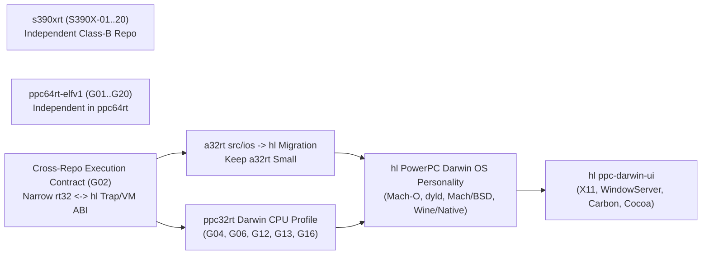

# `rt-series` Active Expansion Plans (`docs/plans/`)

This directory coordinates active multi-repository expansion campaigns across `rt-series` and `hyper-linux`. In keeping with `rt-series`'s distributed ownership model, each executable `.plan` and `.goal` card set lives in its primary owning repository, while cross-repository contracts live here until converged (and move to [`../archive/plans/`](../archive/plans/) upon closeout).

## 1. Distributed Planning Sets

| Campaign | Status | Owning Repo(s) | Distributed Plan Location | Summary |
|---|---|---|---|---|
| **`s390xrt`** (`S390X-01`..`20`) | **Converged (`8410b2c`)** | [s390xrt](https://github.com/zw3rk/s390xrt) | [`../../s390xrt/docs/plans/s390xrt/.plan`](../../../s390xrt/docs/plans/s390xrt/.plan) | Standalone Class-B 64-bit big-endian Linux `s390x` (`EM_S390 = 22`) user-mode translator (`interp` + AArch64 `dbt` + `aot`, shadow-VM `--difftest`, `bench-s390x` `ALL_PASS`). |
| **`ppc64rt-elfv1`** (`G01`..`G20`) | **Converged (`09832a3`)** | `ppc64rt` | [`../../ppc64rt/docs/plans/elfv1/.plan`](../../../ppc64rt/docs/plans/elfv1/.plan) | Big-endian 64-bit PowerPC Linux ELFv1 (`ELFDATA2MSB`, `.opd` function descriptors, `vmx_reserve+8` BE `rt_sigframe`, BE syscall marshaling, `bench-ppc64be.opd` `55.5 ms` `ALL_PASS`). |
| **`ppc-darwin`** (`G01`..`G20`) | **Converged (`a2ccdfc` / `b8cc19a0`)** | `hyper-linux` (`darwin32/personality`) + narrow `ppc32rt` | [`../../hyper-linux/docs/plans/ppc-darwin/.plan`](../../../hyper-linux/docs/plans/ppc-darwin/.plan) & [`../../ppc32rt/docs/plans/ppc-darwin/README.md`](../../../ppc32rt/docs/plans/ppc-darwin/README.md) | 32-bit PowerPC 7400 G4 Mac OS X 10.4/10.5 CLI & OS personality in `hyper-linux/src/darwin32/` + narrow `A32H_ABI 1.2` `G02` bridge in `ppc32rt` (HVF E2E verified). |
| **`ppc-darwin-ui`** (`G01`..`G20`) | Active (`hl` worker) | `hyper-linux` (+ `hyper-linux-x11`) | [`../../hyper-linux/docs/plans/ppc-darwin-ui/.plan`](../../../hyper-linux/docs/plans/ppc-darwin-ui/.plan) | Dedicated `hl` UI workstream for PowerPC Darwin X11, WindowServer/CoreGraphics/Quartz, Carbon HIToolbox, Cocoa/AppKit, input, and CoreAudio. |
| **`a32rt/src/ios` -> `hl` Extraction** | **Converged (`a53ee27` / `b8cc19a0`)** | `a32rt` + `hyper-linux` (`darwin32/personality`) | [`darwin-personality-boundary.md`](darwin-personality-boundary.md) & [`../../a32rt/docs/plans/ios-hl-extraction.md`](../../../a32rt/docs/plans/ios-hl-extraction.md) | `a32rt-slim` (`A32RT_EMBED_IOS=0`, zero `src/ios/*.c` linked) + `A32H_ABI 1.2` `G02` trap/fault bridge running 32-bit ARMv7 Darwin Mach-O end-to-end via `hyper-linux/src/darwin32/`. |

## 2. Dependency Graph Across Workstreams

- **`s390xrt`** and **`ppc64rt-elfv1`** have zero dependencies on Darwin/`hl` UI work and can execute independently in parallel worker waves.
- **`darwin-personality-boundary.md` (`G02`)** unifies how Class-A 32-bit translators (`a32rt` and `ppc32rt`) expose CPU execution, guest memory, faults, and traps to `hyper-linux` without accumulating Mach-O, framework, or GUI code inside the translators.
